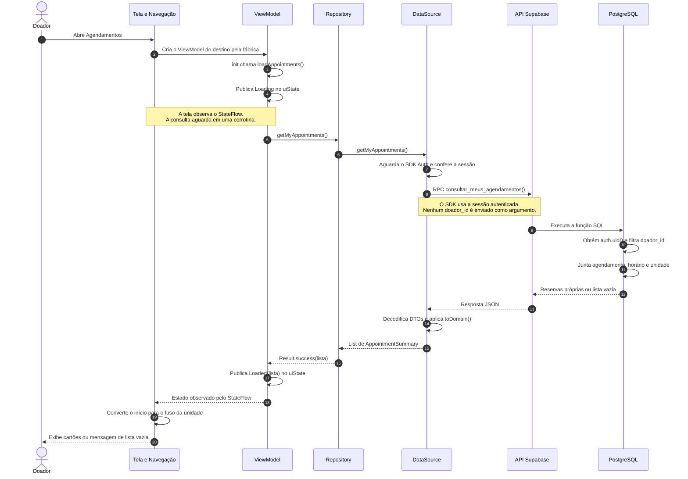

# Diagrama de sequência — consulta dos agendamentos

Implementado e conferido no código em 13/10/2026, após o commit `4d449cc`. Este diagrama representa a listagem integrada ao Supabase, validada no roteiro manual A → B → A. Evidências e limites em [validação](12-validacao.md).

## Como ler

- Leia de cima para baixo: o tempo avança nessa direção; os espaços não representam duração medida.
- Cada coluna representa um participante da operação.
- Setas contínuas representam chamadas; tracejadas representam respostas. A última seta entre ViewModel e tela representa o estado observado, não uma chamada direta a um componente Compose.
- Setas que voltam à mesma coluna representam trabalho feito pelo próprio participante.

## Fluxo implementado

O diagrama agrupa a navegação e a tela na mesma coluna para facilitar a leitura. A fábrica é usada quando o destino precisa de um ViewModel novo; uma recomposição da tela não inicia outra consulta automaticamente. A consulta começa no `init` do ViewModel, e a observação do estado acontece durante o uso da tela; o desenho não detalha o escalonamento interno das corrotinas.

## Participantes no código

| Participante | Arquivo ou operação | Responsabilidade |
| --- | --- | --- |
| Navegação | [MainNavGraph.kt](../app/src/main/java/br/edu/fatec/doesangue/ui/navigation/MainNavGraph.kt) | Obtém o ViewModel da fábrica e observa `uiState` com `collectAsStateWithLifecycle`. |
| Tela | [DonationScreens.kt](../app/src/main/java/br/edu/fatec/doesangue/ui/screens/donations/DonationScreens.kt), `DonationAppointmentsScreen` | Recebe estado e callbacks; mostra carregamento, erro, vazio ou cartões. |
| ViewModel | [AppointmentsViewModel.kt](../app/src/main/java/br/edu/fatec/doesangue/presentation/appointments/AppointmentsViewModel.kt) | Inicia a consulta, impede consultas simultâneas e atualiza o StateFlow. |
| Repository | [SupabaseAppointmentRepository.kt](../app/src/main/java/br/edu/fatec/doesangue/data/repository/SupabaseAppointmentRepository.kt) | Implementa o contrato `AppointmentRepository`; devolve `Result.success` ou `Result.failure`, preservando cancelamento. |
| DataSource | [SupabaseAppointmentDataSource.kt](../app/src/main/java/br/edu/fatec/doesangue/data/supabase/SupabaseAppointmentDataSource.kt) | Confere a sessão local, chama RPC e converte a resposta ao domínio. |
| Mapper | [AppointmentSummaryMapper.kt](../app/src/main/java/br/edu/fatec/doesangue/data/supabase/mapper/AppointmentSummaryMapper.kt) | Converte o DTO em `AppointmentSummary`; o mapper do agendamento converte ID, estado e data de criação. |
| API Supabase | PostgREST acessado pelo cliente compartilhado | Recebe a chamada autenticada e disponibiliza a operação do banco por HTTP. |
| PostgreSQL | [consultar_meus_agendamentos](../supabase/migrations/20261012000200_consultar_meus_agendamentos.sql) | Exige identidade, filtra reservas da própria conta e retorna dados de reserva, unidade, início e fuso. |

O [AppContainer](../app/src/main/java/br/edu/fatec/doesangue/di/AppContainer.kt) monta as dependências e a fábrica. Ele não faz uma consulta a cada abertura da tela; fornece os objetos que realizam a operação. O DTO descreve o formato da resposta, enquanto o modelo de domínio descreve os dados utilizados pelo aplicativo.

## Erro, nova tentativa e cancelamento

Se a sessão estiver ausente, a API falhar ou a conversão da resposta lançar uma exceção, o DataSource propaga a falha. O repository a transforma em `Result.failure`; o ViewModel publica `AppointmentsUiState.Error`, e a tela mostra mensagem genérica e o botão **Tentar novamente**. Esse botão chama `loadAppointments()` por callback e percorre novamente as mesmas camadas.

Cancelamento de corrotina segue outro tratamento: o repository propaga `CancellationException`, e o ViewModel verifica se a corrotina ainda está ativa antes de publicar o resultado. O teste de saída/retorno verifica que a consulta pendente é cancelada ao remover o destino e que o retorno usa um novo ViewModel.

## Responsabilidades no servidor

`consultar_meus_agendamentos()` permite execução somente a `authenticated`, exige `auth.uid()` e usa essa identidade no filtro das reservas. A checagem da sessão no Android facilita o fluxo, mas a autorização efetiva está no servidor. Como a função é `SECURITY DEFINER`, o filtro explícito pelo doador é necessário; não se deve atribuir a proteção dessa RPC apenas à policy de leitura da tabela.

A função inclui reservas próprias mesmo quando a oferta está inativa, a unidade não está publicada ou o registro está passado/cancelado. Isso mantém a consulta das reservas existentes sem ampliar as policies públicas de unidades e horários.

No roteiro confirmado, A recebe a reserva 23, B recebe uma lista vazia e A volta a receber 23. Lista vazia é uma consulta bem-sucedida. Esta operação lê reservas; não grava agendamentos, não cancela e não comprova coleta ou comparecimento.
