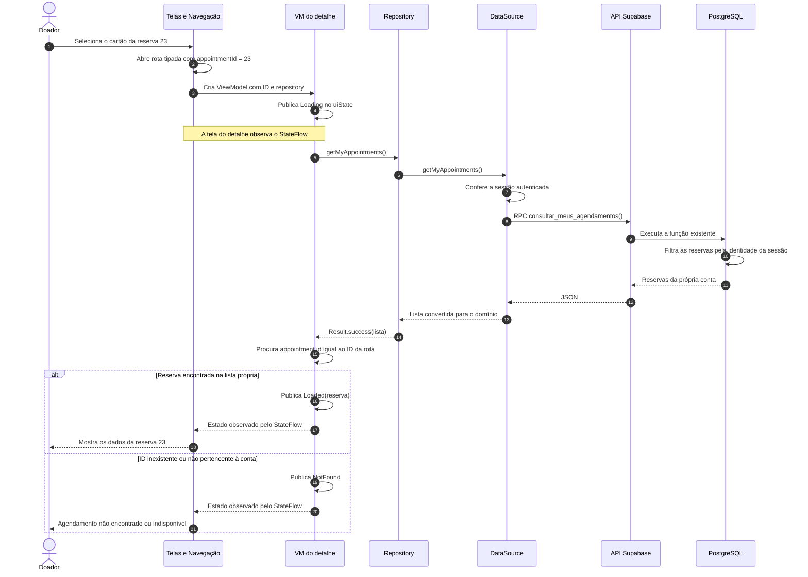

# Diagrama de sequência — detalhes da reserva pelo ID

**Proposto e implementado em pequenos passos em 13/10/2026.** O diagrama foi apresentado antes do código, conforme orientação da usuária. Ela implementou o clique por ID, a nova rota, o estado/ViewModel e a tela de detalhes. Aplicativo e testes compilaram; sete testes instrumentados do detalhe passaram no Pixel_5/Android 12. Captura confirma os dados do detalhe de 23, e a usuária relatou retorno pela seta à lista, como esperado. Ver [validação atual](12-validacao.md). A [consulta da listagem](17-diagrama-sequencia-listagem.md) é reutilizada por este fluxo.

## Objetivo e decisão técnica adotada

Ao selecionar o cartão da reserva 23, abrir seus detalhes com ID, unidade, data/hora no fuso da unidade e estado retornados pelo servidor. A rota transporta somente `appointmentId`; o detalhe consulta os dados novamente pela sessão atual, sem depender do rascunho do agendamento ou da lista guardada em outro ViewModel.

Reutilizar `AppointmentRepository.getMyAppointments()` e a RPC existente `consultar_meus_agendamentos()`. O banco já limita a resposta às reservas da conta; o ViewModel do detalhe procura o ID solicitado nessa lista. Essa escolha reaproveita os dados de `AppointmentSummary` e evita uma nova função SQL para este recorte. Ela consulta todas as reservas próprias, em vez de filtrar um único ID no servidor; uma consulta específica por ID poderá ser avaliada quando esse volume justificar a mudança.

O filtro por ID no ViewModel seleciona o item para apresentação. A autorização continua sendo o filtro por `auth.uid()` no servidor. Informar o ID de outra conta não faz o servidor devolver seus dados.

## Sequência implementada

Leia de cima para baixo; setas contínuas são chamadas e tracejadas são respostas. Navegação, lista e tela de detalhes estão agrupadas para reduzir o número de colunas. As setas ViewModel → telas representam observação de estado, não chamadas diretas a componentes Compose. O desenho mostra uma consulta bem-sucedida; falhas são descritas abaixo.

## Implementação e reaproveitamento

| Participante | Antes da etapa | Implementado nesta etapa |
| --- | --- | --- |
| `DonationAppointmentsScreen` | Mostrava os cartões sem abrir detalhes. | Botão “Ver detalhes” em cada cartão emite callback com seu ID. |
| `AppRoute` / `MainNavGraph` | Rota visual `AppointmentDetail` sem argumento. | Rota tipada `AppointmentDetailById(appointmentId)`; destino usa `toRoute()` para obter o ID. |
| `AppContainer` | Fábrica da listagem. | Função de fábrica do detalhe recebe o ID e fornece o repository existente. |
| `presentation/appointments` | Estado e ViewModel da listagem. | `AppointmentDetailUiState` e `AppointmentDetailViewModel`, associados ao destino do detalhe. |
| Tela do detalhe por ID | Não existia. | `AppointmentDetailByIdScreen` recebe estado e callbacks para Voltar e nova tentativa. |
| `AppointmentRepository` / DataSource / mapper | Consulta e conversão da lista própria implementadas. | Reutilizar `getMyAppointments()` e `AppointmentSummary`. |
| Supabase / PostgreSQL | RPC de consulta própria aplicada e testada. | Reutilizar a RPC; nenhuma migração nova é necessária para esta proposta. |

O fluxo visual antigo do Perfil/Home usa `AppointmentDetailScreen` e a rota sem argumento. Ele será preservado enquanto suas entradas ainda não tiverem sido integradas. A listagem persistida abrirá o novo destino por ID, com dados consultados. Alteração de horário, recorrência e cancelamento persistido continuam sendo etapas próprias; os botões do protótipo não serão ligados como se já executassem essas operações na reserva consultada.

## Estados e dados da tela

- `Loading`: consulta em andamento.
- `Loaded`: reserva própria encontrada, incluindo estado cancelado ou data passada quando retornados pelo banco.
- `NotFound`: ID não encontrado na lista própria. A mensagem não distingue reserva inexistente de reserva de outra conta.
- `Error`: consulta ou conversão falhou; mostrar mensagem genérica e permitir nova tentativa.

Os campos disponíveis são ID, unidade, início, fuso e estado. Endereço não está em `AppointmentSummary`; não preencher com endereço fixo do protótipo. Não inferir coleta, aptidão, comparecimento ou lembrete configurado a partir de um agendamento.

## Falha, cancelamento e validação

O repository mantém o tratamento já existente: exceções comuns retornam `Result.failure`, enquanto `CancellationException` é propagada. O ViewModel do detalhe impede consultas simultâneas e verifica cancelamento antes de publicar um resultado. Nova tentativa consulta novamente para o mesmo ID. Remover o destino deve cancelar a consulta pendente.

`AppointmentDetailFlowTest`: sete aprovados, zero falhas/erros/ignorados, conferidos no XML, no Pixel_5/Android 12. Cenários: escolha entre várias reservas/consulta atualizada/fuso/cancelado/Voltar; carregamento/duplicidade; erro/nova tentativa; ID ausente/lista vazia; saída pendente/troca de ID; troca A/B com ID de outra conta e ID próprio; restauração do ID tipado no estado salvo da navegação. Esta última simula estado salvo do Compose/navegação, não morte real do processo ou renovação da sessão. Todos usam repositories fictícios; não comprovam isolamento real da API. Complemento: seis testes de listagem e dez de navegação aprovados. No roteiro manual orientado para A, captura confirma o detalhe de 23 com Unidade Demo A, 19/10/2026 às 08:00 e estado Agendado; retorno à lista mantendo 23 confirmado por relato. Preservar os dados remotos existentes. Ver [validação](12-validacao.md) para os limites das evidências.

A implementação de produção foi feita pela usuária em pequenos passos. Não houve nova migração ou alteração da RPC. O fluxo visual antigo de detalhe/cancelamento continua separado do destino integrado por ID.
