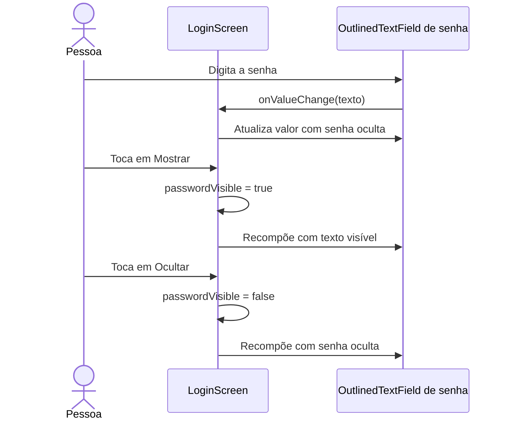

# Visibilidade da senha no login — 13/10/2026

## Estado e escopo

**Implementado:** `LoginScreen` mantém a senha em estado local com `remember`; o campo usa `PasswordVisualTransformation` e fica desabilitado enquanto o login está carregando.

**Implementado pela usuária nesta etapa:** botão Mostrar/Ocultar no final do campo e booleano local `passwordVisible`, inicialmente `false`. O campo alterna entre `VisualTransformation.None` e `PasswordVisualTransformation`; o botão acompanha o bloqueio durante o envio. A alternância muda somente a apresentação, preservando o valor digitado.

## Sequência proposta

## Participantes e decisão

`LoginScreen`, seu estado local e o campo estão em [`AuthScreens.kt`](../app/src/main/java/br/edu/fatec/doesangue/ui/screens/auth/AuthScreens.kt), na camada `ui`. A visibilidade é uma escolha de apresentação, portanto o booleano pertence à tela. O envio existente por `onSignIn(email, password)` continua usando o valor digitado.

A implementação foi guiada em pequenos passos e revisada no código. `assembleDebug` passou em 13/10/2026, gerando o APK de desenvolvimento; `git diff --check` também passou. A usuária relatou sucesso no roteiro manual de ocultação inicial e alternância sem perda de texto. Não houve captura nem inspeção automática dessa interação.

O agente executou `LoginFlowTest` no Pixel_5/Android 12: três aprovados, zero falhas/erros/ignorados, conferidos no XML. A suíte existente cobre campos vazios, falha/nova tentativa com preservação da senha enviada e bloqueio durante o envio; usa repository fictício e não testa os cliques Mostrar/Ocultar. A cobertura específica da alternância nesta etapa é manual. O texto será mantido na primeira versão; a usuária adiou o ícone de olho. Nenhum arquivo de ícone foi criado pelo agente.
