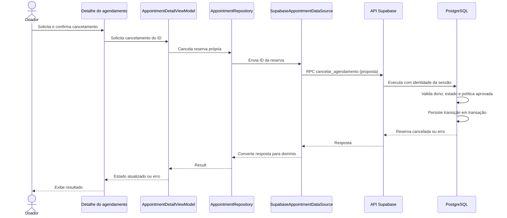

# Cancelamento persistido — 14/10/2026

## Estado da etapa

**Implementado:** criação, listagem própria e detalhe por ID no Android. A melhoria Mostrar/Ocultar senha está no commit `62c10d0`. No banco, tabela de eventos e função de cancelamento estão aplicadas e exercitadas pelos roteiros manuais, incluindo concorrência e limpeza final. O detalhe integrado ainda não oferece cancelamento; telas antigas de cancelamento são demonstrações visuais.

**Proposto para o Android:** o doador solicita o cancelamento no detalhe, confirma a intenção e o servidor decide a transição para `cancelado`, preservando a reserva. O Android envia o ID; a identidade vem da sessão autenticada. Erros mantêm a tela com possibilidade de nova tentativa, sem anunciar sucesso antes da resposta persistida.

**Confirmado pela usuária em 14/10/2026:** permitir cancelamento de reserva própria agendada antes do início, sem antecedência adicional, no ambiente acadêmico sintético. O servidor deverá comparar o instante de início com seu próprio relógio ao decidir a transição; a data do aparelho não autoriza o cancelamento.

**Registro da transição implementado:** tabela `agendamento_cancelamento`, com ID próprio, FK única para a reserva, FK para o perfil que solicitou o cancelamento e instante registrado pelo servidor. Representa o evento de cancelamento; a reserva continua em `agendamento`. A unicidade permite somente um evento de cancelamento por reserva, coerente com os estados atuais e a ausência de reativação. A função atualiza estado e insere o evento na mesma transação; somente o servidor autorizado pode gravar. Isso evita acrescentar campos ao formato atual da reserva retornado pela RPC e mantém uma evidência da transição. Não é histórico genérico de todos os estados nem auditoria de ações administrativas fora da função.

A usuária concluiu e aplicou manualmente `20261014000100_criar_cancelamento_agendamento.sql`: tabela com ID, FK única para reserva, FK para autor e instante `clock_timestamp()`, RLS e privilégios da tabela/sequência revogados para public/anon/authenticated. Função `cancelar_agendamento(bigint)` VOLATILE/SECURITY DEFINER/search_path vazio, EXECUTE somente authenticated. Capturas conferem configuração/permissões, estrutura, comportamento, cenário concorrente e limpeza final. Arquivo revisado estaticamente e `git diff --check` passou. Não reaplicar automaticamente. O agente preparou roteiros de teste/documentação, sem execução remota. Retomada em [checkpoint](checkpoints/2026-10-14-cancelamento-supabase.md).

## Sequência proposta

## Arquivos e responsabilidades previstas

- `ui/screens/donations/AppointmentDetailByIdScreen.kt`: ação, confirmação e exibição dos estados; navegação permanece em `ui/navigation`.
- `presentation/appointments/AppointmentDetailViewModel.kt` e seu estado: coordenação, prevenção de envios simultâneos e tratamento da resposta.
- `domain/repository/AppointmentRepository.kt`: contrato de cancelamento, sem dependências de Compose ou Supabase.
- `data/repository/SupabaseAppointmentRepository.kt` e `data/supabase/SupabaseAppointmentDataSource.kt`: chamada autenticada, conversão e preservação de cancelamento da corrotina.
- `supabase/migrations/`: futura função e eventual registro da transição, escritos pela usuária em pequenos passos. Identidade, permissões, prazo e consistência entre criação/cancelamento ficam no servidor.

## Ordem e limites

Preparação concorrente confirmada por captura: oferta ID 23, início 2026-10-21 21:31:31.436406+00, capacidade 1, reserva temporária de A ID 37 agendada, com COMMIT. Capturas A/B confirmam cancelamento de 37, B aguardando seu bloqueio=true e nova reserva B=38 depois do cancelamento, com somente B ativo e um evento de A. A confirma com COMMIT; B termina em ROLLBACK. Capturas da limpeza e conferência final confirmam registros temporários ausentes e massa original preservada. A reserva original 23 pertence a outra oferta e permanece agendada, com snapshots/guardas explícitas nos roteiros. Não repetir preparação/sessões já exercitadas.

Capturas recebidas em 14/10 confirmam EXECUTE da função somente para authenticated entre os papéis anon/authenticated consultados; SECURITY DEFINER=true, volatilidade=v e search_path vazio. Também confirmam existência/RLS da nova tabela, SELECT/INSERT/UPDATE/DELETE/TRUNCATE negados, USAGE/SELECT/UPDATE da sequência negados e PK/UNIQUE/duas FKs com ON DELETE RESTRICT. Essas conferências são somente leitura. Capturas de comportamento confirmam cancelamento/repetição com evento único, autor/instante, prazo passado bloqueado, cancelamento próprio de oferta inativa/unidade não publicada, repetição após início sem novo evento, parâmetros/identidade/acesso cruzado A/B negados, acessos diretos e anon bloqueados, atomicidade diante de conflito do evento, REPEATABLE READ/SERIALIZABLE rejeitados por 25000 e preservação de 23. Os roteiros sequenciais simulam identidade/papel e terminam em ROLLBACK. O cenário concorrente, sua limpeza e a conferência final foram concluídos conforme capturas. Ver `docs/12-validacao.md` para os limites da evidência.

Conferência final por captura: 2 unidades, 3 horários, 1 perfil, 1 agendamento, 0 eventos; ausência dos registros temporários; reserva original 23 agendada e dados conferidos=true. Checkpoint salvo. Próximo passo: registrar no Git quando autorizado e integrar Android em pequenos passos, retomando este diagrama. Não reaplicar a migração. A função usa READ COMMITTED e bloqueia perfil → horário → reserva, coordenando-se com a criação. Filtra ID/dono/horário na releitura protegida, valida o prazo após obter todos os bloqueios e captura um único instante do servidor para decisão e evento. UPDATE com RETURNING preserva os outros campos; INSERT do evento e retorno acontecem na mesma transação. Sucesso/repetição, falha específica de unicidade do evento e concorrência A-cancelamento/B-criação com uma vaga foram exercitados; outros cenários concorrentes não estão comprovados.

Comportamento previsto para repetição: retornar uma reserva própria já cancelada antes de avaliar o prazo para uma nova transição, sem criar outro evento nem alterar o instante original. Isso permite recuperar o resultado após perda de resposta, mesmo se o início tiver passado. Não autoriza um primeiro cancelamento fora do prazo. Os demais bloqueios serão acrescentados antes da gravação. A lista deverá refletir o resultado ao retornar do detalhe, sem reutilizar uma leitura antiga.

O agente não criou migração, alterou produção ou executou SQL remoto nesta preparação. Preservar a reserva sintética 23; os testes de cancelamento deverão usar outras reservas. Cancelamento libera ocupação de agenda segundo o estado e não modifica estoque nem comprova doação. Origem da definição da política: RN008 em `docs/03-regras-de-negocio.md` e RF009 em `docs/02-requisitos.md`.
