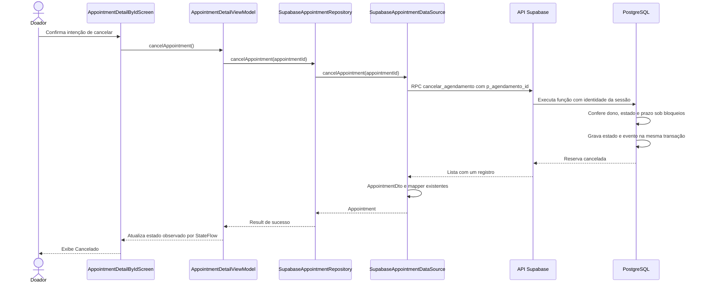

# Cancelamento no Android — proposta de 14/10/2026

## Estado atual após implementação e testes

O desenho apresentado abaixo como proposta foi implementado pela usuária. Vinte testes focados passaram no Pixel_5/Android 12; LintDebug passou com 31 avisos/zero erros. No roteiro real, a usuária cancelou a reserva temporária 39 pelo aplicativo; captura da lista mostra 39 Cancelado e 23 Agendado. Consulta administrativa confirmou exatamente um evento de 39, autor correspondente e instante preenchido. Limpeza específica confirmou oferta 24/reserva 39/evento removidos e original 23 preservada. Não repetir os roteiros. Isso valida esse percurso com uma conta real, sem auditoria completa de JWT/API, concorrência pelo app ou perda real de resposta. Ver docs/12-validacao.md; commit/push autorizados pela usuária após a limpeza; conferir versão e sincronização no Git ao retomar.

## Estado e escopo apresentados antes do código (histórico)

**Implementado no servidor:** `cancelar_agendamento(bigint)`, tabela de eventos, validação de dono/prazo, repetição e gravação atômica. Testes SQL e cenário concorrente com limpeza confirmados; commit `19497a9`. São identidades simuladas, sem validação do cancelamento pela API do Android.

**Proposto nesta etapa:** ligar o detalhe real por ID ao cancelamento persistido, com confirmação da intenção, estado de envio/erro e resposta do servidor. A usuária escreve o código em pequenos passos. Telas antigas de cancelamento continuam visuais até decisão explícita de integração.

## Sequência proposta

Em falha, o repository entrega `Result.failure`, e o ViewModel deve preservar os dados e oferecer nova tentativa, sem apresentar cancelamento confirmado. O cancelamento de uma corrotina permanece propagado; não é a operação de cancelamento de reserva. Se a resposta se perder após gravação, repetir o mesmo ID recupera o estado já cancelado. A lista deverá refletir o resultado ao voltar; a ligação dessa atualização ainda será definida na etapa de navegação/UI.

## Participantes e arquivos

| Participante | Arquivo/camada e responsabilidade |
| --- | --- |
| Tela | `ui/screens/donations/AppointmentDetailByIdScreen.kt`: confirmação e exibição dos estados. |
| ViewModel | `presentation/appointments/AppointmentDetailViewModel.kt` e `AppointmentDetailUiState.kt`: coordenação, prevenção de duplicidade e estado imutável. |
| Contrato | `domain/repository/AppointmentRepository.kt`: nova operação que retorna `Result<Appointment>`, sem dependência do SDK/UI. |
| Repository | `data/repository/SupabaseAppointmentRepository.kt`: implementação do contrato, sucesso/falha e preservação de CancellationException. |
| DataSource | `data/supabase/SupabaseAppointmentDataSource.kt`: valida ID, usa sessão compartilhada e chama RPC com ID numérico. |
| DTO/mapper | `data/supabase/dto/AppointmentDto.kt` e mapper existente: convertem a mesma estrutura de reserva já usada na criação. |
| Servidor | Migração aplicada `20261014000100_criar_cancelamento_agendamento.sql`: identidade, prazo, estado e evento. Não reaplicar. |

## Decisões e primeiro passo

Reutilizar `Appointment`/DTO/mapper porque a função retorna a mesma linha de `agendamento`; o evento está em tabela separada. A identidade vem da sessão e a regra é decidida no servidor. Navegação continua em `ui/navigation`, sem NavController no ViewModel; a fábrica atual já fornece o repository ao detalhe.

Primeiro passo didático: a usuária acrescenta `cancelAppointment(appointmentId: String): Result<Appointment>` ao contrato. Implementações e repositories fictícios precisarão cumprir esse método nos passos seguintes. Nenhum Kotlin foi alterado pelo agente e nenhum teste novo foi executado nesta preparação. Estado de envio/erro, botão, confirmação e atualização da lista ainda não implementados.

## Evolução da integração — 14/10/2026

A usuária implementou o contrato, a chamada RPC no DataSource e o método no repository. O DataSource envia somente `p_agendamento_id` numérico, aguarda a inicialização do Auth, exige sessão e converte a única linha retornada com o DTO/mapper existentes. O repository preserva `CancellationException` e representa outras falhas em `Result.failure`.

O agente adaptou somente as quatro implementações fictícias em `androidTest` para cumprir o novo contrato; cancelamento ainda retorna falha explícita de operação não configurada nesses roteiros. `compileDebugKotlin` e `compileDebugAndroidTestKotlin` passaram, assim como `git diff --check`. Isso confirma compilação, sem execução dos testes ou chamada real da RPC. Estado/ViewModel, botão, confirmação e atualização da lista permanecem pendentes; o diagrama completo continua sendo a proposta da etapa.

Em seguida, a usuária acrescentou `isCancelling`/`cancellationError` ao estado Loaded e a operação no ViewModel. A consulta e o cancelamento impedem operações simultâneas; o envio preserva os detalhes e só atualiza o registro quando a resposta corresponde ao ID solicitado e ao estado CANCELLED. Falhas preservam os dados e oferecem mensagem para nova tentativa; `ensureActive` evita publicação após interrupção da corrotina. `compileDebugKotlin` passou após essas mudanças. Validação comportamental, ligação da tela, confirmação e atualização da lista ainda pendentes.

A usuária ligou o callback na navegação e implementou a confirmação com AlertDialog, o botão, a mensagem de falha e a indicação de envio. Durante o envio, a seta fica ausente, BackHandler intercepta Voltar e as abas não encaminham navegação. `compileDebugKotlin` e `compileDebugAndroidTestKotlin` passaram novamente. Atualização da lista ao voltar, testes comportamentais e verificação real pela API ainda pendentes; a reserva original 23 deve permanecer preservada.

A usuária implementou a atualização da lista com LifecycleEventEffect/ON_RESUME no destino de navegação. Um indicador no SavedStateHandle distingue a primeira retomada (consulta já iniciada no ViewModel) das seguintes, que solicitam nova leitura. O fluxo Android do diagrama agora está implementado no código; a chamada real de cancelamento pela API ainda não foi exercitada. Vinte testes instrumentados passaram no Pixel_5/Android 12 (14 detalhe/cancelamento e seis listagem), zero falhas/erros/ignorados, conferidos nos XML. Incluem sete cenários novos de confirmação, envio pendente, falha/repetição, resposta perdida simulada, ID/estado inesperados e restauração da confirmação; não usam rede. Preparação e limpeza específicas do teste real estão em `supabase/tests/cancelar_agendamento_android_preparar.sql` e `cancelar_agendamento_android_limpar.sql`, ainda sem execução remota. Preservar a reserva original 23.

LintDebug passou com 31 avisos e zero erros; `git diff --check` também passou. Resultados e limites completos em `docs/12-validacao.md`.
