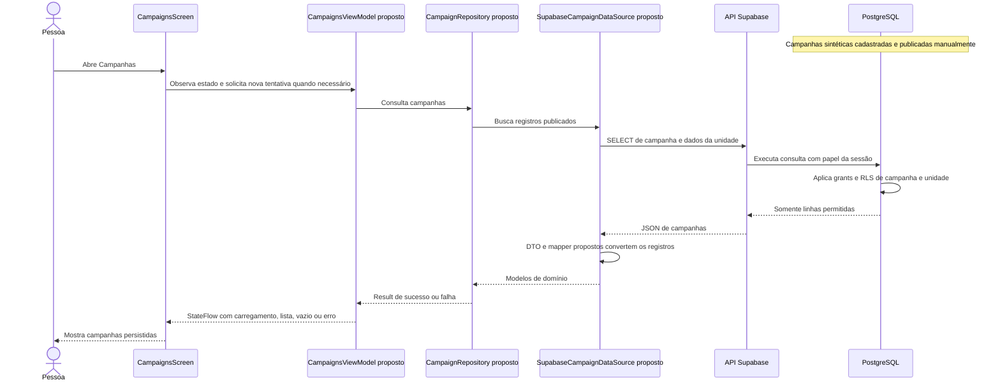

# Campanhas por unidade — etapa iniciada em 15/10/2026

## Confirmado e implementado

**Recorte SQL concluído posteriormente:** a migração foi aplicada manualmente e cinco consultas de catálogo/três roteiros comportamentais foram conferidos por capturas. Conferência final: seis tabelas/seis FKs do domínio; 2 unidades, 3 horários, 1 perfil, 1 agendamento, 0 eventos, 0 campanhas e 0 unidades temporárias; sete registros, 23 agendado com dados conhecidos conferidos=true. Não reaplicar migrações nem repetir automaticamente os testes. Sem seed de campanhas e sem integração Android, que continua proposta no diagrama. Registro completo em `docs/checkpoints/2026-10-15-campanhas-supabase.md`. Os registros abaixo conservam o estado de abertura da etapa.

A usuária aprovou campanhas sintéticas como a próxima entidade do banco: **cada campanha pertence a exatamente uma unidade de coleta**, com publicação manual no Supabase e consulta pelo aplicativo. Uma unidade poderá ter zero ou várias campanhas. Campanha é conteúdo de divulgação; não cria reserva, comprova coleta, determina aptidão ou altera estoque.

O cancelamento Android foi concluído e registrado em `3b9846189c596515cf945fc78fb1c6bcddfdb31d`; na retomada, main estava limpa e sincronizada com origin/main. A reserva original 23 permanece preservada; as fixtures anteriores foram removidas.

Na abertura da etapa, `ui/screens/campaigns/CampaignScreens.kt` e as rotas Campaigns/CampaignDetail em `ui/navigation` já existiam com cartões/textos e detalhe fixos. Modelo, repository, DataSource e ViewModel de campanhas continuam pendentes; a tabela foi implementada durante esta etapa SQL. Os alertas visuais de estoque são históricos do protótipo, sem fonte operacional; não alimentam a nova entidade.

## Sequência proposta para a integração

O diagrama descreve a direção da etapa, antes de seu código. Primeiro serão orientados esquema, permissões e testes SQL; depois a leitura no Android. Publicação será administrativa e manual, com dados sintéticos, sem criar papel administrativo no aplicativo.

## Arquivos e camadas

| Participante | Arquivo ou local e estado |
| --- | --- |
| Tela | `ui/screens/campaigns/CampaignScreens.kt`, existente com dados fixos; futura leitura de estado. |
| Navegação e composição | `ui/navigation/MainNavGraph.kt`, `AppRoute.kt` e `di/AppContainer.kt`, existentes; futura ligação das dependências e identidade do detalhe. |
| ViewModel/estado | Futuros arquivos em `presentation/campaigns`, sem componentes Compose. |
| Domínio | Futuros modelo Campaign e contrato CampaignRepository em `domain`; sem dependência do SDK. |
| Dados | Futuros SupabaseCampaignRepository, SupabaseCampaignDataSource e DTO/mapper em `data`; preservam CancellationException e usam o cliente compartilhado. |
| PostgreSQL | Migração `supabase/migrations/20261015000100_criar_campanha.sql`, em elaboração local pela usuária; ainda não aplicada. |

## Escopo do banco proposto

- PK bigint gerada e FK obrigatória de `campanha.unidade_id` para `unidade_coleta.id`, com ON DELETE RESTRICT. A FK impede uma campanha de apontar para unidade inexistente e a exclusão de unidade referenciada; o aplicativo não duplica o endereço da unidade na campanha.
- Construir nos próximos passos: título, descrição, período coerente, fonte sintética identificada, publicação com default false e data de criação gerada pelo servidor. Tipos e constraints serão apresentados antes de cada trecho; filtro temporal da listagem será definido antes da integração.
- Proposta de acesso: RLS e somente SELECT para anon/authenticated, limitado a campanhas publicadas de unidades publicadas. Escrita e sequência de IDs continuam administrativas; permissões serão implementadas/testadas antes da aplicação. Não usar service_role no Android.
- A aplicação dessa tabela elevará o esquema a seis tabelas e seis FKs entre tabelas do domínio, além da FK para Auth; isso ainda não ocorreu. A massa de 200 registros e a distribuição coerente continuam pendentes. Nenhum seed será aplicado automaticamente.

## Primeiro passo e limites

Captura do teste de acesso confirma os quatro resultados: escrita (INSERT/UPDATE/DELETE/TRUNCATE) bloqueada sob anon/authenticated, SELECT/nextval da sequência bloqueados e campanhas/23 preservadas; fixtures em ROLLBACK, papéis simulados administrativamente. Próximo passo: `supabase/tests/campanha_conferencia_final.sql`, somente leitura, preparado e ainda não executado. Esperados sete registros originais distribuídos nas seis tabelas, zero campanhas/eventos e reserva 23 agendada com dados conhecidos conferidos. Seed e integração Android continuam pendentes.

Captura do teste de integridade confirma os sete resultados esperados (defaults, textos/período, nove NOT NULL, FK/RESTRICT, identidade/PK e originais/23 preservados), com fixtures em ROLLBACK. Próximo passo: `supabase/tests/campanha_escrita_bloqueada.sql`, preparado e ainda não executado; tenta INSERT/UPDATE/DELETE/TRUNCATE e SELECT/nextval da sequência sob anon/authenticated, exige erro 42501 e compara dados originais. Também termina em ROLLBACK. Depois faltará somente a conferência final deste recorte SQL; seed e integração Android permanecem pendentes.

Captura posterior do primeiro teste comportamental confirma a leitura esperada para anon/authenticated em SELECT direto/JOIN: somente campanha publicada de unidade publicada. Fixtures em ROLLBACK, papéis simulados administrativamente, sem JWT/API nem seed persistente. Próximo passo é `supabase/tests/campanha_integridade.sql`, preparado pelo agente e ainda não executado: defaults, oito casos de CHECK, nove NOT NULL, FK inexistente/RESTRICT e identidade/PK, com unidade/campanha temporárias e comparação de dados originais/23. Não reaplicar a migração; negações de escrita e conferência final ainda pendentes.

Catálogos posteriormente conferidos por captura: tabela/RLS e grants, sequência sem acesso dos clientes, seis constraints e nove colunas NOT NULL com identidade/defaults esperados. Policy SELECT/PERMISSIVE para anon/authenticated presente, with_check NULL; a qual ficou cortada na captura e a filtragem será validada pelo comportamento. Agora são seis tabelas/seis FKs do domínio, além de Auth; seed de 200 registros e integração Android continuam pendentes. Próximo passo: executar manualmente `supabase/tests/campanha_leitura_publicada.sql` inteiro como postgres, com fixtures em ROLLBACK; ainda sem execução. Se houver erro, ROLLBACK antes de nova tentativa. Preservar 23 e não reaplicar a migração. Histórico da preparação abaixo.

Aplicação manual posteriormente relatada pela usuária (“feito”) após orientação de execução completa como postgres. Não reaplicar a migração. Ainda sem captura da execução ou consultas de catálogo; próxima etapa é conferir RLS e privilégios com `campanha_tabela.sql`, seguindo depois para sequência, constraints, policy, colunas e testes comportamentais. Nenhum SQL remoto executado pelo agente. Registros abaixo conservam estados anteriores da preparação.

Revisão completa posterior: a usuária concluiu localmente a migração com todos os campos, RLS, revogação de privilégios de public/anon/authenticated na tabela/sequência, SELECT somente a anon/authenticated e policy que exige publicação da campanha e da unidade. Revisão estática e `git diff --check` passaram; nenhuma aplicação remota ou validação comportamental foi executada. O arquivo apresenta recuo irregular, sem alterar a interpretação SQL. Consultas de catálogo somente leitura preparadas em `supabase/tests/campanha_{tabela,sequencia,constraints,policy,colunas}.sql`; executar uma por etapa após a aplicação manual completa. Constraints, negações e isolamento de leitura ainda exigem testes comportamentais com fixtures em ROLLBACK; os catálogos não substituem esses testes. O índice Git mostrou AM para a migração (versão parcial no índice); em futuro commit autorizado, incluir a versão completa revisada. Não reaplicar migrações anteriores. Os registros abaixo conservam os passos do rascunho.

Evolução da tutoria: a usuária criou o rascunho local com PK, FK obrigatória para unidade, título/descrição/fonte não vazios, início/fim obrigatórios, constraint `campanha_periodo_check` exigindo fim > início, publicada com default false e criado_em gerado pelo servidor. Revisão estática e `git diff --check` passaram; ainda faltam RLS, grants/revokes, policy e testes. Não executar o rascunho incompleto nem reaplicar migrações anteriores. O roteiro inicial abaixo é histórico.

Orientar a usuária a criar a migração somente com transação, PK e vínculo obrigatório com unidade. Não executar esse arquivo incompleto: ainda faltam campos, constraints e RLS/grants. O agente não cria nem preenche arquivos de produção. Nenhuma migração, consulta remota ou teste de aplicação foi executado nesta preparação documental. Detalhes por ID e retirada dos literais de estoque serão tratados durante a integração, preservando o agendamento existente.
