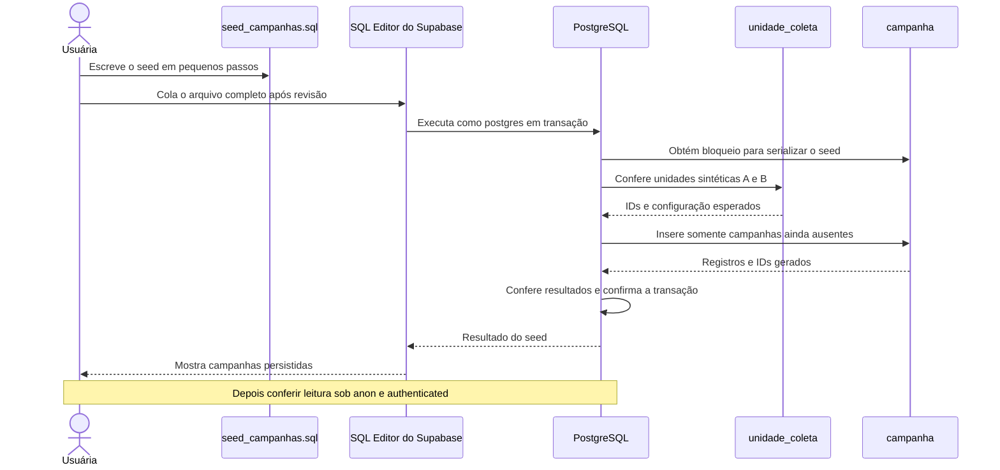

# Seed mínimo de campanhas — etapa iniciada em 15/10/2026

## Retomada após tipo sanguíneo — 15/10/2026

**Recorte concluído:** seed/repetição sem duplicações, leitura/filtros SQL simulados, lista/filtros/detalhe/retorno reais e conferência global aprovados. Total confirmado 14 registros, quatro campanhas/dois vínculos; C/23 preservados. Mensagens específicas também concluídas em tutoria e validadas, conforme docs/25 e docs/12. Commit/push deste marco ainda não executados; os registros de progresso abaixo são históricos.

**Detalhe/retorno:** captura confirma dados da direcionada A+/O+ e usuária confirmou retorno mantendo O+ e duas campanhas. Falta executar `campanha_seed_conferencia_final.sql` (somente leitura) para fechar contagem/preservação; depois iniciar mensagens específicas de erro com novo diagrama e tutoria. Nenhuma produção Kotlin alterada neste recorte.

**Android, lista/filtro:** capturas confirmam Todos → duas campanhas publicadas de A; A− → somente geral; O+ → duas novamente, com tipos e período esperados. Detalhe/retorno e conferência final pendentes. Próximo passo orientado: Ver campanha na direcionada A+/O+. Sem inspeção de JWT/tráfego ou nova suíte, pois nenhuma produção Kotlin mudou.

**Filtro SQL aprovado por captura:** roteiro do seed retornou sucesso para anon/authenticated em Todos/oito tipos, leitura oculta ausente e formato geral/direcionado correto. Papéis administrativos simulados; nenhuma nova escrita. Próximo passo orientado: abrir lista funcional no app por Início → Próximas campanhas → Ver todas e conferir Todos. Filtros/detalhe reais continuam pendentes; mensagens específicas de erro vêm após campanhas.

**Conferência/repetição confirmadas por capturas:** quatro campanhas e dois vínculos persistidos após duas execuções relatadas sem erro; IDs 28/29/30/31 mantidos. Segunda captura confirma 23 agendada/dados conhecidos=true. Preparado `supabase/tests/campanha_seed_filtros.sql`, somente leitura, para leitura direta/RPC e Todos/oito tipos sob anon/authenticated simulados; ainda não executado. Depois verificar filtro/lista/detalhe reais no Android. Detalhes e limites em docs/12.

**Aplicação relatada:** após executar o seed completo manualmente, a usuária informou “Success. No rows returned”. Conferência dos registros ainda pendente: preparado `supabase/tests/campanha_seed_conferencia.sql`, somente leitura como postgres. A resposta de execução não comprova isoladamente leitura por papel, repetição sem alterações ou filtro real no Android; essas verificações seguem na tutoria. Nenhuma execução remota pelo agente.

**Progresso posterior:** usuária concluiu o seed local com quatro campanhas, dois vínculos A+/O+, bloqueio das duas tabelas, pré-condições das unidades e conferências de quantidade/período/publicação/vínculos antes do COMMIT. Revisão estática do arquivo completo não encontrou ajustes necessários; ainda sem execução PostgreSQL nesta retomada. Próximo passo orientado: executar manualmente o arquivo completo no SQL Editor como postgres, uma vez; depois conferir leitura/repetição e percurso real no Android. Não considerar idempotência ou filtro remoto comprovados apenas pela revisão. Original 23 permanece fora das operações do seed.

A usuária escolheu concluir campanhas e depois mensagens específicas de erro. Cadastro/tipo/filtro foram registrados e enviados no commit 218deca. O Android e a RPC de campanhas estão implementados; o seed local continua incompleto, preservado e não executado. Última conferência remota: oito registros do domínio, zero campanhas/vínculos e reserva original 23 preservada. Os estados abaixo desta atualização são históricos.

Plano atualizado para validar tanto inclusão geral quanto filtragem: quatro campanhas sintéticas — a campanha geral já iniciada, uma segunda publicada na Demo A com vínculos A+ e O+, um rascunho na Demo A e uma publicada na Demo B oculta. Sem vínculos significa geral; os tipos divulgados não representam compatibilidade médica. Após aplicação/repetição manual e conferência, Todos/A+/O+ devem mostrar as duas publicadas de A; A− deve mostrar apenas a geral. Os dois casos ocultos permanecem ausentes. Ainda é um seed mínimo, separado da massa acadêmica de 200 registros.

```mermaid
sequenceDiagram
    actor Pessoa as Usuária
    participant Editor as SQL Editor
    participant Banco as PostgreSQL
    participant Tela as CampaignReadScreens
    participant VM as CampaignsViewModel
    participant Repo as SupabaseCampaignRepository
    participant Fonte as SupabaseCampaignDataSource
    Note over Pessoa,Banco: Proposto nesta retomada: completar e aplicar seed revisado
    Pessoa->>Editor: Executa seed_campanhas.sql completo
    Editor->>Banco: BEGIN e bloqueios de campanha e vínculos
    Banco->>Banco: Confere unidades e insere campanhas ausentes
    Banco->>Banco: Insere vínculos A+ e O+ ausentes
    Banco->>Banco: Confere dados e COMMIT
    Banco-->>Editor: Dados sintéticos persistidos
    Editor-->>Pessoa: Resultado para conferência
    Note over Tela,Fonte: Implementado: consulta Android; validação real com seed pendente
    Pessoa->>Tela: Abre campanhas e escolhe filtro
    Tela->>VM: loadCampaigns / selectBloodType
    VM->>Repo: getCampaigns com filtro
    Repo->>Fonte: Consulta campanhas
    Fonte->>Banco: RPC consultar_campanhas
    Banco->>Banco: RLS e filtro por tipo ou campanha geral
    Banco-->>Fonte: Campanhas permitidas
    Fonte-->>Repo: DTOs
    Repo-->>VM: Modelos ou falha
    VM-->>Tela: Estado de conteúdo, vazio ou erro
    Tela-->>Pessoa: Lista filtrada
```

Arquivos/camadas: `supabase/seed_campanhas.sql` prepara os dados pelo SQL Editor; `campanha` e `campanha_tipo_sanguineo` são tabelas, sem criar novas migrações. A leitura usa `ui/screens/campaigns/CampaignReadScreens.kt` → `presentation/campaigns/CampaignsViewModel.kt` → contrato `domain/repository/CampaignRepository.kt`, implementado em `data/repository/SupabaseCampaignRepository.kt` → `data/supabase/SupabaseCampaignDataSource.kt` → RPC. Detalhe por ID já existe, com `CampaignDetailViewModel.kt`, e será verificado no roteiro real. Nenhum desses arquivos de produção foi alterado nesta retomada.

Primeiro passo de código orientado: incluir as duas tabelas no bloqueio inicial do seed. Demais inserções/conferências serão escritas pela usuária em passos seguintes. Não executar o rascunho; nenhum SQL remoto nem teste Android foi executado pelo agente nesta preparação documental.

## Estado e objetivo

Esquema, permissões e testes SQL de campanha concluídos; commit/push `13e0ead62a83fe112687d2bfc483c0b496f40a22`. Na retomada, main estava limpa. Última conferência remota: 2 unidades, 3 horários, 1 perfil, 1 agendamento, 0 eventos, 0 campanhas, total de sete registros; original 23 agendado com dados conhecidos conferidos.

A usuária concordou em prosseguir com um seed mínimo de três campanhas sintéticas. O agente orienta/revisa; a usuária escreve `supabase/seed_campanhas.sql`, separado do seed existente de unidades. Nenhum seed de campanhas foi criado/aplicado nesta preparação documental. A integração Android continua pendente: este diagrama mostra execução manual de SQL, sem ViewModel ou repository intermediando.

## Sequência proposta



## Participantes e arquivos

| Participante | Responsabilidade |
| --- | --- |
| Usuária/arquivo | Escrever `supabase/seed_campanhas.sql` em tutoria; não executar o rascunho incompleto. |
| SQL Editor | Execução manual como postgres no mesmo desenvolvimento acadêmico, somente após revisão/orientação. Não usar db reset/push. |
| PostgreSQL | Transação, bloqueio da tabela para serializar o seed, validação de pré-condições e constraints existentes. |
| unidade_coleta | Reutilizar Demo A publicada e Demo B oculta, sem criar, editar ou excluir unidades. Conferir identidade/configuração sem depender de IDs fixos. |
| campanha | Receber três registros sintéticos com fonte identificada, sem alterar linhas existentes. |
| Testes futuros | Roteiros em `supabase/tests` para conferência administrativa, leitura por papel e repetição controlada. Ainda não preparados/executados. |

## Recorte proposto

| Registro | Unidade | Publicação da campanha | Leitura por anon/authenticated |
| --- | --- | --- | --- |
| Incentivo sintético | Demo A publicada | true | Visível |
| Rascunho sintético | Demo A publicada | false | Oculto |
| Divulgação sintética | Demo B oculta | true | Oculto |

- As campanhas permanecerão no banco após COMMIT, diferentemente das fixtures dos testes anteriores em ROLLBACK. Não geram agendamento, coleta ou alteração de estoque.
- Fonte identificará a demonstração acadêmica. Período de exemplo proposto: 15/10/2026 até 01/12/2026, interpretado no fuso da unidade, cobrindo a apresentação de 25/11; não expressa regra médica. Os valores serão explicados antes do trecho correspondente.
- Repetir o mesmo roteiro deverá preservar os registros existentes. Proposta: bloqueio SHARE ROW EXCLUSIVE durante a transação e INSERT apenas quando unidade/título/fonte sintética ainda não existirem, sem UPDATE/DELETE nem nova restrição de unicidade para campanhas reais. Não é garantia de unicidade geral do domínio.
- Validar existência/configuração das duas unidades antes das inserções; ausência/duplicidade ou dados diferentes devem interromper a transação. Preservar integralmente a reserva original 23 e os demais dados.
- Se forem inseridas três campanhas e nada mais mudar, o domínio terá dez registros. A meta de 200 registros e sua distribuição permanecem pendentes; este seed mínimo não substitui a massa final.

## Primeiro passo

Orientar somente a criação do arquivo com BEGIN, bloqueio da tabela e COMMIT. Inserções, pré-condições e conferências serão acrescentadas nos próximos passos. Não executar até o arquivo estar completo/revisado. Nesta preparação, somente documentação foi alterada; não houve SQL remoto, criação automática de produção ou repetição de testes Android.
