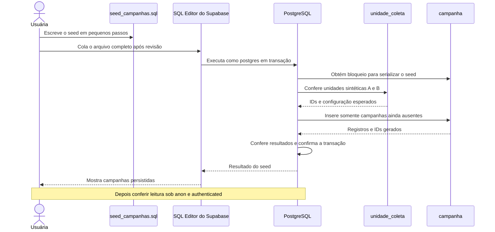

# Seed mínimo de campanhas — etapa iniciada em 15/10/2026

## Estado e objetivo

Esquema, permissões e testes SQL de campanha concluídos; commit/push `13e0ead62a83fe112687d2bfc483c0b496f40a22`. Na retomada, main estava limpa. Última conferência remota: 2 unidades, 3 horários, 1 perfil, 1 agendamento, 0 eventos, 0 campanhas, total de sete registros; original 23 agendado com dados conhecidos conferidos.

A usuária concordou em prosseguir com um seed mínimo de três campanhas sintéticas. O agente orienta/revisa; a usuária escreve `supabase/seed_campanhas.sql`, separado do seed existente de unidades. Nenhum seed de campanhas foi criado/aplicado nesta preparação documental. A integração Android continua pendente: este diagrama mostra execução manual de SQL, sem ViewModel ou repository intermediando.

## Sequência proposta

## Participantes e arquivos

| Participante | Responsabilidade |
| --- | --- |
| Usuária/arquivo | Escrever `supabase/seed_campanhas.sql` em tutoria; não executar o rascunho incompleto. |
| SQL Editor | Execução manual como postgres no mesmo desenvolvimento acadêmico, somente após revisão/orientação. Não usar db reset/push. |
| PostgreSQL | Transação, bloqueio da tabela para serializar o seed, validação de pré-condições e constraints existentes. |
| unidade_coleta | Reutilizar Demo A publicada e Demo B oculta, sem criar, editar ou excluir unidades. Conferir identidade/configuração sem depender de IDs fixos. |
| campanha | Receber três registros sintéticos com fonte identificada, sem alterar linhas existentes. |
| Testes futuros | Roteiros em `supabase/tests` para conferência administrativa, leitura por papel e repetição controlada. Ainda não preparados/executados. |

## Recorte proposto

| Registro | Unidade | Publicação da campanha | Leitura por anon/authenticated |
| --- | --- | --- | --- |
| Incentivo sintético | Demo A publicada | true | Visível |
| Rascunho sintético | Demo A publicada | false | Oculto |
| Divulgação sintética | Demo B oculta | true | Oculto |

- As campanhas permanecerão no banco após COMMIT, diferentemente das fixtures dos testes anteriores em ROLLBACK. Não geram agendamento, coleta ou alteração de estoque.
- Fonte identificará a demonstração acadêmica. Período de exemplo proposto: 15/10/2026 até 01/12/2026, interpretado no fuso da unidade, cobrindo a apresentação de 25/11; não expressa regra médica. Os valores serão explicados antes do trecho correspondente.
- Repetir o mesmo roteiro deverá preservar os registros existentes. Proposta: bloqueio SHARE ROW EXCLUSIVE durante a transação e INSERT apenas quando unidade/título/fonte sintética ainda não existirem, sem UPDATE/DELETE nem nova restrição de unicidade para campanhas reais. Não é garantia de unicidade geral do domínio.
- Validar existência/configuração das duas unidades antes das inserções; ausência/duplicidade ou dados diferentes devem interromper a transação. Preservar integralmente a reserva original 23 e os demais dados.
- Se forem inseridas três campanhas e nada mais mudar, o domínio terá dez registros. A meta de 200 registros e sua distribuição permanecem pendentes; este seed mínimo não substitui a massa final.

## Primeiro passo

Orientar somente a criação do arquivo com BEGIN, bloqueio da tabela e COMMIT. Inserções, pré-condições e conferências serão acrescentadas nos próximos passos. Não executar até o arquivo estar completo/revisado. Nesta preparação, somente documentação foi alterada; não houve SQL remoto, criação automática de produção ou repetição de testes Android.
