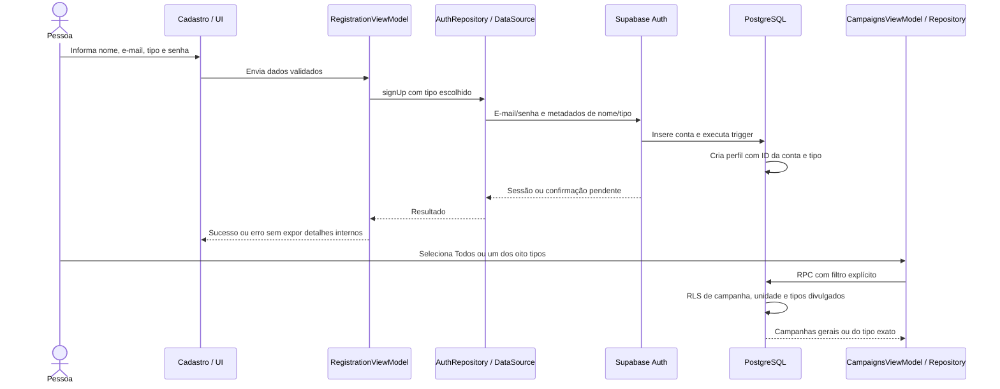

# Tipo sanguíneo no cadastro e filtro de campanhas — 15/10/2026

## Autorização e escopo

Exceção posterior autorizada pela usuária para o teste real: usar seu e-mail de acesso ao Supabase somente no Auth, mantendo nome Doador Demo C e tipo Não sei no perfil. O endereço não deve ser solicitado no chat nem registrado em código/docs/logs. A escolha ocorreu após rejeição do endereço em example.com pelo signup; não amplia autorização para outros dados pessoais ou configurações remotas. Não pedir autorização de novo; conferir resultado da nova tentativa em tutoria.

A usuária pediu explicitamente que o agente implemente diretamente esta alteração e depois retome a tutoria. A exceção vale para tipo sanguíneo no cadastro/perfil e filtro de campanhas, incluindo a conexão do cadastro e da leitura hoje visuais. A usuária aprovou a opção explícita “Não sei”. Não autoriza funcionalidades médicas, confirmação de coleta, filtro público de doadores ou alteração dos agendamentos. O seed guiado em `supabase/seed_campanhas.sql` permanece preservado/incompleto e sem execução remota.

Antes de código de produção, o fluxo abaixo foi apresentado à usuária. Migração/código/testes serão preparados localmente; aplicação no Supabase e testes reais ainda precisam da execução orientada pela usuária. Não reaplicar migrações antigas. Preservar a reserva original 23.

## Diagrama proposto

## Decisões técnicas

- Tipo autodeclarado: oito opções ABO/Rh e NAO_SEI. Não calcula compatibilidade, aptidão ou estoque. Contas antigas ficam como Não sei, sem inventar tipagem.
- O cadastro precisa selecionar uma opção, incluindo Não sei. Senha fica somente no campo local e durante a requisição; não vai para navegação, metadados, perfil, SavedStateHandle ou logs.
- Perfil criado por trigger após INSERT no Auth usando somente ID da nova conta e campos permitidos. Isso funciona mesmo quando confirmação de e-mail impede sessão imediata e evita conta criada sem perfil por falha de uma segunda requisição. Metadados não dão privilégios nem definem o dono; o ID vem do Auth. Contas administrativas sem metadados do cadastro continuam compatíveis com a recuperação existente de perfil.
- RLS existente do perfil permanece própria; acrescentar privilégios por coluna para o tipo, sem permitir mudar ID/dono. Exibir e permitir atualização do próprio tipo no perfil, inclusive para contas antigas.
- Relação N:M de campanha com tipos divulgados em tabela associativa; campanha sem vínculos é geral. Filtro manual Todos/oito tipos, incluindo campanhas gerais em todos os filtros. Não usar regras de compatibilidade nem inferir tipo de um doador por uma campanha.
- A PK composta impede repetir o mesmo tipo na campanha. ON DELETE CASCADE remove somente seus vínculos quando uma campanha é excluída administrativamente; não apaga unidades, perfis ou reservas. O tipo é um enum do PostgreSQL, não uma tabela adicional nem uma FK fictícia.
- Consulta pública via RPC SECURITY INVOKER, respeitando RLS e publicação da campanha/unidade. Campanhas e detalhes passam a mostrar dados retornados, com carregamento/erro/vazio. Rotas visuais antigas continuam separadas.
- Campos visuais de cadastro sem persistência (telefone/nascimento/histórico) não serão apresentados como salvos. O fluxo funcional usará nome/e-mail, tipo, revisão e senha; não acrescentar dados pessoais sem uso.

## Regra adicional aprovada — mensagens de erro

Em 15/10/2026, a usuária pediu registrar que validações e tratamento de falhas devem distinguir erros conhecidos e orientar sua resolução. Prioridade: cadastro/login. **Requisito aprovado, implementação pendente.** O cadastro/login ainda usa fallback genérico para falhas do repository; não considerar esta regra atendida pelos testes anteriores.

| Situação identificada | Mensagem proposta para a pessoa |
|---|---|
| E-mail inválido localmente | Informe um e-mail válido. |
| email_address_invalid retornado pelo Auth | Este endereço de e-mail não é aceito. Use outro endereço válido. |
| email_not_confirmed | Confirme seu e-mail pelo link recebido antes de entrar. |
| invalid_credentials | E-mail ou senha incorretos. |
| Limite de tentativas ou envio atingido | Muitas tentativas. Aguarde um pouco e tente novamente. |
| Falha de conexão identificada | Não foi possível conectar. Verifique sua conexão e tente novamente. |
| Falha desconhecida | Mensagem geral da operação e nova tentativa, sem detalhes internos. |

Os códigos de autenticação foram conferidos na [referência oficial do Supabase](https://supabase.com/docs/guides/auth/debugging/error-codes). Os textos acima são propostas de UI em português; não exibir o HTTP/erro técnico bruto. HTTP 400 não diferencia endereço inválido de confirmação pendente. Preservar informação estruturada da falha nas camadas, sem SDK na apresentação, e CancellationException como cancelamento. Não inferir existência de conta indevidamente nem prometer reenvio de e-mail ainda não implementado. Testes focados devem cobrir causas distintas, mensagem/ação correspondente e fallback quando a implementação for guiada.

Esta anotação não confirma que a nova tentativa com o endereço autorizado foi concluída: a usuária citou “Email not confirmed” como exemplo da regra, sem ainda confirmar o resultado do cadastro.

## Ajuste visual do Perfil — solicitado para depois

Em 15/10/2026, após captura de Meu perfil, a usuária pediu que a tela apresente apenas o tipo sanguíneo escolhido. A grade com nove opções não deve permanecer aberta na visualização normal. **Ajuste aprovado para implementação futura em tutoria; produção ainda não alterada.**

Confirmado: mostrar valor persistido e disponibilizar as demais opções somente ao editar. Preservar edição própria/Não sei e as validações/gravação existentes. O formato do editor (seletor fechado, diálogo ou formulário) será definido na etapa de UI; botão Salvar restrito à edição é proposta de organização. O seletor explícito do cadastro continua necessário. Arquivos relacionados: ProfileContent.kt/BloodTypePicker e percurso de ProfileFlowTest. Começar a implementação futura pela visão/diagrama da interação, conforme regra de tutoria.

## Arquivos envolvidos

Domínio: BloodType, resultado do cadastro, Campaign e contratos Auth/Perfil/Campaign.
Dados: DTO/mapper do perfil/campanha, DataSources e repositories Supabase.
Apresentação: cadastro, perfil e campanhas em seus ViewModels/estados.
UI/navegação/DI: telas de cadastro, seletor de tipo, perfil, campanhas/detalhe e factories no AppContainer.
Banco: nova migração incremental para tipo, perfil/trigger, relação de campanhas e RPC; testes SQL em ROLLBACK. Sem ALTER das migrações já aplicadas, reset, seed ou operação remota automática.

## Estado inicial

Esquema de campanhas está aplicado/testado; último commit é 13e0ead. Cadastro e campanhas ainda visuais, perfil mínimo nome/ID. Base confirmada: seis tabelas/seis FKs do domínio, sete registros, reserva 23 preservada. A nova migração ainda não foi aplicada; testes/código desta alteração ainda não executados.

## Implementação local

- Cadastro funcional em quatro passos: nome/e-mail, tipo obrigatório (incluindo Não sei), revisão, senha/confirmação. Compartilha RegistrationViewModel dentro do grafo Auth; senha somente na memória da tela/requisição. Validação e bloqueio de envios/Voltar durante a resposta; resultado com sessão abre Main, sem sessão mostra orientação de confirmação e retorno ao login. Recuperação de senha e Google continuam visuais.
- `BloodType`, `RegistrationResult`, `Campaign` e contratos independentes da UI. Repositories Supabase preservam CancellationException; DTOs/mapper traduzem nomes SQL, enum e instantes. AppContainer fornece factories sem NavController nos ViewModels.
- Perfil mostra tipo persistido e permite salvar a própria alteração. Tipo antigo recebe NAO_SEI no banco; a UI não inventa tipagem. Falha mantém seleção para nova tentativa; ID e demais campos não são enviados no UPDATE.
- O antigo formulário visual Editar perfil não anuncia mais O+ fixo: orienta atualizar o tipo na tela Perfil, onde ocorre a gravação real. Os demais campos desse protótipo continuam fora deste recorte.
- Lista funcional em Campanhas: Todos/oito tipos, gerais incluídas, carregamento/erro/nova tentativa/vazio, detalhe vinculado ao ID retornado e data no fuso da unidade. Troca de filtro cancela a consulta anterior e descarta resposta tardia. Detalhe reutiliza a consulta pública e busca o ID na lista permitida; não cria uma segunda RPC. A prévia fixa da Home e rotas de protótipo continuam separadas e não são fonte de dados desta lista.
- Migração incremental `20261015000200_tipo_sanguineo_cadastro_campanhas.sql`: enum, coluna do perfil, trigger de cadastro, tabela associativa com PK composta/FK/CHECK/RLS e RPC invoker. A transação que cria a conta também cria seu perfil; uma falha no trigger impede concluir o cadastro. Contas criadas administrativamente sem nome nos metadados continuam com recuperação de perfil. Metadados posteriores não sincronizam o perfil: ele é a fonte persistente utilizada pelo app.
- Uma campanha pode divulgar vários tipos, um tipo pode aparecer em várias campanhas. Sem vínculos significa geral. Não há tipo “Não sei” como alvo de campanha. A publicação administrativa continua necessária; campanhas com unidade não publicada permanecem ocultas.

## Banco remoto e retomada guiada

Validação real concluída neste cenário: cadastro/perfil automático de C, atualização O+ sintética/releitura e retorno a Não sei confirmados pela usuária. Captura final administrativa confirma oito registros (2 unidades/3 horários/2 perfis/1 reserva, zero eventos/campanhas/vínculos), C=NAO_SEI/confirmado/dados=true e 23 agendada/dados=true. Sem inspeção de JWT/tráfego/falhas. Filtro real no Android ainda depende do seed guiado de campanhas; mensagens específicas e visual ficam como melhorias futuras. Commit/push deste marco autorizados pela usuária em 15/10/2026; conferir resultado no Git ao retomar.

Validação Android local: nove testes locais e 68 instrumentados aprovados, zero falhas/erros; um remoto ignorado. Conferência nos XML, com repositories fictícios e sem HTTP. Detalhes/cenários e intercorrências em [validação](12-validacao.md); estado de retomada em [checkpoint](checkpoints/2026-10-15-tipo-sanguineo.md).

**Migração aplicada manualmente pela usuária**, com relato de sucesso e capturas da coluna/default, RLS, funções/EXECUTE, trigger, grants, constraints e policies. O final de CASCADE ficou parcialmente cortado na captura de constraints. Agora são sete tabelas/sete FKs do domínio, além da FK perfil→Auth; enum e funções não são tabelas. Última contagem global continua a anterior (sete registros), sem nova conferência. Testes comportamentais/trigger real/API ainda pendentes. Não executar db push/reset, reaplicar migrações nem executar o seed incompleto.

1. Aplicação da décima migração e conferências de configuração realizadas. Não repetir automaticamente.
2. `campanha_filtro_tipo.sql` e `perfil_tipo_sanguineo_isolamento.sql` concluídos por capturas, em ROLLBACK e com papéis simulados, sem JWT/login nem criação de Auth. Conferência final também concluída por captura: total sete registros, perfil A=NAO_SEI e 23 agendada/dados conhecidos=true; linha de unidades cortada, duas inferidas pelo total. Zero campanhas/vínculos/eventos, 3 horários/1 perfil/1 reserva. Não repetir automaticamente os testes aprovados. Recorte SQL fechado, próximo passo é cadastro real guiado.
3. Roteiro real guiado: cadastrar uma conta sintética nova pelo app com Não sei, conferir por consulta administrativa que conta e perfil nasceram com o mesmo ID/nome/tipo, conferir ausência de senha no domínio e distinguir confirmação pendente de sessão disponível. Repetir com tipo conhecido se necessário. Não versionar endereço de pessoa real, senha, token ou segredo. Não afirmar envio/recebimento de e-mail apenas pela tela de sucesso. Mudança do próprio tipo e leitura isolada A/B pela API ainda precisam de teste real neste recorte.

   Resultado: endereço autorizado somente no Auth; perfil automático confirmado sem Criar perfil. Edição para O+ sintético persistiu ao reabrir e retorno a Não sei foi confirmado, incluindo consulta final. Massa atual oito registros conforme captura; a contagem sete era anterior a C. Metadados Auth mantêm valores iniciais e podem divergir de edições próprias; após restauração para Não sei, dados de C conferem. Sem inspeção de JWT/tráfego.

   Conferir também as configurações do Auth para a política prevista de senha (mínimo de oito caracteres, maiúscula, minúscula, número e símbolo), envio e confirmação de e-mail. A validação da UI está implementada; não comprova por si só a política do servidor. Redirecionamento/deep link de confirmação no Android e reenvio de e-mail não foram implementados nesta alteração.
4. Retomar o seed guiado preservado. Completar as três campanhas e os vínculos sintéticos em pequenos passos; testar repetição e então filtro real/lista/detalhe. A massa de 200 registros, demais etapas e conta do professor continuam pendentes.

Não há servidor PostgreSQL local disponível nesta sessão; os SQLs foram preparados/revisados e não tiveram execução comprovada. A compilação/testes Android em memória não substituem a validação da migração, do trigger nem da API.

## Referências técnicas

- [Supabase — Managing user data](https://supabase.com/docs/guides/auth/managing-user-data): perfil referenciando Auth e criação por trigger com metadados; falhas do trigger podem bloquear signup.
- [PostgreSQL — CREATE TRIGGER](https://www.postgresql.org/docs/current/sql-createtrigger.html): evento AFTER INSERT/FOR EACH ROW e função de trigger.
- SDK Auth Kotlin 3.6.0 consultado no sources.jar local: Email.Config.data e signUpWith; sessão presente e confirmação pendente tratados separadamente.
