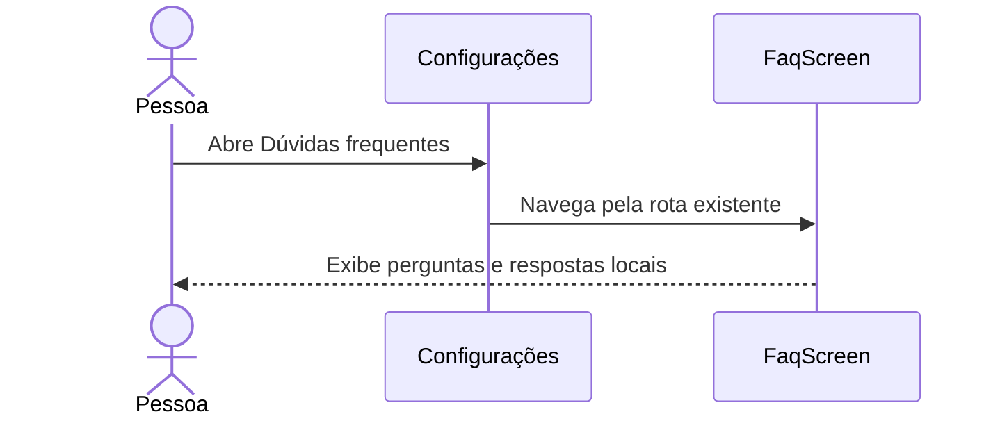

# FAQ informativo — 15/10/2026

## Autorização e escopo

A usuária pediu explicitamente que o agente implemente o FAQ e autorizou conteúdo estático/ajustes visuais simples sem nova funcionalidade, camada ou conceito. Preferência registrada no AGENTS.md; demais funcionalidades continuam em tutoria. Implementado somente FaqScreen em ProfileScreens.kt, mantendo rota, assinatura e navegação existentes. Não há ViewModel/repository/tabela novos nem operações remotas.

Fluxo apresentado antes da alteração:

## Conteúdo implementado

Nove perguntas com respostas visíveis em cartões no DsScreen já rolável: triagem/aptidão, duração geral, frequência sem cadência universal, preparo sem jejum, distinção entre agendamento e doação, cancelamento antes do início, consulta de registros/histórico demonstrativo, Não sei no cadastro/perfil e filtro de campanhas. Retiradas as setas que sugeriam abertura de respostas sem ação. Fonte e data de revisão aparecem na tela.

Conteúdo clínico apenas informativo, sem cálculo de aptidão, intervalos automáticos ou critérios novos. Explicita o ambiente acadêmico e distingue histórico visual de coletas comprovadas. Fluxos de cancelamento/campanhas/perfil descritos conforme a implementação já validada. Não promete mapa, notificações, reenvio de confirmação ou recuperação de senha.

## Fontes primárias conferidas em 15/10/2026

- [Ministério da Saúde — duração do atendimento](https://www.gov.br/saude/pt-br/composicao/saes/doacao-de-sangue/faq/quanto-tempo-dura-a-doacao): estimativa de cerca de 40 minutos para o processo completo; não é garantia de duração individual.
- [Ministério da Saúde — preparo e jejum](https://www.gov.br/saude/pt-br/composicao/saes/doacao-de-sangue/faq/e-necessario-estar-em-jejum-1): estar alimentado e descansado.
- [Hemocentro Unicamp — critérios e etapas](https://www.hemocentro.unicamp.br/perguntas-frequentes/criterios-para-doacao-de-sangue/): avaliação pela equipe e distinção entre tipos de doação. Não foram copiados prazos individuais ou tabelas de aptidão.
- Conteúdo já revisado em docs/16 e RestrictionContent.kt como referência de linguagem e limites.

## Validação

Alteração reversível de conteúdo/UI sem mudança de fluxo ou assinatura: nenhum teste novo que apenas repita os textos. `assembleDebug lintDebug --offline --console=plain` aprovado; relatório XML confirma zero erros e 31 avisos, sem aumento da contagem. `git diff --check` sem erro. Layout usa os cartões, tipografia e rolagem existentes; sem nova validação visual no emulador nesta execução. Nenhuma nova execução no Supabase; nenhuma mudança nos demais itens do inventário. F16 concluído nesse recorte; commit/push deste conjunto ainda não solicitados.
