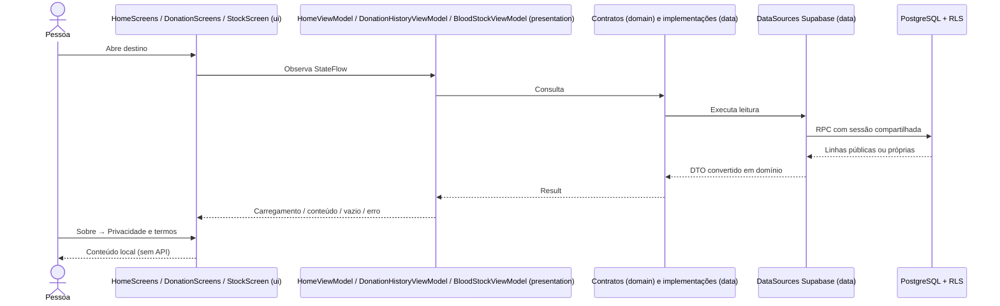

# Home, estoque, histórico e privacidade — 15/10/2026

## Autorizado e confirmado

A usuária delegou diretamente F18, F01, F11 e F12. Autorizou níveis Estável/Alerta/Crítico e registros de doação fictícios publicados manualmente no Supabase. O doador apenas consulta: não confirma coleta nem modifica estoque. Nenhuma alteração remota está autorizada por este recorte; preparar migração/seed/testes locais e orientar aplicação manual. Preservar reserva 23 e perfis existentes.

## Fluxo existente e proposto antes da implementação

Existente: perfil, reservas e campanhas já têm repositories/API; Home não os consome. Histórico e estoque são fixos na UI. Sobre tem um link sem ação.

Proposto: Home consulta os repositories existentes e o novo estoque; histórico tem consulta privada independente. Privacidade é conteúdo local acessível por Sobre. Respostas independentes na Home evitam que uma falha esconda as outras seções.

## Decisões

- Próximo agendamento: menor início futuro com estado agendado. Não equivale a doação nem aptidão.
- Campanhas na Home usam a mesma política da listagem existente; não introduzir filtro temporal novo silenciosamente.
- Estoque: um nível manual por unidade/tipo conhecido, fonte e instante. Leitura pública somente para unidade publicada. Sem quantidades, limiares clínicos, localização inferida ou atualização automática por reserva.
- Histórico: registro sintético por doador/unidade/instante, fonte e referência única de publicação. Total calculado da lista própria, sem inferência a partir de agendamento. Consulta mantém registros próprios mesmo se a unidade ficar oculta, sem expor histórico alheio.
- Ambas as tabelas são explicitamente de demonstração. Escrita e sequência negadas aos papéis do aplicativo. Nenhum trigger liga reserva, histórico e estoque.
- Privacidade descreve o protótipo e seus limites; não promete exclusão, contato ou política operacional ainda não implementados.

## Estado e validação

Implementação concluída. Usuária aplicou manualmente a migração e o seed, repetido sem divergência; não reaplicar a migração. Capturas confirmam integridade, escrita/sequência bloqueadas, leitura administrativa isolada A=2/C=1, visitante/identidade ausente bloqueados, RLS nas duas tabelas e funções STABLE/search_path vazio (estoque invoker; histórico definer). Conferência independente: estoque=16, histórico=3, A=2, C=1, reserva 23 agendada/dados=true. SQL deste recorte concluído; meta acadêmica de 200 e contagem global atual continuam pendentes.

Validação local anterior: 27 testes JVM e 32 instrumentados aprovados, SQL PostgreSQL/PGlite isolado aprovado. Redesenho posterior da Home aprovado no Figma, com 32 instrumentados e repetição dos 12 de Home aprovados; fontes e acessos revisados, detalhes em docs/30. APKs/Lint aprovados (zero erros/32 avisos).

Na conferência Android real, estoque falhou como A/C por Instant.parse rejeitar +00:00 no Android/desugaring. Causa reproduzida por teste Android offline e chamada SDK real, corrigida em ambos os mappers usando OffsetDateTime. Após correção: seis testes locais e dois Android aprovados, um deles consulta real de oito tipos só da Demo A; APKs/Lint aprovados. Nenhuma escrita remota pelo agente. Usuária confirmou o funcionamento após a correção e autorizou encerrar com commit do conjunto. Histórico A/C pela UI e estoque de A após a correção ficam para a retomada, sem exigir novos dados nem repetir os testes SQL. Evidências/limites em docs/12; checkpoint em docs/checkpoints/2026-10-15-home-estoque-historico.md. Push novo não solicitado.

## Arquivos e responsabilidades

- `domain/model/BloodStock.kt`, `DonationRecord.kt` e contratos correspondentes: dados e operações de consulta, sem SDK/UI.
- `data/supabase`: DTOs, conversão de bigint/instante/fuso, DataSources RPC; repositories preservam CancellationException e retornam demais falhas em Result.
- `presentation/home`: quatro resultados independentes; próxima reserva futura ativa; consulta na entrada e no retorno ao destino. Fontes demo antigas permanecem separadas e não alimentam a nova Home.
- `presentation/stock` e `presentation/donations`: Loading/Loaded/Error, vazio representado pela lista vazia, bloqueio de requisições simultâneas e cancelamento ao sair.
- `HomeScreens`, `StockScreen`, `DonationScreens`: exibem estado e callbacks. Fonte/atualização/unidade no estoque; histórico próprio e total da lista recebida. Sem mutações de estoque/histórico pelo doador.
- `ProfileScreens`: Privacidade e termos local; versão real via BuildConfig; FAQ ajustado para histórico persistido fictício.
- `AppContainer`, `AppNavHost`, `MainNavGraph`, `AppRoute`, `DoeSangueApp`: injeção e navegação. Conclusão da reserva abre Home; atalho do Perfil abre lista própria; prévia de campanha/detalhe da próxima reserva passam IDs reais. HomeScheduled fica como redirecionamento de compatibilidade; protótipos antigos não foram apagados.

## Modelo e permissões novos

| Tabela | Chave e relações | Campos e integridade | Consulta pelo app |
| --- | --- | --- | --- |
| estoque_sangue | PK(unidade_id,tipo_sanguineo), FK unidade RESTRICT | Tipo conhecido; nível estavel/alerta/critico; fonte não vazia; atualizado_em; sintetico obrigatório=true | anon/authenticated: SELECT somente unidade publicada; RPC invoker |
| doacao_historico | PK identidade bigint, FK doador→perfil e unidade, ambas RESTRICT | ocorrido_em; fonte/referencia não vazias; referência única; sintetico=true; criado_em default now; índice doador/data/ID | Somente RPC authenticated, definer, auth.uid obrigatório e filtro próprio; escrita/leitura direta/sequência negadas |

Todas as funções são STABLE com search_path vazio; histórico não recebe doador por parâmetro e retorna apenas ID do registro, unidade, instante, fuso, fonte e marca sintética. Não há papel administrador no Android. Publicação é administrativa no painel. Novas relações: unidade 1:N níveis (um por tipo), perfil 1:N registros, unidade 1:N registros.

Esquema versionado com nove tabelas e dez FKs do domínio, além da FK perfil→Auth. Aplicação manual concluída; seed acrescentou 16 níveis (8 de unidade pública A e 8 de B oculta) e 3 registros (A=2, C=1), conferidos remotamente. Previsão de 33 registros totais se a base anterior de 14 estiver preservada. **Total global ainda não consultado independentemente.** Continua faltando a massa de 200 e sua distribuição final.

## Testes SQL locais executados

PostgreSQL 18.6 em memória / PGlite 0.5.10. Onze migrações carregadas em banco descartável; Auth mínimo simulado e fixtures próprias (não copia dados/contas reais). Seed executado duas vezes mantém IDs e contagens 16/3. Roteiros de integridade, escrita/sequência bloqueadas, leitura pública e isolamento A/C/identidade ausente/anon passaram. Conferência e configuração das funções passaram; fixture da reserva 23 preservada. Relatório: `app/build/reports/sql/estoque-historico.json`; runner versionado em `supabase/tests/local` e instruções em `supabase/README.md`.

O primeiro ensaio de integridade identificou que o PostgreSQL 18 devolve SQLSTATE 23001 para RESTRICT, em vez de 23503 nesse caso. O roteiro aceita ambos os bloqueios; nenhuma constraint foi relaxada. Duas falhas do runner (diretório temporário diferente no sandbox e exportação de package.json) foram corrigidas antes do resultado aprovado. Não são testes de JWT, Auth real, PostgREST ou configuração do Supabase; os mesmos roteiros e a verificação manual Android continuam pendentes no ambiente remoto.

## Roteiro de referência e conferências restantes

Aplicação/seed/repetição/testes SQL da ordem em `supabase/README.md` já concluídos; não reaplicar a migração neste banco. Na retomada, conferir no app A: estoque 8 públicos e histórico 2 (inclui unidade histórica oculta). Sair e entrar como C: histórico 1, sem registros de A. C sem reserva futura deve ver convite para agendar. Conferência real de campanhas/privacidade pode complementar o percurso; testes em memória já cobrem os acessos. Não cancelar 23 para testar. A publicação de estoque/histórico não comprova coleta real nem aptidão.

Limites: testes em memória não medem tráfego/autenticação real; a listagem simples ainda não tem paginação para massas acima do limite de resposta da API. A contagem exibida corresponde à lista recebida; para massas que excedam o limite configurado no servidor será necessário paginar e consultar o total no servidor. Política operacional de privacidade (responsável/canal/retenção/exclusão) e demais IDs permanecem pendentes.
