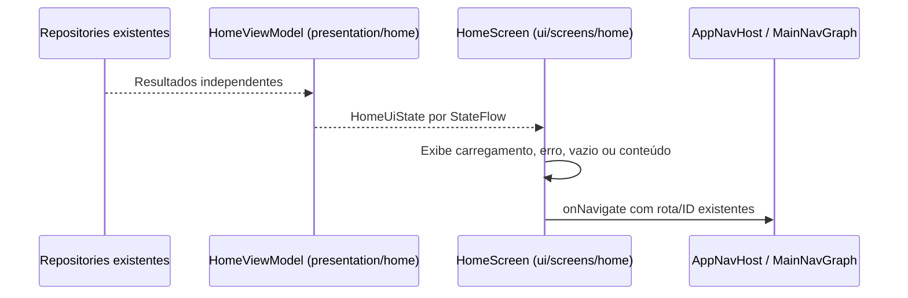

# Home aprovada no Figma → Compose — 15/10/2026

A usuária aprovou a proposta e pediu implementação direta. Referência: [Home no Figma](https://www.figma.com/design/OyI66BkEa9qPpGZ1mNJIWj?node-id=33-56), contexto de desenho e screenshot obtidos antes da edição. Escopo: apresentação da Home e sua barra inferior; preservar fontes, dados, rotas, estados e regras existentes. Migração/seed estavam pendentes no momento do redesenho; aplicação e testes SQL foram concluídos depois pela usuária, conforme docs/28 e docs/12. O redesenho não fez escrita remota.

## Fluxo existente, preservado

Nenhuma consulta ou regra de negócio foi acrescentada. Organização implementada: um botão Agendar doação; reserva existente em cartão clicável; preparo em faixa informativa; estoque agrupado por unidade, em indicadores compactos; campanha em prévia ilustrada; acesso ao histórico pela barra Doações. Estados de erro/vazio continuam funcionais. Dados de nome/reserva/estoque/campanhas permanecem dinâmicos; os exemplos fixos do Figma não foram copiados.

## Adaptação à plataforma

Reutilizados DsScreen, PrimaryButton, Poppins e ilustrações figma_raw_4/figma_raw_6. Extensão opcional da barra inferior permite aplicar o desenho somente à Home. Android fornece status e gesto do sistema; hora/bateria fictícias não são desenhadas no app. Conteúdo central rolável, barra fixa, textos sem alturas rígidas. Cada unidade de estoque mantém identificação/fonte/atualização próprias, sem combinar dados de unidades diferentes em um indicador. Links secundários preservam área de toque mínima nativa, mesmo que ocupem mais altura que o desenho estático.

Ícones estáticos obtidos pelo get_design_context e baixados por curl conforme as instruções do conector; originais em docs/figma/inicio/assets. Conversão SVG→VectorDrawable pelo Svg2Vector do SDK Android já disponível localmente, sem dependência nova. Licença Lucide ISC, incluindo o aviso MIT dos ícones derivados de Feather, preservada nos assets do aplicativo e junto aos SVGs. A conversão muda somente o formato, mantendo paths/geometria e cores do asset aprovado.

## Validação

- Antes do redesenho: os 12 testes existentes da Home passaram. Após a primeira implementação: 32 testes instrumentados passaram (Home 12, navegação 10, criação 6, restrições 4), sem falhas/ignorados na saída do executor.
- Revisão visual identificou quebra de “Unidades” na fonte 1,5. Ajustadas as margens da barra nesse tamanho e o espaço entre títulos/links. Após o ajuste: 12 testes da Home passaram, com zero falhas/erros/ignorados conferidos no XML. Nenhuma nova operação de domínio foi acrescentada.
- Na primeira tentativa dessa repetição, o Android interrompeu a instrumentação por `keyDispatchingTimedOut`, aguardando foco por 5 segundos na ComponentActivity. Sem falha de asserção detalhada. Após encerrar somente o processo do aplicativo, a repetição sem mudança de código passou. Não tratar a tentativa interrompida como aprovação.
- `compileDebugKotlin`, `compileDebugAndroidTestKotlin`, `assembleDebug` e `lintDebug` aprovados. Lint: zero erros e 32 avisos. Diff sem erros de whitespace.
- Capturas sintéticas normal/rolada/fonte 1,5 em `captures/2026-10-15-home-design`, ignoradas pelo Git. Fontes, ilustrações FIT, nove vetores locais e respectivos tamanhos/call sites conferidos. Não houve teste com leitor de tela, todos os dispositivos ou sessão real para o estoque/histórico novo.
- O executor Gradle removeu APKs/imagens ao terminar a suíte. Para preservar a conferência visual final, instalados os mesmos APKs e repetido somente `homeUsesNameNearestFutureActiveBookingAndIdDetail` por instrumentação direta: `OK (1 test)`. Quatro capturas recuperadas e revisadas; barra com todos os rótulos legíveis e conteúdo ampliado sem sobreposição, com rolagem. Não houve outra mudança de produção depois das validações.

Fechamento posterior: migração/seed e roteiro SQL aplicados pela usuária. Parser de datas de estoque/histórico corrigido após falha real no Android; seis testes locais e dois Android aprovados, incluindo leitura pública real. Conferência visual do histórico A/C ainda pendente. Commit do conjunto autorizado no encerramento, sem novo push solicitado. Detalhes em docs/28 e docs/12.

## Arquivos do redesenho

- `ui/screens/home/HomeScreens.kt`: composição e estados existentes; `HomeContent.kt`: cabeçalho, ação principal e cartões; `HomeStockPreview.kt`: indicadores por unidade.
- `ui/screens/home/HomeBottomBar.kt` e `HomeStyle.kt`: navegação, ícones e estilos restritos à Home. Com fonte acima de 1,2, a barra reduz as margens para dar mais largura aos rótulos sem reduzir a fonte escolhida.
- `ui/components/DoeSangueComponents.kt`: parâmetro opcional para a barra da Home; demais chamadas preservam a barra anterior.
- Nove `res/drawable/home_ic_*.xml`, licença em `assets/licenses/lucide.txt` e originais SVG/licença em `docs/figma/inicio/assets`.
- `HomeReadFlowTest.kt` e `DonationRestrictionsTest.kt`: seletores dos cartões/acessos, comportamento existente e capturas normal/rolada/com fonte 1,5.

Nenhum arquivo de domínio, repository, ViewModel, rota, migração ou seed foi alterado por este redesenho. Alterações anteriores dessas áreas no working tree pertencem ao recorte funcional de docs/28.
