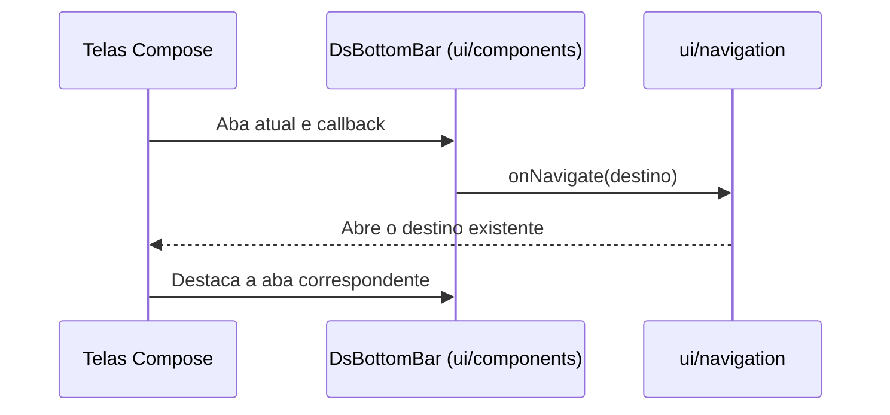

# Barra inferior compartilhada — 16/10/2026

Usuária solicitou correção direta: aplicar o visual aprovado da barra da Home às demais telas. Escopo apenas visual, incluindo identificação da aba selecionada; sem novas rotas, camadas, regras ou consultas. F02/F03 foram escolhidos como próxima etapa funcional, depois deste ajuste, em tutoria.

## Antes e proposta apresentada

Antes: HomeScreen usa HomeBottomBar por override de DsScreen; demais telas usam DsBottomBar antigo, com símbolos de texto. Proposta: mover a implementação aprovada para ui/components/DsBottomBar.kt, recebendo a aba atual. Home passa a usar o mesmo componente padrão. Ícones vetoriais, dimensões, fonte Poppins, fundo e adaptação da margem com fonte ampliada são preservados. Ícone e rótulo acompanham a seleção atual; Doações também selecionada em Agendamentos, como antes.

Telas sem barra continuam sem barra. Configurações preserva o callback que impede navegação durante logout; navegação permanece fora dos ViewModels. Não modificar os dados fixos de Unidades antes da etapa didática F02/F03 nem o restante do layout dessas telas.

## Arquivos e validação

Diretamente relacionados: HomeBottomBar.kt (origem), ui/components/DsBottomBar.kt (destino compartilhado), DoeSangueComponents.kt (remove implementação anterior) e HomeScreens.kt (usa barra padrão). Resources home_ic_* já existentes são reutilizados; sem nova dependência ou alteração remota no Figma.

Implementado: DsBottomBar único em ui/components, sem dependência de estilos da tela Home. A assinatura pública anterior foi preservada. Home usa a barra padrão de DsScreen; o override opcional de DsScreen permanece compatível. Ícones e rótulos recebem a cor da seleção atual; grupo de seleção e papel de aba expõem o estado às tecnologias de assistência.

- Antes da edição: dez AppNavigationTest aprovados no Moto g04/Android 14.
- Após a edição: `assembleDebug assembleDebugAndroidTest lintDebug --offline --console=plain` aprovados. XML de Lint: zero erros/20 avisos.
- Instrumentação direta no mesmo aparelho: dez AppNavigationTest, cinco LogoutFlowTest e um percurso de HomeReadFlowTest aprovados (`OK (16 tests)`, 84,623 s). Repositories fictícios, sem rede nem gravação remota. Teste existente ampliado para exigir exatamente a aba esperada selecionada em cada raiz, retorno à Home e seleção de Doações em Agendamentos; mantém verificações de histórico de navegação.
- Capturas das cinco abas e Agendamentos em `captures/2026-10-16-barra-inferior` (ignoradas pelo Git). Revisão de Unidades/Perfil/Doações/Agendar e fonte 1,5 da Home: ícones, rótulos e destaque corretos, sem sobreposição. Dados fixos da aba Unidades e grade de tipos do Perfil continuam fora do escopo deste ajuste.
- APK atualizado instalado por `adb install -r`, preservando dados; sem remoção da instalação. Diff sem erros de whitespace. Não repetidos SQL ou testes remotos. Não houve novo commit/push solicitado.

Próxima etapa funcional escolhida: F02/F03 (unidades e busca), com diagrama próprio antes da implementação guiada. Nenhum código dessas funcionalidades foi implementado automaticamente a partir desta correção visual.
