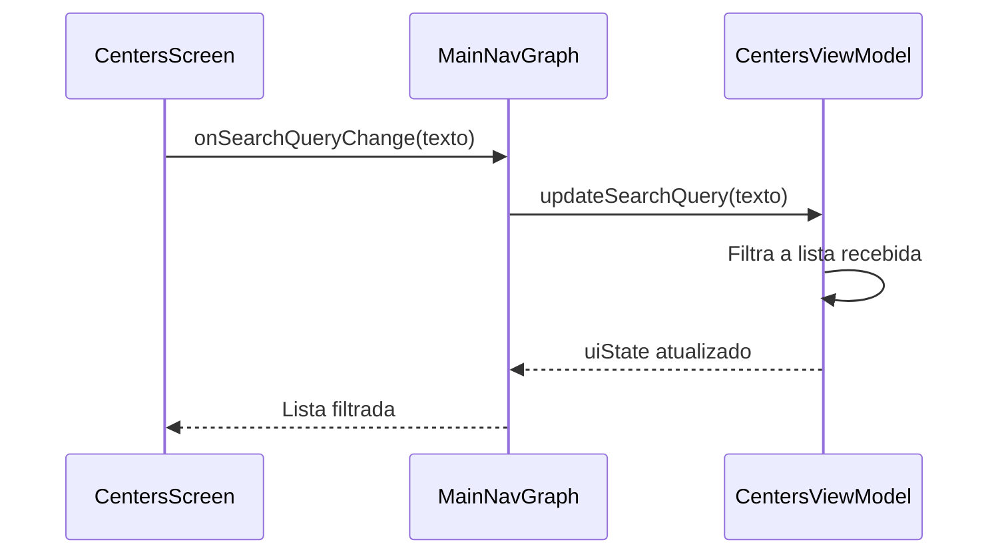
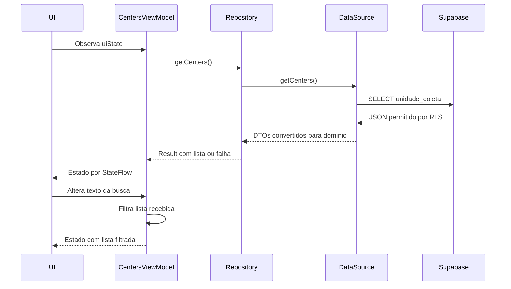
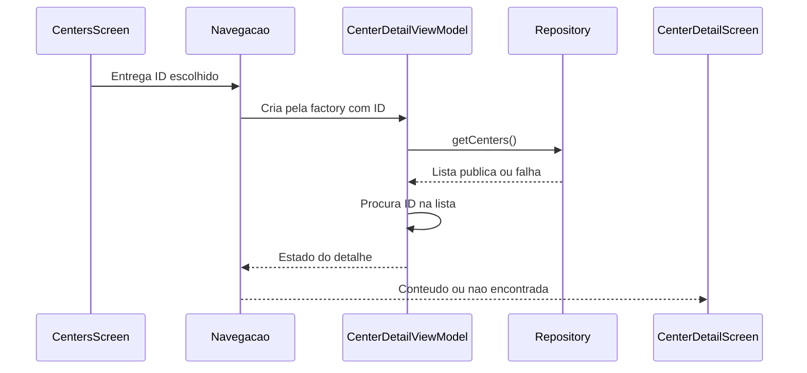

# Unidades: lista, detalhe e busca — etapa iniciada em 16/10/2026

## Fechamento em 16/10/2026

F02/F03 implementados pela usuária e conferidos: lista pública, detalhe por ID/retorno e busca local por nome/cidade. Usuária confirmou o roteiro final da busca (correspondência, termo sem resultado e limpeza recuperando a lista). Evidência manual por relato, sem novas capturas/inspeção HTTP/JWT. Última execução: 13 testes de lista/detalhe/busca aprovados em 62,253 s, APKs/Lint aprovados (zero erros/20 avisos); dez testes de navegação já aprovados no recorte do detalhe. Sem repetir testes/SQL por esta confirmação. Somente documentação atualizada neste fechamento, sem novo commit/push ou implementação de backlog. Seções abaixo conservam passos e propostas históricas da tutoria. Limites: catálogo retornado pela API, filtro local sem pesquisa SQL/paginação; mapa/distâncias e pré-seleção no agendamento fora do escopo.

## Confirmado e existente

Atualização de 16/10: lista real confirmada pela usuária conforme roteiro, somente Demo A com cidade/endereço e Demo B ausente. Evidência por relato, sem nova captura/inspeção de requisição ou JWT. Os itens abaixo registram o estado inicial da etapa; lista/estados já implementados e validados, detalhe por ID e busca continuam propostos. Próximo passo orientado: acrescentar CenterDetailById(centerId: String) em AppRoute.kt, conservando a rota antiga durante a construção do novo percurso.

Usuária escolheu F02/F03 após concluir estoque/histórico e corrigir a barra inferior. Retomar tutoria: usuária escreve produção, agente orienta/revisa um passo por resposta. Somente documentação produzida nesta preparação.

- DonationCenter, DonationCenterRepository.getCenters(), SupabaseDonationCenterRepository, DataSource/DTO/mapper e injeção no AppContainer já existem e alimentam o agendamento. Não criar cópias nem refazer o banco.
- RLS/grants de unidade_coleta já limitam leitura a unidades publicadas; escrita operacional não pertence ao doador.
- CentersScreen e CenterDetailScreen ainda usam textos fixos. CenterDetail é rota sem ID; busca é VisualField sem entrada funcional. Isso não é consulta real nessa aba.
- Barra compartilhada em DsBottomBar já concluída e validada; preservar.

## Proposto para esta etapa

Ligar a aba ao repository existente, com estado/ViewModel próprios, carregamento/erro/nova tentativa/vazio e lista de DonationCenter. Na sequência, abrir detalhe por ID e consultar novamente o catálogo público pelo mesmo contrato; ID ausente ou unidade despublicada resultam em não encontrada, sem dados fixos substitutos. Factories ficam em AppContainer; coleta de estado/roteamento em ui/navigation. ViewModels não recebem NavController nem componentes Compose.

Busca inicial por nome ou cidade sobre a lista recebida, no dispositivo, com texto preservado ao filtrar/repetir consulta. Evita uma chamada por tecla e mantém o contrato usado no agendamento. Planejar comparação sem diferenciar caixa/acentos e espaços externos, em função de filtro sem efeitos colaterais. **Não é busca SQL nem paginação do catálogo completo**: limita-se aos registros retornados pela API. Se a massa de unidades exceder o limite do servidor, será necessário paginação/busca remota em etapa própria; não afirmar completude além desse limite. Não alterar consulta compartilhada nem regras de disponibilidade do agendamento silenciosamente.

F04 (mapa/distâncias) e T05 (pré-seleção de unidade no agendamento) continuam fora do recorte. Remover distâncias literais e indicação de atendimento não fornecida pelo modelo quando substituir os dados fixos. Não oferecer clique de mapa sem ação. O acesso ao agendamento continua abrindo a escolha existente; rótulo deve ser “Agendar doação” enquanto não houver pré-seleção. Campos opcionais vazios recebem texto de ausência, sem inventar telefone/horário/serviço. horario_atendimento é apenas descrição, não agenda estruturada.

## Sequência proposta: carregar e buscar

Progresso F03: cache, normalização/filtro, atualização do estado, callback e campo de busca escritos pela usuária e conferidos. Nome OU cidade, sem diferenciar caixa/acentos/espaços externos; busca vazia restaura a lista recebida. Campo antes dos estados permanece editável em carregamento/erro/vazio; mensagem específica de nenhum resultado. Agente ampliou somente testes/docs: APKs aprovados em 8 s, Lint em 32 s (zero erros/20 avisos), OK (13 tests) em 62,253 s no Moto g04/Android 14. Quatro casos novos mais nove existentes de lista/detalhe; fakes/sem rede. Cobrem normalização/nome/cidade/limpeza sem novas leituras, retorno preservando filtro, texto durante carregamento e erro/nova tentativa com texto/catálogo mais recentes. Conferência manual da busca real ainda pendente. Próximo passo: buscar parte do nome/cidade, termo inexistente e limpar para recuperar a lista. Limites de catálogo/paginação e restauração já descritos continuam válidos.

Conferência posterior em 16/10: usuária confirmou o percurso real do detalhe Demo A e retorno à lista conforme roteiro, por relato sem captura/inspeção de tráfego. F02 concluído nesse recorte. F03 iniciado em tutoria: primeira orientação é guardar allCenters no ViewModel e preenchê-lo no sucesso, para filtrar sempre a lista original recebida e permitir limpar a busca. Entrada/filtro ainda propostos; comparação por nome/cidade sem distinguir caixa/acentos e espaços externos, limitada ao catálogo retornado.

Fluxo proposto da digitação (consulta inicial já implementada):

UI representa CentersScreen e a coleta/callbacks em MainNavGraph. Na criação pela factory, CentersViewModel inicia a consulta. A parte Repository → Supabase já existe; UI/ViewModel da aba e filtro serão implementados pela usuária.

## Sequência proposta: detalhe pelo ID

Progresso em 16/10: CenterDetailById(centerId: String) escrita pela usuária e conferida com @Serializable, preservando CenterDetail. Próximo passo orientado: criar presentation/centers/CenterDetailUiState.kt com Loading/Loaded/NotFound/Error, seguindo o padrão de detalhe de agendamento. Clique ainda aponta ao protótipo; só mudar para a nova rota quando o destino estiver registrado. Nenhuma nova execução de testes nesta revisão da declaração da rota.

Atualização posterior: CenterDetailUiState criado pela usuária e conferido, com Loading/Loaded(DonationCenter)/NotFound/Error. Próximo passo curto: estrutura de CenterDetailViewModel com repository/centerId pelo construtor, StateFlow e Job; operação de consulta será orientada depois. Sem teste novo para a declaração do estado.

Estrutura de CenterDetailViewModel conferida: construtor com repository/centerId, estado inicial Loading, StateFlow público e loadJob. Próximo passo orientado: init/loadCenter, consulta getCenters e localização por ID, distinguindo Loaded/NotFound/Error e preservando cancelamento com ensureActive. Sem ligação/factory/destino de detalhe ou nova validação comportamental até este ponto.

Consulta do detalhe conferida posteriormente: init/loadCenter, guarda pelo Job, getCenters, ensureActive, firstOrNull por centerId e estados Loaded/NotFound/Error. Usuária usou launch(...).also { loadJob = it }, equivalente à atribuição orientada. compileDebugKotlin --offline --console=plain aprovado em 16/10 (11 s), sem teste de comportamento/rede para o detalhe. Próximo passo orientado: centerDetailViewModelFactory(centerId: String) no AppContainer, usando donationCenterRepository. Destino e clique novos ainda pendentes.

## Arquivos e camadas

| Participante | Arquivos | Situação |
| --- | --- | --- |
| Modelo e contrato | domain/model/DonationCenter.kt; domain/repository/DonationCenterRepository.kt | Existentes, reutilizar |
| Repository e API | data/repository/SupabaseDonationCenterRepository.kt; data/supabase/SupabaseDonationCenterDataSource.kt; DTO/mapper de unidade | Existentes, reutilizar |
| Estado e coordenação | presentation/centers/CentersUiState.kt; CentersViewModel.kt; estados/ViewModel de detalhe | Propostos, usuária implementará |
| Lista/detalhe | ui/screens/centers/CenterScreens.kt | Substituir dados fixos pelos estados/callbacks |
| Composição e navegação | di/AppContainer.kt; ui/navigation/AppRoute.kt, MainNavGraph.kt e passagem das factories | Propostos; ID na rota, sem NavController no ViewModel |

## Ordem guiada e verificação

Checkpoint do detalhe: integração completa escrita pela usuária e conferida, incluindo onDetail(String), clique com center.id, CenterDetailById/toRoute, factory/estado/ViewModel/tela e callbacks. Protótipo antigo preservado. Agente adaptou dez chamadores de teste à factory do detalhe e ampliou CentersReadFlowTest com cinco cenários. APKs/Lint aprovados (zero erros/20 avisos); OK (19 tests) em 93,537 s no Moto g04/Android 14: nove de lista/detalhe e dez de navegação. Novos cenários: seleção por ID com dados atualizados e ordem alterada/retorno/outra unidade/agendamento geral; ID ausente e catálogo vazio; campos opcionais vazios sem serviços/distâncias inventados; erro/repetição/carregamento/guarda contra simultaneidade; resposta tardia ignorada após limpar ViewModel. Repositories fictícios, sem rede/SQL; conferência manual do detalhe real ainda pendente. Próximo passo: usuária abrir Demo A, conferir dados e voltar à lista, depois busca em tutoria.

Atualização: lista ligada de ponta a ponta pela usuária, com factory, coleta respeitando ciclo de vida, state/onRetry e carregamento/erro/vazio. Cartões usam state.centers com nome/cidade/endereço, sem distâncias fictícias ou controles de busca/mapa inativos. Detalhe permanece protótipo até a etapa por ID. Agente adaptou dez chamadores instrumentados à nova factory e criou CentersReadFlowTest. APKs/Lint aprovados (zero erros/20 avisos); quatro testes de Unidades e dez de navegação aprovados em 72,97 s no Moto g04/Android 14, com fontes fictícias/sem rede. Cobrem conteúdo recebido, vazio, erro/repetição, carregamento/guarda contra simultaneidade e resposta tardia após limpar ViewModel. Primeira tentativa com tela apagada/bloqueada foi interrompida; repetição com tela ativa passou, restaurando o tempo de desligamento da tela. Próximo passo: conferência manual somente leitura da lista real, depois detalhe por ID e busca em tutoria. Não alegar teste de RLS/API a partir dos fakes.

1. CentersUiState e CentersViewModel criados pela usuária e conferidos: quatro campos, repository pelo construtor, StateFlow público, loadCenters com Job/init/ensureActive e sucesso/falha. Factory no AppContainer reutiliza donationCenterRepository; passagem pelos grafos e lista integradas. Validação automatizada deste recorte aprovada conforme atualização acima.
2. ViewModel e consulta existente; factory e ligação à aba; lista e estados; validação focada.
3. Rota/detalhe por ID e estados; validação de seleção/ID inexistente/indisponível/retorno.
4. Entrada e filtro por nome/cidade, limpeza/nova tentativa; distinguir estado carregando/erro de resultado vazio. Verificar que voltar do detalhe à mesma instância mantém a busca; troca de aba mantém a política atual de navegação, sem promessa de restauração após morte do processo.

Testes com repositories fictícios para sucesso/erro/vazio, cancelamento/duplicidade, filtro/limpeza, ID e navegação. Roteiro real somente leitura com Demo A pública e Demo B oculta, sem publicar B ou criar novas contas para este teste. Não repetir SQL, reserva 23, testes remotos ou suíte completa só pela criação do estado. Nenhum teste executado nesta preparação documental, pois não houve mudança de comportamento.
