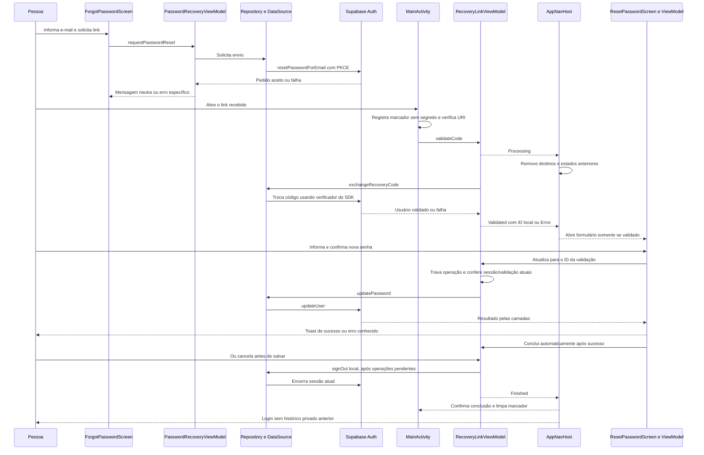

# Recuperação de senha — F07

## Estado em 21/10/2026

A usuária autorizou o agente a concluir diretamente esta sprint e executar os testes, após a implementação guiada. A autorização vale para este recorte; outras funcionalidades continuam em tutoria. Identificador preservado: `br.edu.fatec.doesangue`. Sem SQL, mudanças em reservas/perfis, Git ou envio automático de e-mail.

Implementação local completa: solicitação, PKCE, entrada fria/quente, prioridade sobre Splash/login, validação do retorno, formulário, atualização, saída e retorno ao login. Configuração remota concluída com autorização posterior específica: única Redirect URL br.edu.fatec.doesangue://auth/recovery adicionada e confirmação visual Successfully added 1 URL/Total URLs: 1 conferida. Site URL existente preservada. Usuária confirmou em 21/10 o percurso real completo: saída, solicitação, recebimento/abertura do e-mail, retorno à redefinição, gravação da nova senha, login com a nova e rejeição da anterior. Evidência por relato, sem inspeção nova de tráfego/JWT ou registro da senha. Fluxo anterior aceito; ajustes solicitados depois: Toast e retorno automático, com Mostrar/Ocultar nos dois campos. Esses ajustes foram validados com 10 testes instrumentados de recuperação (81,521 s) e cinco de login; APKs e Lint aprovados (zero erros/14 avisos). Atualização instalada preservando dados no emulador e Moto g04. Usuária confirmou posteriormente o resultado dos ajustes de Toast, retorno automático e Mostrar/Ocultar. F07 concluída neste recorte; confirmação por relato, sem nova inspeção de tráfego. O agente não repetiu envio real.

## Quem conversa com quem



Aceitação do pedido não comprova existência da conta ou entrega. HTTP 400 sozinho não identifica a causa. Interface usa categorias estruturadas, orientações em português e fallback sem detalhes internos.

## Onde ficou a maior parte do trabalho?

1. **Voltar do e-mail para o lugar certo.**
   Configuramos o endereço de retorno no Supabase e no Android. O aplicativo precisa receber o link tanto ao iniciar quanto quando já está aberto.
2. **Comprovar que o retorno é válido.**
   Receber um link não libera automaticamente a troca de senha. O SDK combina o código recebido com um verificador guardado na instalação que iniciou o pedido. Esse mecanismo é o **PKCE**. Só depois da validação liberamos o formulário.
3. **Evitar operações fora de ordem.**
   Imagine abrir um segundo link enquanto a primeira senha está sendo salva. Precisamos impedir que uma tela antiga altere a senha usando a sessão do novo link. O coordenador confere a identidade e usa uma trava, chamada `Mutex`, para organizar essas operações.
4. **Tratar interrupções e falhas.**
   Rede indisponível, link inválido, resposta atrasada, aplicativo recriado ou falha no logout exigem comportamentos diferentes. Por exemplo: se a senha foi salva e o logout falhou, tentar novamente deve repetir **somente o logout**.
5. **Testar essas combinações.**
   O percurso normal é apenas uma parte. Também verificamos bloqueios, respostas atrasadas, troca de links, navegação e limpeza dos campos.

Os três ViewModels dividem as responsabilidades:

| Arquivo | Responsabilidade |
| --- | --- |
| `PasswordRecoveryViewModel` | Solicitar o link e apresentar o resultado |
| `RecoveryLinkViewModel` | Coordenar validação, identidade, gravação e saída |
| `ResetPasswordViewModel` | Validar os campos e acompanhar o salvamento |

O **`RecoveryLinkViewModel` foi a peça central da complexidade**: ele garante que as várias partes conversem na ordem correta, inclusive quando algo interrompe o caminho.

## Arquivos e responsabilidades

| Camada | Arquivos | Responsabilidade |
| --- | --- | --- |
| Domínio | `domain/repository/AuthRepository.kt`, `domain/model/AuthError.kt`, `domain/validation/PasswordValidator.kt` | Contratos, falhas conhecidas e regra compartilhada de senha |
| Dados | `data/supabase/SupabaseAuthDataSource.kt`, `data/repository/SupabaseAuthRepository.kt`, `data/supabase/mapper/AuthErrorMapper.kt` | SDK, Result, classificação e preservação de CancellationException |
| Cliente | `data/supabase/SupabaseClientFactory.kt` | PKCE no SDK 3.6.0; sem alterar redirect global do cadastro |
| Apresentação | `PasswordRecoveryViewModel`, `RecoveryLinkViewModel`, `ResetPasswordViewModel` e estados/helpers em `presentation/auth` | Pedido, coordenação serializada, validação/formulário e mensagens |
| Composição | `DoeSangueApplication.kt`, `di/AppContainer.kt`, `MainActivity.kt` | Cliente compartilhado e coordenador retido pela Activity |
| Entrada | `AndroidManifest.xml`, `ui/navigation/RecoveryLinkParser.kt` | ACTION_VIEW, endereço dedicado, leitura estrita, app aberto/fechado |
| Navegação | `DoeSangueApp.kt`, `AppNavHost.kt`, `AppRoute.kt`, `AuthNavGraph.kt` | Fluxo de estado, prioridade, destino protegido e descarte dos estados anteriores |
| UI | `ui/screens/auth/AuthScreens.kt` | Solicitação, progresso/erro, formulário, sucesso e saída |

`ResetPasswordViewModel` recebe uma operação suspensa para salvar. Na recuperação, a factory liga essa operação ao coordenador e ao ID da validação; não liga diretamente ao SDK. O construtor com AuthRepository permanece para uso isolado/testes. Nenhum ViewModel recebe NavController ou SDK.

## Decisões de segurança e concorrência

- URI canônica: `br.edu.fatec.doesangue://auth/recovery`. Somente ACTION_VIEW desse scheme/host é tratado pela Activity. Parser exige endereço hierárquico, autoridade/caminho exatos, um código não vazio/sem espaços, sem fragmentos ou indicadores de erro. Endereços alheios são ignorados; retorno reconhecido inválido produz erro sem trocar código.
- O parser só extrai: o SDK/servidor validam código e verificador. O verificador é gerado e armazenado pelo SDK; não há criptografia/cache paralelo.
- MainActivity usa `singleTask`, onCreate/onNewIntent e o mesmo container da Application. O código é removido da instância do Intent após a leitura e não entra em rota, SavedStateHandle, logs ou estado de UI.
- `validationId` é um contador local sem segredo. Diferencia novos links da mesma conta, inclusive quando StateFlow conflar Processing intermediário. Cada transição remove a pilha anterior; o formulário/ViewModel tem chave por validação.
- Troca, atualização e saída compartilham Mutex. Um segundo link invalida o formulário anterior imediatamente, mas só troca a sessão após a gravação anterior liberar a trava. Guardas por estado/ID e identidade da sessão impedem usar uma tela antiga para alterar a senha de outra sessão.
- CancellationException é preservada e resultados cancelados não são publicados. Os testes provocam respostas tardias/NonCancellable para conferir a ordem e o descarte.
- A senha fica em remember, sem rememberSaveable nem estado do ViewModel. Os dois campos começam mascarados, cada um com Mostrar/Ocultar independente como no login; alternar não muda os valores. Visibilidade também é local e não salva na recriação. Campos/alternância são bloqueados durante gravação/sucesso, limpos no sucesso e descartados ao sair/recriar. Não há trim da senha. No sucesso, LaunchedEffect limpa valores/visibilidade, mostra o Toast Senha salva com sucesso. e aciona a saída existente automaticamente. rememberUpdatedState mantém callback atual sem usar sua identidade como chave nem repetir o efeito por recomposição.
- Splash e callbacks de login/cadastro leem o valor atual do fluxo antes de abrir Main. Sem Validated, nem acesso direto à rota permite gravar senha.
- Concluir, cancelar ou voltar pelo sistema encerra a sessão atual antes do login. Falha na saída mantém o bloqueio e oferece nova tentativa. A operação é local; não promete revogar todas as sessões em outros dispositivos.
- Um único booleano em SharedPreferences registra recuperação pendente antes da troca. Não contém código/token/senha. Se o processo for interrompido e o coordenador não existir, uma sessão restaurada não abre Home: exige novo link/saída. O marcador só é removido após a saída bem-sucedida. Teste injeta o marcador; não equivale a matar/restaurar um processo real.

## Configuração remota e aceite real concluídos

Nenhuma migração ou tabela nova de senha é necessária. Após autorização explícita para acessar/configurar o painel e login realizado pela própria usuária no navegador conectado, foi adicionada somente esta URL em Authentication → URL Configuration → Redirect URLs:

```text
br.edu.fatec.doesangue://auth/recovery
```

Antes da alteração, a lista não tinha Redirect URLs; após salvar, confirmação de sucesso e total 1 conferidos. Site URL http://localhost:3000 preservada, sem wildcard, alterações em provedores, modelos de e-mail, políticas ou SQL. Evidência visual local: captures/2026-10-21-recovery-finish/supabase-redirect-confirmado.png (ignorada pelo Git). A abertura do painel havia sido rejeitada pela revisão automática; a nova autorização específica da usuária permitiu concluir a ação diretamente, sem contornar o bloqueio. O código de retorno deve ser aberto no mesmo aplicativo/instalação que solicitou a recuperação, onde está o verificador PKCE.

Roteiro real realizado e confirmado pela usuária para o fluxo principal (itens de expiração/indisponibilidade remota não foram relatados). Não repetir automaticamente para os ajustes de UI:

1. Solicitar uma vez pelo app com endereço autorizado no Auth, mantendo perfil fictício; conferir mensagem neutra.
2. Abrir o e-mail/link no aparelho da solicitação, com app fechado e depois aberto em uma segunda solicitação. Não colar URL/código/senha em chat ou logs.
3. Salvar senha válida, concluir, conferir login com a nova senha e rejeição da anterior. A conta de teste deve ter senha conhecida pela usuária; agente não registra o valor.
4. Conferir link reutilizado/expirado e indisponibilidade de rede com mensagens específicas, sem abrir Home indevidamente.
5. Conferir que reserva 23 e perfis/dados do domínio não foram alterados; não repetir SQL nem cancelar reservas para esse teste.

## Evidências locais aprovadas

39 testes JVM e 81 instrumentados aprovados; APKs e Lint final aprovados (zero erros/14 avisos). Activity: oito testes em 54,268 s; regressão: 73 em 139,468 s. Resultados detalhados, limitações e tentativas interrompidas: `docs/12-validacao.md`. Testes usam valores sintéticos, fontes fictícias ou SDK com interceptor que responde antes da rede. A Application de instrumentação exige container fictício para MainActivity e mantém marcador só em memória; não altera armazenamento Auth real. APKs instalados com -r, sem wipe/uninstall.

## Fontes técnicas

- [SDK Kotlin: recuperação](https://supabase.com/docs/reference/kotlin/auth-resetpasswordforemail).
- [SDK Kotlin: atualização](https://supabase.com/docs/reference/kotlin/auth-updateuser).
- [Retorno em aplicativos móveis](https://supabase.com/docs/guides/auth/native-mobile-deep-linking).
- APIs exatas conferidas no sources.jar local de Supabase Kotlin 3.6.0 (Auth, AuthImpl, PKCE e cache padrão). Não há evento PASSWORD_RECOVERY nessa versão; origem External ou sessão existente não provam validação.
- [AOSP Android 12 — JankTracker](https://android.googlesource.com/platform/frameworks/base/+/refs/tags/android-mainline-12.0.0_r63/libs/hwui/JankTracker.cpp): código do abort nativo Impossible totalDuration observado no emulador, separado de falha Kotlin do aplicativo.
