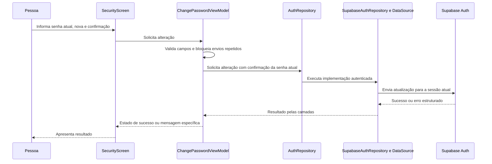

# Alterar senha em Configurações — F08

## Estado em 22/10/2026

**Sprint F08 concluída neste recorte.** Usuária confirmou os cenários reais: senha atual incorreta apresenta mensagem específica; senha correta permite salvar, com Toast e retorno às Configurações mantendo sessão; após sair, senha anterior recusada e nova senha aceita. Também confirmou o teclado de e-mail na recuperação após padronização dos três formulários. Aceites por relato, sem nova captura, inspeção de tráfego/JWT ou credenciais registradas.

Produção principal escrita pela usuária em tutoria; agente investigou, revisou, documentou e executou testes. A pedido explícito, corrigiu a variante de erro current_password_invalid e padronizou opções do teclado de e-mail. Evidências locais aprovadas abaixo; últimos APKs/Lint aprovados (zero erros/14 avisos). Nenhuma suíte repetida apenas pela confirmação manual. Registros de progresso abaixo são históricos e não reabrem etapas concluídas. Usuária autorizou posteriormente commit e push do conjunto concluído em 22/10, incluindo ajuste de teclados, testes e documentação. Próxima funcionalidade depende de escolha da usuária e mantém tutoria/diagrama.

Na inspeção inicial, SecurityScreen em ProfileScreens.kt tinha três campos visuais e botão sem operação; MainNavGraph já possuía o destino Security. AuthRepository.updatePassword e a integração de atualização já existiam por F07, assim como PasswordValidator. F07 permanece preservada, com contrato e mensagens próprios de recuperação.

## Quem conversa com quem — implementado localmente

Fluxo implementado pela usuária e validado com fontes fictícias: estado/ViewModel, contrato/repository/DataSource, factory/grafos e formulário funcional. Sessão ausente classificada corretamente, três campos editáveis com visibilidade independente, erros e bloqueios durante gravação. Usuária escolheu explicitamente em 22/10: confirmar sucesso e voltar às Configurações mantendo a sessão; comportamento implementado, testado e confirmado manualmente por relato. Sem logout ou coordenador de recuperação neste fluxo. Bloqueio com senha atual incorreta e autenticação com nova senha/rejeição da antiga também confirmados por relato. A consulta autorizada ao log identificou a variante real de erro; isso não constitui auditoria completa da API/configuração remota.

## Arquivos diretamente relacionados

| Parte | Arquivos ou localização | Responsabilidade |
| --- | --- | --- |
| Estado e apresentação novos | presentation/auth/ChangePasswordUiState.kt e ChangePasswordViewModel.kt | Carregamento, validação e resultado sem armazenar senhas no estado |
| Validação existente | domain/validation/PasswordValidator.kt | Regra da nova senha compartilhada com cadastro/recuperação |
| Contrato | domain/repository/AuthRepository.kt | Representar a operação de F08 sem expor SDK à apresentação |
| Dados | data/repository/SupabaseAuthRepository.kt e data/supabase/SupabaseAuthDataSource.kt | Acesso autenticado ao SDK e preservação de CancellationException |
| Erros | domain/model/AuthError.kt, data/supabase/mapper/AuthErrorMapper.kt e mensagens de apresentação | Distinguir senha atual incorreta, sessão indisponível e outras falhas identificadas |
| Injeção e navegação | di/AppContainer.kt, DoeSangueApp.kt, AppNavHost.kt e MainNavGraph.kt | Fornecer dependências e estado à tela |
| Tela existente | ui/screens/profile/ProfileScreens.kt, SecurityScreen | Campos locais, Mostrar/Ocultar, callbacks e apresentação do estado |

## Investigação técnica e limites

- SDK instalado: Supabase Kotlin 3.6.0. Fonte local UserUpdateBuilder contém currentPassword, e AuthImpl.updateUser utiliza supabaseJson para serializar o pedido.
- Divergência confirmada em diagnóstico isolado do binário 3.6.0: currentPassword não possui SerialName para current_password, e supabaseJson não define conversão automática de nomes. Serialização real de UserUpdateBuilder emitiu currentPassword e omitiu current_password. A API documentada espera current_password. Não assumir que atribuir a propriedade já envia o campo correto, nem alterar globalmente a serialização do cliente.
- A documentação oficial descreve envio de current_password. O código público do servidor consultado condiciona a exigência/validação à configuração UpdatePasswordRequireCurrentPassword e ao tipo de sessão. Isso não comprova a versão ou configuração do projeto remoto. Confirmar essa proteção antes de apresentar o campo como funcional; não tratar uma resposta de sucesso isolada como prova de validação da senha anterior.
- Solução localizada escrita pela usuária após diagnóstico e conferida estruturalmente: DataSource.changePassword monta JSON explícito com password e current_password e chama authenticatedSupabaseApi(client.auth, requireSession=true).putJson("user", body). Fonte SDK conferida: resolve a URL do Auth, exige sessão e reutiliza o parser de erros estruturados do plugin. É API marcada SupabaseInternal; OptIn restrito ao método, versão 3.6.0 fixada e teste HTTP obrigatório antes do aceite. Não alterar serialização global, acessar credencial administrativa, executar login auxiliar nem modificar updatePassword de F07. O método não altera metadados do usuário; comportamento da sessão após sucesso ainda precisa do teste de integração planejado.
- Não alterar configuração remota nesta etapa de investigação. Se necessária, preparar a alteração e solicitar autorização específica. Nenhum e-mail ou teste de senha real foi enviado/executado.
- Preservar F07 e identificador br.edu.fatec.doesangue. Não criar tabelas/colunas de senha, não alterar SQL, reservas ou perfis.
- Senhas devem ficar somente em memória local do formulário, sem logs, SavedState ou persistência manual. Não aplicar trim às senhas. A validação de força aplica-se à nova senha; não impor a regra atual de cadastro à senha anterior.
- Mensagens conhecidas devem ser específicas em português e próprias do contexto de Configurações. Não orientar solicitar link de recuperação para qualquer falha de sessão indiscriminadamente.

## Histórico do progresso da tutoria

ChangePasswordUiState.kt escrito pela usuária e conferido em 22/10, com isSaving, passwordChanged e errorMessage. Somente representa o resultado da operação; não contém senhas nem libera/executa alteração. Conferência estrutural sem necessidade de novos testes nesta declaração.

Estrutura de ChangePasswordViewModel.kt escrita pela usuária e conferida: recebe AuthRepository e expõe o estado com MutableStateFlow privado e asStateFlow público. A operação savePassword foi acrescentada posteriormente, conforme registro abaixo.

AuthRepository.changePassword(currentPassword: String, newPassword: String): Result<Unit> acrescentado pela usuária e conferido, preservando updatePassword usado por F07. As implementações e os fakes precisam acompanhar o contrato nos próximos passos; assinatura isolada não constitui integração nem compilação aprovada. Confirmação dos campos é validação da apresentação e não precisa ser enviada ao servidor.

CURRENT_PASSWORD_INCORRECT acrescentado pela usuária ao enum AuthError e conferido. Esse preparo permite distinguir senha atual incorreta dos demais erros sem comparação de mensagens em inglês.

AuthErrorMapper.toAuthError alterado pela usuária e conferido: no else do primeiro when, classifica current_password_mismatch via AuthRestException.error e preserva UNKNOWN para os demais códigos. Throwable.toAuthFailure permanece preservado. Fonte local 3.6.0 conferida: AuthErrorCode não contém esse valor, mas AuthRestException preserva o código original em error.

AuthErrorMessages.toAuthErrorMessage atualizado pela usuária e conferido com CURRENT_PASSWORD_INCORRECT -> "Senha atual incorreta."; when contempla a nova categoria. Regras de apresentação específicas de F08 serão ligadas posteriormente. A estratégia de envio/validação no servidor segue pendente da investigação descrita acima. Classificação e mensagem terão testes após completar as implementações exigidas pelo novo contrato; não registrar compilação aprovada neste estado intermediário.

ChangePasswordViewModel.validatePassword escrito pela usuária e conferido: valida senha atual vazia, força da nova, confirmação e diferença entre nova/atual, sem trim ou política de força aplicada à senha antiga. Validação local não comprova a senha atual no servidor nem realiza gravação.

savePassword(currentPassword, newPassword, confirmation) escrito pela usuária e conferido com guarda de envio/sucesso, validação local, carregamento antes do launch, chamada ao contrato changePassword, ensureActive e atualização do resultado. Erros passam por toAuthErrorMessage com fallback próprio de alteração. A ativação síncrona de isSaving antes da corrotina bloqueia pedidos repetidos.

SupabaseAuthDataSource.changePassword escrito pela usuária e conferido com awaitInitialization, corpo JSON explícito e API autenticada do SDK conforme estratégia acima. Imports presentes e updatePassword de F07 preservado. Pedido HTTP já validado com interceptor sem rede; configuração/validação remota continuam pendentes, sem comprovação de que a senha atual foi validada em um servidor real.

SupabaseAuthRepository.changePassword escrito pela usuária e conferido: chama DataSource, retorna Result<Unit>, preserva CancellationException e classifica demais exceções via toAuthFailure. Sete fakes adaptados pelo agente; testes novos usam resposta explícita de alteração, demais fluxos retornam falha se a operação não estiver configurada.

SessionRequiredException importada e classificada pela usuária em Throwable.toAuthFailure como AuthFailure(AuthError.SESSION_UNAVAILABLE), antes de AuthRestException. Correção conferida e testes aprovados. É exceção local tipada do SDK, distinta de AuthSessionMissingException recebida pela API; não inferir por texto ou HTTP. Não ampliar classificação de Exception genérica para sessão.

ChangePasswordViewModel importado no AppContainer e changePasswordViewModelFactory criada pela usuária com authRepository existente, após a factory simples de resetPassword. Conferência estrutural aprovada; sem repetir testes por essa declaração.

Passagem AppContainer → DoeSangueApp → AppNavHost escrita pela usuária e conferida: parâmetro changePasswordViewModelFactory: ViewModelProvider.Factory declarado após resetPasswordViewModelFactory e argumento fornecido por appContainer.changePasswordViewModelFactory. Ainda não é usado por um destino de tela.

changePasswordViewModelFactory acrescentada pela usuária à assinatura de mainNavGraph e repassada na chamada em AppNavHost, conferida. Dependência não enviada a AuthNavGraph. Agente adaptou os dez chamadores de AppNavHost nos testes; assembleDebug e assembleDebugAndroidTest aprovados em 14s. Sem repetir suítes comportamentais ou Lint por esta passagem de parâmetro.

ChangePasswordUiState importado e assinatura de SecurityScreen ampliada com state/onSave pela usuária, conferidos. MainNavGraph importa e cria ChangePasswordViewModel no destino Security, coleta uiState e passa state/model::savePassword, conferido. Campos e botão ainda não usam o callback e não há gravação pela UI.

SecurityScreen mantém currentPassword/newPassword/confirmation e currentPasswordVisible/newPasswordVisible/confirmationVisible em remember/mutableStateOf, com visibilidade inicialmente false; fieldsEnabled calculado a partir de isSaving/passwordChanged. Imports presentes e código conferido. Sem rememberSaveable ou senhas no ViewModel; usados pelos campos editáveis no passo posterior.

SecurityPasswordField privado criado pela usuária após SecurityScreen e conferido: label/value/onValueChange/visible/onToggleVisibility/enabled, OutlinedTextField singleLine, KeyboardType.Password, máscara condicionada e TextButton Mostrar/Ocultar bloqueado conforme enabled. Imports presentes. Usado nos três campos de F08 no passo posterior, sem refatorar outros fluxos de senha.

Três VisualField de SecurityScreen substituídos pela usuária por SecurityPasswordField, com cada valor/onValueChange, flag de visibilidade/onToggleVisibility e fieldsEnabled, conferidos. Botão de salvar ainda sem callback. Após sucesso: confirmação e retorno às Configurações mantendo a sessão, conforme escolha explícita da usuária.

SecurityScreen atualizado pela usuária e conferido: BackHandler(enabled = !fieldsEnabled) sem navegação e DsScreen com onBack condicional; orientação de força e state.errorMessage em cor de erro após o terceiro campo. Tela não tem barra inferior; seta/Voltar aguardam gravação/sucesso. Botão ainda sem envio.

SecurityScreen atualizado pela usuária e conferido com LocalContext e callback atual via rememberUpdatedState(onBack); LaunchedEffect(state.passwordChanged) limpa três senhas e três flags, mostra Toast "Senha salva com sucesso." e chama o callback original de retorno. Imports presentes. Sucesso volta às Configurações mantendo sessão, conforme escolha explícita; sem logout ou callback condicionado a fieldsEnabled dentro do efeito. Botão ainda visual.

Botão de SecurityScreen ligado pela usuária e conferido: texto Salvando…/Alterar senha conforme isSaving, onClick chamando onSave(currentPassword,newPassword,confirmation) e enabled=fieldsEnabled. Testes de UI com fakes criados/executados pelo agente e aprovados; resultado abaixo.

Conferência por capturas da usuária em 22/10: provedor Email exibe Require current password when updating desativado. Esse é o rótulo observado no painel para a exigência da senha atual. Secure password change também aparece desativado, mas corresponde à reautenticação e é configuração distinta. As imagens mostram ainda Minimum password length = 6 e Password requirements com Select an option, sem seleção visível; confirmar/alinhar a política do servidor em passo posterior, sem presumir os requisitos de 8 caracteres/maiúscula/minúscula/número/símbolo já ativos. Capturas são evidência do formulário exibido, sem comprovar persistência de alterações.

Após orientação de ativar Require current password when updating e alinhar mínimo a 8, usuária relatou ter feito as duas alterações. Captura posterior mostra Password requirements = Lowercase, uppercase letters, digits and symbols, seleção correspondente às quatro categorias exigidas. Não houve inspeção independente da configuração persistida nem nova captura do toggle/mínimo; a seleção exibida sozinha não comprova clique em Save.

Teste real relatado em 22/10: usuária informou senha atual deliberadamente incorreta e relatou que a senha foi alterada. Usou a sessão que já estava aberta, sem sair e entrar pelo login normal; isso não comprova a origem da sessão nem explica sozinho o resultado. Ao fechar e reabrir as configurações de Email, confirmou que Require current password when updating está desativada. A exigência remota desligada é compatível com o comportamento observado; o envio correto de current_password pelo aplicativo não obriga o servidor a validá-lo quando essa proteção está desativada. Fonte pública: [implementação do Supabase Auth](https://github.com/supabase/auth/blob/master/internal/api/user.go). Não houve inspeção independente do painel ou da versão remota.

Próximo passo guiado: ativar somente Require current password when updating, clicar em Save e reabrir para confirmar que permanece ativa. Depois, em passo separado, sair e entrar pelo login normal usando a nova senha do teste anterior, antes de repetir o cenário negativo. Esperado na repetição: Senha atual incorreta., permanência na tela e ausência de Toast/retorno de sucesso. Sessões de recuperação são dispensadas dessa exigência pelo servidor; não confundir essa exceção com qualquer sessão já aberta nem com a opção distinta Secure password change. Não pedir nem registrar senhas. Bloqueio real e aceite de gravação com senha correta permanecem pendentes; sem mudança de produção por hipótese.

Nova tentativa relatada pela usuária em 22/10: aplicativo exibiu a mensagem genérica de impossibilidade de alteração. Usuária pediu mensagem específica de senha atual incorreta. Inicialmente, conferência localizada confirmou que mapper e apresentação já tratavam current_password_mismatch como CURRENT_PASSWORD_INCORRECT e “Senha atual incorreta.”; 17 JVM anteriores passaram, mas faltava o código real.

Diagnóstico concluído após autorização explícita para consultar o Supabase: no painel conectado, Logs filtrado por Auth, a tentativa PUT /user de 22/10/2026 às 15:24:00 (America/Sao_Paulo) retornou status 400 e error_code = current_password_invalid. Essa variante não era reconhecida pelo mapper, causando UNKNOWN e mensagem genérica. A descrição textual não foi usada para classificar a causa. Consulta somente leitura, sem alteração de configurações ou credenciais; não versionar conteúdo integral dos logs, identificadores pessoais ou endereços de rede. O código observado no serviço remoto difere de current_password_mismatch consultado anteriormente na fonte pública; preservar ambos como variantes explícitas.

Correção direta solicitada pela usuária: AuthErrorMapper aceita current_password_invalid e current_password_mismatch como CURRENT_PASSWORD_INCORRECT, reutilizando a mensagem existente “Senha atual incorreta.”. Fallback, current_password_required e demais erros permanecem distintos. Testes JVM e do SDK ampliados com a variante real. Antes da correção, dois casos JVM reproduziram o defeito; depois, 17 JVM aprovados e 13 SupabaseAuthPkceTest aprovados no Moto g04/Android 14 em 3,052s, incluindo classificação da resposta interceptada sem rede. APKs e Lint aprovados (build em 1m1s); atualização instalada com -r preservando dados. Usuária confirmou “agora deu certo” após repetir o cenário de senha atual incorreta: mensagem específica aceita por relato no aplicativo atualizado, sem nova inspeção remota. Esse aceite é restrito ao cenário negativo. Próximo passo guiado: fornecer senha atual correta e nova válida/diferente com confirmação, conferir Toast e retorno às Configurações mantendo sessão. Login com nova senha e rejeição da anterior serão conferidos depois; percurso completo F08 ainda pendente. Sem SQL ou Git.

Confirmação posterior: usuária relatou que o teste positivo saiu correto, após roteiro de senha atual correta, Toast e retorno às Configurações mantendo sessão. Não estender esse relato ao login com nova senha/rejeição da antiga, ainda não confirmado. Antes do fechamento da sprint/documentação, solicitou ajuste direto dos teclados de e-mail, indicando recuperação como tela em que percebeu ausência do @. Investigação localizada: login, cadastro e recuperação já declaram KeyboardType.Email; Editar perfil usa VisualField não editável. Conferência nativa pontual identificou tipo 0x8021 (texto/e-mail com autocorreção), sem leitura de conteúdo digitado e sem comprovar disposição visual de teclas. Padronizados os três campos em AuthScreens.kt/RegistrationScreens.kt com capitalization=None e autoCorrectEnabled=false, mantendo Email. Isso solicita ao teclado formato de e-mail sem corrigir endereços nem capitalizar automaticamente; não garante disposição específica escolhida pelo aplicativo de teclado. Sem nova camada ou alteração de validação/Auth. Usuária confirmou “esta correto” após roteiro de conferir o teclado na recuperação, aceitando o ajuste visual por relato, sem nova captura. Não estender esse aceite manual às outras telas nem alegar inspeção visual pelo agente. Sprint permanece aberta somente para verificar login com nova senha e rejeição da anterior; não repetir suítes ou alterar produção por essa confirmação.

Agente consultou somente os registros autorizados no painel, não executou SQL, não enviou e-mail e não alterou credenciais/configurações remotas. Aceite real F08 permanece pendente.

## Histórico das validações locais

**UI local aprovada em 22/10:** assembleDebug, assembleDebugAndroidTest e lintDebug offline aprovados em 25s, zero erros/14 avisos. Novo ChangePasswordFlowTest com seis casos e dez AppNavigationTest: OK (16 tests) em 90,32s no Moto g04/Android 14. Testes exercitam campos inválidos sem pedido, visibilidade independente/texto efetivamente desenhado, falha de rede com valores preservados, campos/botão/Voltar/seta bloqueados durante gravação, erro e nova tentativa, Toast observado via evento Android, retorno às Configurações com sessão preservada e sem logout, reabertura vazia e restauração de estado Compose sem senhas/visibilidade. Restauração usa StateRestorationTester; não equivale a matar/restaurar o processo real. API/repos fictícios em todo o grafo; sem rede, e-mails ou alteração de credencial real. APKs instalados com -r preservando dados. Fonte nova de teste: app/src/androidTest/java/br/edu/fatec/doesangue/ui/navigation/ChangePasswordFlowTest.kt; saída ignorada em captures/2026-10-22-f08-ui/ui-and-navigation.txt. Não houve alteração de produção pelo agente, SQL, configuração remota ou Git.

**Resultado final do recorte de dados/ViewModel em 22/10:** após a correção de SessionRequiredException pela usuária, 17 testes JVM aprovados (11 AuthErrorMapperTest/seis AuthErrorMessagesTest). APKs e Lint aprovados em 22s, zero erros/14 avisos. No Moto g04/Android 14, seis ChangePasswordViewModelTest e 13 SupabaseAuthPkceTest: OK (19 tests) em 3,361s. Sem rede, storage do Auth só em memória e respostas do SDK interceptadas; APKs instalados com -r preservando dados. Nenhuma operação real de senha, e-mail, SQL ou configuração remota. Falhas iniciais abaixo são históricas e foram resolvidas. UI/F08 remota ainda não concluídas.

Testar campos/confirmacão/força, valores sem trim, guarda de envios repetidos, mensagens conhecidas, sessão inválida e falhas/repetição. Na camada de dados, conferir o pedido HTTP gerado sem rede real, inclusive o nome do campo da senha atual. Teste real posterior deve comprovar que senha atual errada impede a alteração e que a nova funciona após sucesso; somente pela usuária, sem compartilhar credenciais. Casos de troca de identidade/saída durante operação devem acompanhar a estratégia escolhida.

Diagnóstico local executado em 22/10: Java com classes.jar extraídos dos AARs Auth/Core 3.6.0, Kotlin/Serialization do cache, UserUpdateBuilder e Json reais; confirmou as chaves geradas usando valores sintéticos e sem rede. Helper em captures/2026-10-22-f08-investigation/CheckCurrentPassword.java, ignorado pelo Git. Não substitui teste HTTP da solução proposta, testes do ViewModel ou build do aplicativo; novo contrato ainda sem implementações completas.

Validação inicial posterior: APKs/Lint aprovados em 1m48s (zero erros/14 avisos). Primeira rodada JVM: 16 aprovados; após acrescentar reprodução da sessão ausente: 16/17 aprovados, uma falha esperada até corrigir mapper. Android: inicialmente 17/19; corrigida a ordem do teste de erros, rodada seguinte 18/19. Seis casos de ChangePasswordViewModelTest passaram; SupabaseAuthPkceTest passou em 12/13 (dez anteriores de F07 e dois novos de F08). A falha restante nas duas plataformas é classificação de SessionRequiredException em UNKNOWN. Pedido F08 conferido como PUT /auth/v1/user, com sessão sintética, chaves exatas password/current_password, valores sem trim, usuário e verificador pendente preservados. Falhas classificadas de senha atual/força/reuso/limite/sessão foram exercitadas por respostas interceptadas do SDK. session_not_found dispara limpeza assíncrona da sessão; colocá-lo antes de weak_password invalidava o cenário seguinte, corrigido somente no teste. Não houve alteração de produção pelo agente. APKs instalados com -r no Moto g04 conectado por ADB sem fio; dados reais preservados, storage Auth dos testes só em memória e nenhuma rede/e-mail/alteração real de senha. Não caracteriza aceite remoto, configuração da proteção de senha atual ou tela F08 funcional. Rerodar recortes afetados após correção do mapper.

## Fontes consultadas

- [Supabase — verificação da senha atual](https://supabase.com/docs/guides/auth/passwords#verifying-the-current-password).
- [Supabase — atualização de usuário em Kotlin](https://supabase.com/docs/reference/kotlin/auth-updateuser).
- [Supabase — exigir senha atual ao alterar senha](https://supabase.com/docs/guides/auth/password-security#require-current-password-when-changing-password), consultado em 22/10; não comprova a configuração do projeto.
- [Código público do Supabase Auth — UserUpdate](https://github.com/supabase/auth/blob/master/internal/api/user.go), consulta em 22/10/2026; referência pública, sem comprovar configuração/versão do ambiente remoto.
- Fontes locais 3.6.0: UserUpdateBuilder.kt, AuthImpl.kt e Utils.kt nos sources.jar do cache Gradle.
