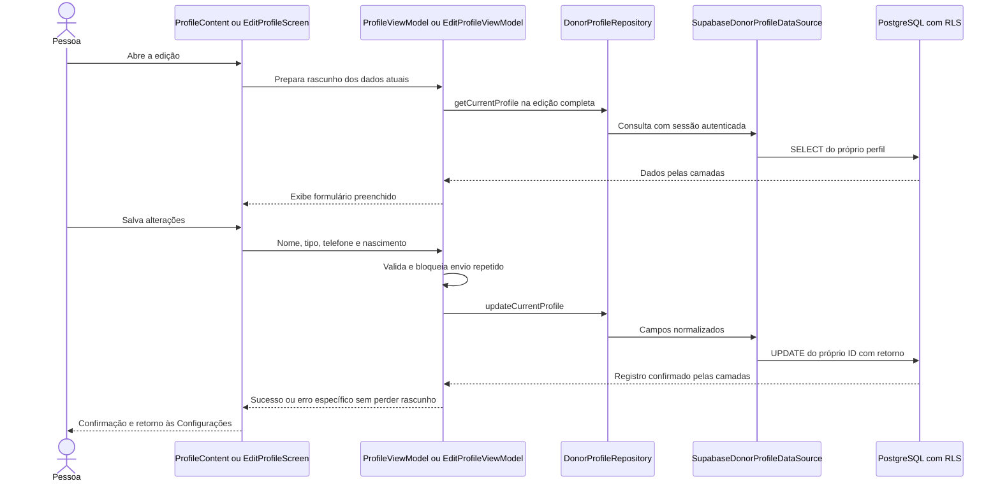

# Meu perfil e edição do perfil — A01/F10

**Fechamento em 22/10/2026:** usuária confirmou que a conferência visual/manual das implementações terminou sem erros, incluindo os ajustes de apresentação/máscara e o retorno pelo Voltar do Android. Aceite por relato, sem nova captura, inspeção HTTP/JWT ou repetição de SQL/testes. A01/F10 concluídos neste recorte. Ajustes finos adicionais ficam para depois, ainda sem especificação/implementação. Usuária autorizou documentar, fazer commit e push do conjunto completo de perfil, testes, migração e documentação; não incluir capturas/configurações locais nem iniciar outro ID.

## Escopo autorizado em 22/10/2026

Usuária autorizou implementação direta das duas telas e escolheu incluir telefone e nascimento, além de nome de exibição e tipo sanguíneo. Campos novos opcionais, inicialmente nulos nos perfis existentes; sem inferência de dados. Telefone com DDD, 10 ou 11 dígitos após retirar formatação; nascimento como data de calendário, sem horário e sem regra de aptidão/idade mínima. E-mail de acesso pertence ao Auth e não será alterado por esta tela. Usar somente dados sintéticos na validação.

Hoje a alteração do tipo já grava no Supabase, mas todas as opções ficam abertas em Meu perfil. Editar perfil é um protótipo com valores fixos. Proposta: opções só após ação explícita, cancelar descarta rascunho; edição completa consulta os dados persistidos e salva os quatro campos em um único UPDATE. Não alterar cadastro, agendamentos, estoque ou Auth.

## Sequência proposta antes da implementação

A01 reaproveita a gravação de tipo existente. F10 acrescenta estado/ViewModel da edição, contrato de atualização completa e campos opcionais no modelo/DTO/mapper. DI manual e grafos passam a factory; apresentação não conhece o SDK. Ao voltar a Meu perfil, recarregar o registro para não mostrar dados antigos.

## Banco e validação

Migração incremental, grants por coluna e testes de integridade/isolamento com ROLLBACK preparados e validados. Não reaplicar migrações antigas nem executar reset/push. Usuária autorizou posteriormente a aplicação desta migração e as conferências, confirmando explicitamente o projeto acadêmico `fbrycvxelubxxafjstbo`, embora o painel o identifique como main Production. Migração aplicada e conferida conforme evidências abaixo. RLS existente continua limitando acesso ao próprio ID; ID/criação permanecem sem UPDATE pelos clientes.

## Implementação local

- `ProfileContent`, `ProfileScreen`, `ProfileUiState` e `ProfileViewModel`: modo explícito de edição do tipo, cancelar restaura valor salvo, falha preserva seleção, sucesso fecha opções e gravação bloqueia outras ações. Telefone/nascimento persistidos aparecem no resumo, com indicação quando ausentes.
- `EditProfileScreen`, `EditProfileUiState` e `EditProfileViewModel`: consulta/carregamento/ausência/erro, formulário com nome/tipo/telefone/nascimento, validação específica, envio único, campos bloqueados enquanto salva e confirmação por Toast/retorno às Configurações. Cancelar sai sem enviar. Rascunho pertence ao destino e é descartado ao sair; não é prometida restauração após morte do processo.
- `DonorProfileRepository`, `SupabaseDonorProfileRepository` e `SupabaseDonorProfileDataSource`: UPDATE único dos quatro campos, ID obtido da sessão, retorno conferido contra identidade/valores enviados. Campos opcionais vazios enviados explicitamente como NULL. Erros estruturados de sessão, permissão, dados, migração indisponível e rede, com fallback para desconhecidos; sem detalhes brutos na UI.
- `DonorProfile`, DTO e mapper: telefone opcional e nascimento como `LocalDate`, recebido em ISO/sem fuso. Compatibilidade com respostas antigas sem as novas colunas. Criação de perfil ausente envia somente ID/nome, evitando novos campos no INSERT sem ampliar permissões.
- `AppContainer`, `DoeSangueApp`, `AppNavHost`, `MainNavGraph`: factory própria da edição; Meu perfil recarrega ao retornar para mostrar o registro salvo. Nome da Home usa leitura existente ao retornar; não alterar metadados de Auth. Texto informativo de privacidade acompanha os campos opcionais.

## Validação e limites

Baseline do perfil antes de editar: seis dos sete testes passaram na primeira rodada; um falhou sem hierarquia Compose e passou isolado após a usuária disponibilizar o celular desbloqueado (9,712s). A tentativa de dispensar bloqueio por comando foi rejeitada automaticamente e não executada; não contornar. Nenhum caso de negócio foi alterado para esconder essa falha de disponibilidade.

Primeira rodada local: nove JVM aprovados (três validação/seis mapper) e 19 instrumentados em 62,259s no Moto g04/Android 14 (três SDK/cinco ViewModel/sete perfil/quatro edição). Posteriormente acrescentada cobertura de criação com colunas permitidas, erro específico na consulta, ano civil inválido, capturas e regressão de navegação. O novo caso de INSERT identificou que o interceptor de teste esperava objeto, mas o SDK envia lista: corrigido somente o simulador; rodada abortada não é aprovação.

**Rodada final:** nove JVM e **OK (31 tests) em 108,026s** no Moto g04/Android 14: quatro SDK, seis ViewModel, sete perfil, quatro edição completa e dez navegação. APKs/Lint finais aprovados em 40s (zero erros/14 avisos), APK de testes refeito em 5s após ajuste do simulador. Testes só com dados fictícios, SDK interceptado antes da rede e storage de Auth em memória; instalação com -r preservou dados. Capturas revisadas em `captures/2026-10-22-perfil-edicao` (ignoradas): resumo sem grade de tipos, editor com campos preenchidos, tipo selecionado, salvar desabilitado sem alterações e cancelar. Não são capturas do perfil real nem prova de gravação remota.

Banco local: PGlite 0.5.10/PostgreSQL em memória, 12 migrações, Auth mínimo simulado. Novos campos nulos, UPDATE próprio, telefone válido/inválido/limpeza, nascimento/data futura, privilégios por coluna, isolamento de terceiros/anon e preservação de perfis e reserva 23 no ROLLBACK aprovados. O runner inclui uma reserva 23 sintética e exige que exista antes de comparar. Não comprova JWT/HTTP nem o estado/configuração do Supabase remoto.

## Pendências registradas antes do aceite

1. Conferência no aplicativo: encerrada pelo aceite geral da usuária em 22/10, conforme anotação de fechamento. Não atribuir novos cenários específicos ou inspeção técnica ao relato.
2. Commit/push: autorizados pela usuária no fechamento; incluir o conjunto concluído. Os registros anteriores de ausência de autorização/aceite são históricos.
3. Ajustes finos visuais: adiar conforme pedido da usuária; detalhes ainda a definir. Novas funcionalidades voltam à tutoria.

## Aplicação remota autorizada e conferida — 22/10/2026

Usuária autorizou aplicar somente a migração 20261022000100 e executar conferências/testes com ROLLBACK. Revisão automática bloqueou a primeira tentativa por diferença entre autorização para desenvolvimento e rótulo main Production; nada foi executado nessa tentativa. Usuária então confirmou explicitamente que a referência acima é seu ambiente acadêmico e autorizou a operação nele. Não estender a autorização a outras migrações, seed, Auth, Figma ou Git.

Conferência anterior: executor postgres, zero colunas novas, dois perfis. Agregados dos campos originais dos perfis e do registro 23 guardados somente para comparação, sem publicar dados pessoais. Primeira execução pelo editor falhou com 42601 porque preencher o textarea do Monaco manteve prefixo da consulta anterior; o erro de sintaxe impediu a migração. Editor limpo e SQL reinserido/conferido integralmente por seleção/cópia, sem modificar o arquivo da migração; nova execução retornou **Success. No rows returned**. Não reaplicar.

Conferência posterior: tipos text/date, opcionais/sem default, grants de UPDATE nos campos para authenticated, sem UPDATE de ID/criação e sem acesso anônimo, RLS ativo e dois CHECKs presentes. Roteiro `perfil_edicao_integridade_isolamento.sql` executado inteiro e aprovado: edição própria, inválidos/futuro bloqueados, limpeza com NULL, terceiros/anon bloqueados e reserva 23 preservada. O alerta do editor referia-se às tabelas temporárias do roteiro, isoladas na sessão; nenhuma RLS do domínio foi desativada.

Após o ROLLBACK, sete conferências retornaram **true**: colunas, permissões, RLS, CHECKs, perfis originais preservados, reserva 23 preservada e campos opcionais ainda nulos (sem inferência). Capturas/resultados ignorados em `captures/2026-10-22-perfil-edicao/supabase-*`. É execução administrativa no banco com identidades simuladas, sem prova de JWT/API real ou gravação pelo aplicativo. Somente aceite manual Android permanece pendente neste recorte de implementação/validação.

## Ajustes de UX solicitados após a conferência — 22/10/2026

Usuária pediu inspiração na organização do perfil do Mercado Livre e máscara no nascimento: digitar somente números era rejeitado por faltar as barras. Ajuste restrito à apresentação: cabeçalho com iniciais/nome/tipo, cores do Doe Sangue, dados agrupados e ações em lista com ícones. Os destinos e as operações continuam os mesmos; não reproduzir funcionalidades ou dados da referência.

`BirthDateMask` formata oito dígitos como DD/MM/AAAA e mantém o mapeamento do cursor para editar/apagar. `EditProfileScreen` usa teclado numérico e transforma digitação/colagem em texto formatado antes do callback existente. ViewModel, validador de calendário, repository e SQL continuam com o mesmo contrato: campos opcionais, datas inválidas/futuras bloqueadas e limpeza com NULL. Não exige nova migração.

Arquivos deste ajuste: `ProfileContent.kt` (cabeçalho/dados/linha de ação), `ProfileScreens.kt` (ações em lista), `EditProfileScreen.kt` (entrada numérica), novo `BirthDateMask.kt` e ícone `profile_ic_settings.xml`. Testes: novo `BirthDateMaskTest.kt` e ampliação de `ProfileEditFlowTest.kt`; documentação em docs/12, docs/35 e AGENTS.md.

Validação concluída: cinco JVM (dois máscara/cursor e três ProfileValidator) e **12 instrumentados em 70,341s** no Moto g04/Android 14 (cinco ProfileEditFlow/sete ProfileFlow), todos fictícios/sem rede. Caso novo digita 08071987, confere 08/07/1987, apaga/reinsere dígito pelo cursor, salva como LocalDate, reabre, cola data com barras e limpa o campo opcional. Casos existentes mantêm calendário inválido bloqueado e validam criação, troca de tipo, falhas/nova tentativa, cancelamento e atualização do resumo/Home. Primeira compilação do teste exigiu opt-in da API experimental de teclado; anotação adicionada somente ao teste, sem alterar produção para contornar falha. APKs/Lint finais aprovados em 18s, zero erros/14 avisos. Instalação -r preservou dados; capturas sintéticas meu-perfil-ux.png e editar-perfil-ux.png revisadas. Sem SQL, rede de teste, nova regra, Git ou mudança de contrato. Aceite visual/manual da usuária permanece pendente.

## Voltar do Android na raiz Perfil — 22/10/2026

Usuária relatou fechamento ao usar o Voltar da barra do Android, enquanto a seta do app funcionava. Investigação localizada: `AppNavHost.navigateMain` remove o percurso anterior ao trocar de aba; Perfil pode ficar sem tela anterior. A seta usa `NavigationBack.navigateBackOrHome`, mas `ProfileScreen` só interceptava Voltar durante gravação. Com a gravação ociosa, o evento seguia ao Android e podia encerrar a Activity.

Correção restrita a `ProfileScreens.kt`: o BackHandler do Perfil encaminha o evento ao callback onBack existente quando não está salvando, usando o mesmo retorno da seta; durante gravação continua consumindo o evento. Decisões/destinos permanecem em ui/navigation. Não mudar a saída do Android na Home nem o histórico de outras abas. Novo caso em AppNavigationTest verifica Perfil → Home e Sobre → Configurações → Perfil → Home por Voltar do Android; ProfileFlowTest também verifica o bloqueio durante atualização de tipo.

Primeira tentativa não chegou ao cenário porque o celular estava em Dozing/bloqueado, sem hierarquia Compose já na entrada do teste; não é reprodução nem aprovação do bug. Usuária disponibilizou celular desbloqueado, sem contornar bloqueio. Repetição antes de instalar a correção reproduziu exatamente o defeito em 8,987s: Espresso reportou `NoActivityResumedException: Pressed back and killed the app` ao voltar da raiz Perfil.

Após a correção: **OK (18 tests), 90,189s** no Moto g04/Android 14 (11 AppNavigationTest/sete ProfileFlowTest), todos fictícios/sem rede. O mesmo caso antes reprovado passou; também aprovados retorno interno, seta, restauração de navegação, login/cadastro, percurso de agendamento e bloqueio do Voltar durante gravação de tipo. APKs/Lint aprovados em 23s (zero erros/14 avisos), atualização instalada com -r preservando dados. Somente produção alterada nesta correção: ProfileScreens.kt; testes AppNavigationTest.kt/ProfileFlowTest.kt e documentação. Sem SQL/novos destinos/Git. Aceite manual da usuária permanece pendente.
