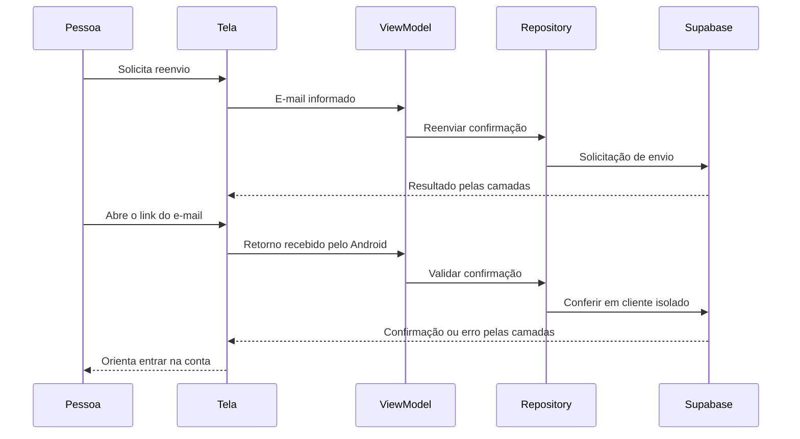

# Confirmação de e-mail — F09

## Escopo autorizado em 22/10/2026

Usuária delegou concluir diretamente F09 para encerrar o dia; próximas funcionalidades voltam à tutoria, com diagrama antes dos novos conceitos. Reenvio explícito na tela de confirmação e acesso pelo erro email_not_confirmed do login, retorno Android com app aberto/fechado, validação e mensagens específicas. Não enviar e-mails reais nos testes nem alterar credenciais, perfis ou reserva23. Novo retorno proposto: `br.edu.fatec.doesangue://auth/confirmation`; configuração remota específica dependerá de autorização após implementação verificável. Sem novo Git solicitado.

## Sequência proposta antes da implementação

Participantes: EmailVerificationScreen/EmailConfirmationDialog e MainActivity (UI/entrada), EmailConfirmationViewModel (estado e controle), AuthRepository (contrato), SupabaseAuthRepository/SupabaseAuthDataSource (dados) e Supabase Auth. Cadastro existente passa a informar redirect próprio. PKCE de cadastro e fragmento de reenvio são tratados distintamente; parser exige destino exato e não confunde confirmação com recuperação. Cliente efêmero somente em memória verifica o retorno sem importar sessão no cliente principal nem apagar seu verificador PKCE. Confirmar não autentica automaticamente ou substitui outra conta conectada.

Reenvio só mediante ação, com validação, envio único, espera local e limites do servidor preservados. Resposta bem-sucedida não prova que uma conta existe nem que o e-mail chegou; texto neutro quando houver cadastro pendente. Código/token só na memória necessária para validar/repetir falha transitória, nunca em estado salvo/logs. Erros inválidos/expirados orientam novo envio; rede/limites permitem tentar novamente. Nenhuma nova tabela/migração.

Fontes: [cadastro Kotlin](https://supabase.com/docs/reference/kotlin/auth-signup), [Auth do SDK](https://supabase-community.github.io/supabase-kt/auth-kt/io.github.jan.supabase.auth/-auth/index.html), [autenticação por senha](https://supabase.com/docs/guides/auth/passwords). Conferidos também os fontes locais 3.6.0 de AuthImpl/Auth/Email/UserInfo; resend não prepara novo PKCE, exchangeCodeForSession apaga o verificador do cliente usado e retrieveUser valida o token no servidor. Por isso a validação do retorno usa cliente isolado, mantendo F07 intacta.

## Implementação e arquivos

AuthRepository/SupabaseAuthRepository/SupabaseAuthDataSource acrescentam reenvio SIGNUP e conferência do retorno; cadastro envia redirect próprio. SupabaseClientFactory cria cliente efêmero Auth com sessão/verificador em memória, sem persistência/renovação/callbacks de ciclo de vida. Consulta usuário confirmado no servidor, fecha cliente temporário e preserva conta/verificador originais; não importa sessão de confirmação no app.

Novos EmailConfirmationCredential (descrição redigida), EmailConfirmationUiState/ViewModel, EmailConfirmationLinkParser e EmailConfirmationScreens. Integração em MainActivity, DoeSangueApp, AppNavHost, AuthNavGraph, AppContainer e manifest. LoginUiState/LoginViewModel/AuthScreens oferecem reenvio para email_not_confirmed explícito. Parser distingue código PKCE e fragmento signup, sem aceitar recovery; Intent limpo após consumo e credencial não entra em rota/estado salvo. Recuperação tem prioridade; confirmação não substitui a conta conectada.

Espera local de 60s após envio aceito, sem promessa de que o limite do servidor termine nesse prazo. Estado só em memória; contagem local não sobrevive à morte do processo. UI mostra checagem/confirmado/erro e nova tentativa somente para falhas transitórias. A rota coleta StateFlow dentro do destino, evitando copiar estado congelado no builder. AuthErrorMapper trata OtpExpired como categoria contextual de link/sessão indisponível.

## Validação — 22/10/2026

**17 JVM aprovados** (11 AuthErrorMapper/seis AuthErrorMessages) e **61 Android aprovados** no Moto g04/Android14, fictícios/sem rede/e-mail:

- 11 em2,363s: quatro SupabaseEmailConfirmationTest, cinco EmailConfirmationViewModelTest e dois EmailConfirmationLinkParserTest. SDK real/interceptor, SIGNUP/redirect, usuário confirmado, preservação de conta/verificador, duplicatas, cancelamento/respostas atrasadas e mensagens.
- Seis EmailConfirmationActivityTest em28,876s: cadastro pendente/preenchimento/reenvio explícito, login não confirmado, validação/rede/repetição/espera, abertura fria/com sessão, rotação sem replay e prioridade de recuperação.
- 44 regressão em149,549s: 13 SupabaseAuthPkceTest, dez RecoveryActivityFlowTest, cinco RegistrationFlowTest, cinco LoginFlowTest e 11 AppNavigationTest. F07/F08 e Voltar do Perfil preservados.

Rodadas iniciais reprovaram por espera da Splash/rolagem de telas fixas no executor; helper passou a detectar ancestral rolável pela semântica. Teste seguinte encontrou estado congelado no builder; corrigido na produção coletando fluxo na rota. Rodadas reprovadas não contam como aprovação. APKs/Lint aprovados, zero erros/14 avisos; compilação após correção23s/Lint final8s. Instalação -r preservou dados. Captura sintética de reenvio revisada em captures/2026-10-22-confirmacao-email (ignorada); primeira captura do diálogo coincidiu com Toast de outro caso e não comprova erro/aceite real. Nenhum SQL executado.

## Configuração remota autorizada

Usuária autorizou especificamente adicionar somente br.edu.fatec.doesangue://auth/confirmation ao projeto acadêmico fbrycvxelubxxafjstbo (main Production). Painel já autenticado; sem digitação de credenciais. Lista anterior somente recovery; adicionado confirmation e conferidos **dois retornos**. Site URL localhost:3000 e demais configurações preservados. Sem e-mail real, template ou SQL. Evidência ignorada supabase-retorno.png; viewport estreito complementado por texto completo da árvore acessível. Não repetir configuração.

## Aceite por relato e retomada

Implementação, testes e configuração concluídos. Em 22/10, após a explicação do reenvio, a usuária informou que funcionou corretamente. Aceite manual do recorte por relato, sem atribuir novos cenários de aparelho, captura ou inspeção HTTP. Conta já confirmada/resposta neutra de reenvio não comprovam entrega. Roteiro abaixo mantido como referência, sem necessidade de repeti-lo por essa confirmação.

1. Usar perfil fictício/e-mail permitido no Auth, sem informar endereço/senha na conversa. Conferir e-mail preenchido após cadastro e reenvio somente mediante toque.
2. Abrir link no aparelho da instalação que iniciou cadastro; conferir E-mail confirmado, Continuar e login. Se inválido/expirado/rede, conferir mensagem e ação correspondente.
3. Conferir reenvio/novo link e retorno com app aberto se desejado. Não desconfirmar/excluir contas para fabricar cenário; preservar A/C/reserva23.

Amanhã próximas funcionalidades voltam à tutoria com diagrama, pois envolvem conceitos novos. Não iniciar outros IDs/configurações/provedores/templates. Após aceitar também o ajuste de Autofill, usuária autorizou em 22/10 commit e push do conjunto completo F09/Autofill, incluindo testes e documentação. 491bdfb é o marco anterior de perfil enviado/sincronizado; anotações anteriores de Git pendente são históricas.

## Observação posterior — preenchimento automático

Usuária relatou sugestão de senha pelo Google na alteração via Perfil, inconsistência no cadastro e sugestões de e-mail intermitentes. Inspeção de RegistrationScreens, AuthScreens, EmailConfirmationScreens e SecurityPasswordField confirmou tipos de teclado, mas não semântica explícita ContentType para Autofill. KeyboardType define teclado; identificação de e-mail/usuário/senha existente/nova senha para o serviço de preenchimento exige configuração própria. Ausência dessas dicas é uma lacuna do app, sem provar a causa de cada ocorrência observada. A oferta final depende também do provedor habilitado e dos dados disponíveis. Proposta pendente: identificar campos por finalidade e conferir cadastro em etapas/salvamento somente no momento apropriado, preservando senhas fora de estado salvo/logs. Nenhuma produção alterada nesta investigação. Fonte: [Autofill em Compose](https://developer.android.com/develop/ui/compose/text/autofill).

Atualização posterior: usuária autorizou diretamente o ajuste de Autofill. Implementação e evidências próprias em [docs/37](37-preenchimento-automatico.md); não confundir a investigação anterior sem edição com o recorte posterior autorizado. Banco e configuração remota de F09 preservados.
