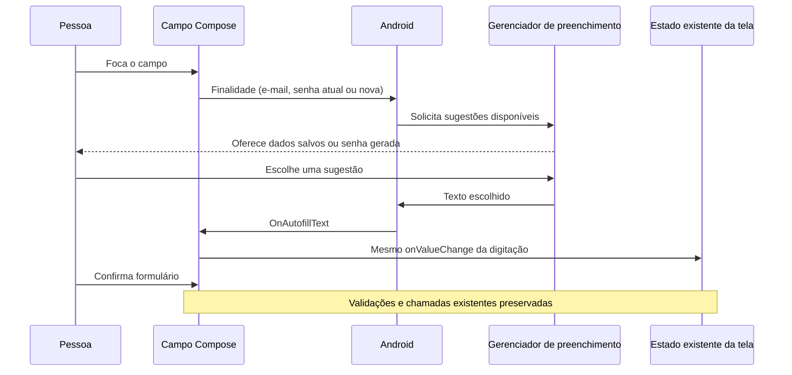

# Preenchimento automático de e-mail e senha

## Pedido e fluxo — 22/10/2026

Após confirmar funcionamento de F09, usuária relatou sugestão de senha pelo Google no menu Segurança, mas inconsistente no cadastro, e sugestões de e-mail intermitentes. Autorizou diretamente o ajuste dos campos. Recorte de UI: nenhuma mudança de Auth, banco, perfil, credenciais, identificador ou regra de senha.

Fluxo apresentado antes da edição: **campo → Android → gerenciador do Google → preenchimento do campo**. O campo declara sua finalidade; Android consulta o serviço habilitado; a pessoa escolhe uma sugestão; o Compose envia o texto ao mesmo callback já usado na digitação. Preencher não envia formulário automaticamente. Resposta e validação continuam pelas camadas existentes.

## Configuração implementada

| Tela/campo | ContentType |
| --- | --- |
| Login: e-mail / senha | Username + EmailAddress / Password |
| Cadastro: primeiro e-mail | EmailAddress |
| Cadastro: e-mail da conta na última etapa | NewUsername + EmailAddress |
| Cadastro: senha e confirmação | NewPassword |
| Recuperação e reenvio: e-mail | Username + EmailAddress |
| Redefinição: nova senha e confirmação | NewPassword |
| Segurança: senha atual / nova e confirmação | Password / NewPassword |

KeyboardType Email/Password e Mostrar/Ocultar preservados. No cadastro em etapas, e-mail preenchido também aparece junto da senha para associar a conta. É editável e usa updateEmail/validateIdentity/register existentes: endereço inválido não chama o repository, e a conta usa o endereço final validado. A proposta inicial de somente leitura foi descartada ao conferir PopulateViewStructure do Compose 1.9.5: exportação do valor de TextField para Autofill fica condicionada à ação SetText. Nenhuma ação semântica artificial foi acrescentada para contornar isso.

Na redefinição e na alteração via Segurança, commit do contexto ocorre após sucesso, antes de limpar senhas e sair, para o serviço poder oferecer atualização. Não é chamado no toque inicial do botão nem em falha. Login/cadastro mantêm conclusão por navegação do fluxo existente; Compose pode finalizar contexto automaticamente na navegação. Oferta de senha gerada e de salvamento é controlada pelo serviço, inclusive possibilidade de oferta antecipada ao escolher senha gerada; não há promessa de controle total desses diálogos pelo app. Senhas continuam em remember, sem SavedStateHandle/rememberSaveable, logs ou banco do domínio.

Arquivos: AuthScreens.kt, RegistrationScreens.kt, EmailConfirmationScreens.kt, ProfileScreens.kt e ligação de updateEmail na rota Register4 em AuthNavGraph.kt. Sem novas camadas/dependências.

## Verificação e limites

**44 testes Android distintos aprovados**, com dados fictícios/sem rede/e-mails no Moto g04/Android 14:

- Seis AuthAutofillTest em 16,291 s: entrada por OnAutofillText chega ao callback correto no login, cadastro, recuperação, reenvio e troca/redefinição; não envia sozinho; senha atual/nova distintas; visibilidade e limpeza preservadas.
- Regressão: cinco LoginFlowTest, seis RegistrationFlowTest (inclui e-mail final inválido bloqueado e endereço corrigido usado pelo repository), cinco PasswordRecoveryFlowTest, seis ChangePasswordFlowTest, dez RecoveryActivityFlowTest e seis EmailConfirmationActivityTest. Rodada de 38 em 178,228 s aprovou 37; último caso perdeu foco em closeSoftKeyboard. Repetição ainda perdeu foco (20,006 s); dumpsys indicou Configurações em primeiro plano e tela Awake. Após usuária disponibilizar aparelho livre/desbloqueado, somente esse caso repetido passou em 10,562 s, sem mudar produção/executor por essa interferência. Não apresentar a rodada de 38 como inteiramente aprovada de uma vez.

Primeira rodada dos seis novos testes reprovou três comparações por identidade de ContentType composto; fontes 1.9.5 confirmam ausência de igualdade por valor. Teste passou a verificar presença da indicação em e-mails e exercer entrada/callback, mantendo comparação das constantes individuais Password/NewPassword/EmailAddress. Após correção somente do teste, seis aprovados; nenhuma mudança de produção motivada por essa falha. APKs/Lint finais aprovados em 25 s; Lint após último ajuste de teste em 8 s, zero erros/14 avisos. Instalação com -r preservou dados. Conexão inicialmente indisponível; aparelho já pareado reconectado pela depuração sem fio, sem alterar configuração global. Consulta somente do nome de autofill_service confirmou serviço Google habilitado; nenhuma conta/senha salva acessada.

Não interpretar testes semânticos como prova da interface real do Google. Exibição depende do provedor habilitado, credenciais disponíveis, versão do aparelho e decisões do serviço. Não garantir sugestão sempre visível nem preenchimento automático das duas senhas por todos os provedores. Posteriormente, em 22/10, usuária confirmou o teste do ajuste: aceite manual por relato no recorte, sem atribuir cenários adicionais, captura ou inspeção de credenciais/tráfego. Não confundir esse aceite com os testes semânticos nem com o aceite anterior de F09.

Aceite sugerido: na mesma instalação, conferir sugestões de e-mail no login, cadastro, recuperação e reenvio; no fim do cadastro, conferir sugestão de nova senha; conferir que Segurança distingue senha atual/nova e que Mostrar/Ocultar continua funcionando. Não criar contas reais, trocar senhas ou enviar e-mails apenas para demonstrar o teclado; usar dados fictícios e não compartilhar credenciais na conversa.

Fonte: [Autofill em Compose — Android Developers](https://developer.android.com/develop/ui/compose/text/autofill), além dos fontes locais ui-android 1.9.5 (AndroidAutofillManager e PopulateViewStructure). Documentação de F09 em docs/36. Após o aceite, usuária autorizou commit e push de todo o conjunto F09/Autofill, com testes e documentação, preservando arquivos locais ignorados. Não repetir testes/envios/configuração por essa confirmação documental.
