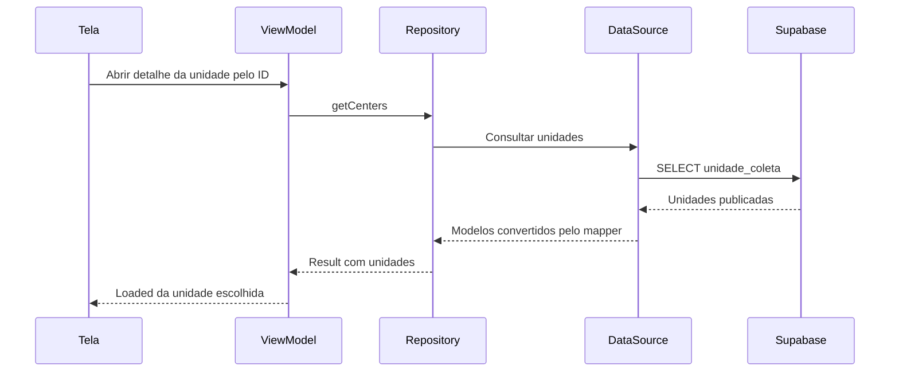
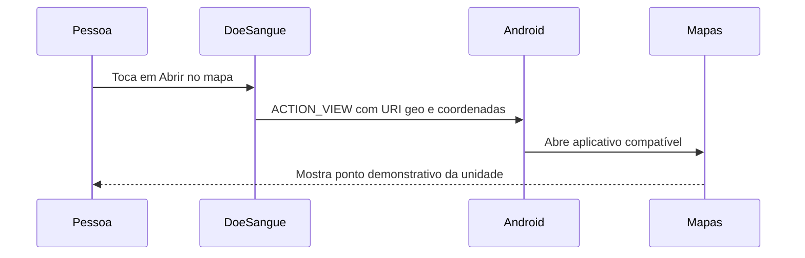

# F04 — abrir unidade no aplicativo de mapas

## Estado atual — 25/10/2026

Após o aceite manual, usuária autorizou commit e push de toda esta etapa, incluindo implementação, testes, migração/seed e documentação. Envio normal para origin/main, preservando arquivos locais ignorados; não reaplicar banco nem repetir suítes aprovadas por essa autorização. Próximo ID continua dependente de escolha e tutoria.

Integração Android escrita pela usuária e validada: coordenadas do catálogo passam ao detalhe, botão condicional chama callback no grafo, launcher abre ACTION_VIEW/geo e trata falhas específicas. Banco/seed aprovados anteriormente e não repetidos. Agente criou testes/docs, sem editar produção: sete JVM de mapper em0,225s e25 Android em76,311s aprovados no Moto g04/Android14. APKs/Lint aprovados em1m26s, zero erros/14 avisos; instalação -r preservou dados. Oito testes de Intent/launcher, três da tela e14 de lista/busca/detalhe/grafo; detalhes em docs/12. Saídas geo foram interceptadas, sem abrir mapa real ou acessar rede.

**Aceite manual recebido em25/10:** usuária confirmou o teste e relatou abertura no Google Maps e no Waze. Recorte escolhido de abertura externa por unidade concluído, com evidência por relato; sem nova captura/inspeção de tráfego ou atribuição de detalhes adicionais sobre rótulo, posição exibida ou retorno. O rótulo enviado é Demonstração: nome da unidade, mas sua exibição depende do receptor. Sem receptor, espera-se o Toast específico, já exercitado automaticamente. Distâncias/GPS/mapa interno permanecem fora deste recorte; F04 ampliada não concluída. Confirmação altera somente documentação, sem repetir testes/SQL/seed/remoto ou executar Git. Próxima etapa depende de escolha da usuária, em tutoria. Seções seguintes conservam a evolução histórica e as propostas anteriores à implementação.

## Confirmado em 23/10/2026

Usuária escolheu F04 como próxima etapa e, entre mapa interno e externo, escolheu abrir a unidade no aplicativo de mapas. Retomada em tutoria: usuária escreve produção, agente orienta/revisa em passos curtos. Marco anterior 42972b7 conferido, main limpa e 0/0 em relação à referência local origin/main; sem novo fetch/push solicitado nesta retomada.

Primeiro recorte: abrir posição demonstrativa da unidade pelo detalhe, com Intent ACTION_VIEW e URI geo, permitindo ao Android escolher aplicativo compatível. Não fixar Google Maps como único receptor. Não consultar GPS, solicitar permissão de localização, calcular distância ou iniciar navegação automaticamente neste recorte. Distâncias e mapa com várias unidades continuam pendentes de decisão própria, não apresentar toda F04 como concluída ao terminar somente a abertura externa.

Dados existentes são fictícios (Cidade fictícia/Endereço fictício A/B) e não podem ser geocodificados como locais reais. Acrescentar coordenadas demonstrativas explicitamente identificadas como simulação, sem alegar localização de hemocentro verdadeiro. Coordenadas a definir no seed didático posterior; não preencher automaticamente dados remotos nem geocodificar endereços sintéticos. Toda coordenada aponta para uma posição geográfica; o vínculo com a unidade será fictício.

## Estado existente conferido

DonationCenter, DTO e tabela unidade_coleta não possuem latitude/longitude. SupabaseDonationCenterDataSource faz select e mapper; SupabaseDonationCenterRepository preserva contrato getCenters. CenterDetailViewModel consulta lista pública e seleciona centerId; estado Loaded alimenta CenterDetailReadScreen em CenterScreens.kt. MainNavGraph liga CenterDetailById. Lista pública/busca/detalhe são funcionais; protótipo antigo não é o destino deste ajuste.

## Fluxo proposto — abertura externa

A consulta acima continuará trazendo a unidade e passará a transportar coordenadas opcionais. Quando elas estiverem presentes, a tela oferecerá a ação. Com coordenadas ausentes, informar localização não cadastrada, sem assumir zero/zero, pesquisar endereço fictício ou mostrar ação sem comportamento.

Sem aplicativo compatível, a camada Android trata ActivityNotFoundException e apresenta mensagem específica; não alegar que houve abertura. O app de mapas pode usar suas próprias permissões/configurações, mas Doe Sangue não pede ou recebe localização do doador neste fluxo. Abertura não retorna reserva, confirmação ou dados geográficos novos. Nenhum pedido de reserva é criado pelo mapa.

| Participante/responsabilidade | Arquivo/camada |
| --- | --- |
| Coordenadas válidas, sem dependência Android | domain/model/GeoCoordinates.kt, novo proposto |
| Unidade com posição opcional | domain/model/DonationCenter.kt, alteração futura |
| Transporte JSON/conversão | data/supabase/dto/DonationCenterDto.kt e mapper/DonationCenterMapper.kt, alterações futuras |
| Persistência das coordenadas públicas | nova migração/seed/roteiro em supabase, a escrever em tutoria |
| Consulta e estado | repositories/DataSource e presentation/centers existentes; reusar contrato |
| Botão no detalhe e callback | ui/screens/centers/CenterScreens.kt e ui/navigation/MainNavGraph.kt, alterações futuras |
| Construção da URI/abertura e falhas Android | helper em ui/maps, proposto, sem Context/Intent no domínio ou ViewModel |

## Sequência de tutoria proposta

1. Criar GeoCoordinates no domínio com latitude/longitude e invariantes numéricas.
2. Acrescentar posição opcional à unidade, mantendo compatibilidade com dados atuais.
3. Escrever migração de duas colunas opcionais com CHECK de par completo e faixas; revalidar RLS/grants existentes. Não executar remotamente sem autorização específica.
4. Transportar dados no DTO/mapper: par ausente representa ausência; par parcial/inválido não vira coordenada inventada. Preparar exemplos sintéticos e testes isolados.
5. Implementar URI/Intent e tratamento de ausência de aplicativo; ligar callback ao detalhe somente para posição cadastrada.
6. Conferir construção/encoding da URI, ausência/invalidez, aplicativos indisponíveis, navegação e preservação de lista/busca/agendamento. Teste real de abertura apenas quando houver dados demonstrativos e aplicativo disponível.

## Primeiro passo orientado

Em 24/10, conteúdo escrito pela usuária conferido: GeoCoordinates com latitude/longitude, init/require para valores finitos e faixas -90..90/-180..180. Arquivo está salvo como domain/model/GeoCoodinates.kt, com erro de grafia apenas no nome do arquivo; classe correta. Próximo passo orientado: renomear somente arquivo para GeoCoordinates.kt. Não avançar DonationCenter antes de conferir o nome. Índice AM preservado. Agente alterou apenas documentação; sem nova compilação/teste comportamental, produção, migração, seed, dependência ou configuração remota executada. Nenhum novo Git solicitado.

Fonte primária: [Common intents — mostrar localização](https://developer.android.com/guide/components/intents-common#Maps). URI geo/Intent são integração Android com aplicativo externo, não Maps SDK embutido. Guia de diagramas consultado para sequência local; nenhum arquivo Figma foi alterado.

## Progresso posterior — 24/10

Renomeação para GeoCoordinates.kt conferida, conteúdo correto e índice preexistente preservado. Próximo passo curto: usuária acrescentar val coordinates: GeoCoordinates? = null ao final de DonationCenter. Propriedade ainda não escrita/conferida; ausência de posição é null, nunca zero/zero inventado. Não alterar DTO, mapper, banco ou UI neste mesmo passo. Sem produção editada pelo agente, compilação/testes novos, SQL/remoto/Figma/Git.

Posteriormente no mesmo dia, DonationCenter.coordinates: GeoCoordinates? = null conferida no código da usuária. Próximo passo: criar somente o arquivo local supabase/migrations/20261024000100_adicionar_coordenadas_unidade.sql, sem executar. Proposta SQL: duas colunas double precision opcionais, CHECK de par completo/ausente e dois CHECKs de faixa; begin/commit, sem seed, policies ou grants novos. Arquivo ainda não escrito/conferido; remoto/DTO/mapper/UI/testes pendentes. Invariantes no Kotlin não substituem constraints no banco. Fontes: [CHECKs e NULL](https://www.postgresql.org/docs/current/ddl-constraints.html), [tipos numéricos](https://www.postgresql.org/docs/current/datatype-numeric.html). Sem produção alterada pelo agente ou novos testes/compilação/operações remotas/Git.

Migração local escrita pela usuária e conferida estaticamente: corresponde à proposta. Ainda sem execução/teste local ou remoto, sem seed/RLS/grants modificados; índice AM preservado. Próximo passo curto orientado: acrescentar latitude: Double? = null e longitude: Double? = null ao construtor de DonationCenterDto. Campos ainda não escritos/conferidos; nomes iguais aos do JSON dispensam SerialName, defaults toleram ausência no payload anterior à migração. Conversão para GeoCoordinates no mapper fica para o passo seguinte. Agente somente documentação, sem produção/compilação/testes novos/remoto/Figma/Git.

Na conferência posterior, os dois campos foram encontrados em DonationCenter (domínio); DonationCenterDto ainda sem eles. Correção orientada: mover somente latitude/longitude para o construtor do DTO e manter coordinates como representação única da posição no domínio. Não avançar mapper antes de conferir essa correção; nenhuma produção alterada pelo agente ou novos testes/compilação/SQL/remoto/Git.

Correção de arquivos conferida: DTO com latitude/longitude opcionais/default null; domínio com coordinates, sem duplicação das colunas. Próximo passo curto: importar GeoCoordinates e escrever no mapper helper privado DonationCenterDto.toCoordinates(): GeoCoordinates?, null apenas se ambos ausentes; demais casos constroem GeoCoordinates com requireNotNull de cada coluna. Par parcial falha; limites numéricos reutilizam init do domínio. Helper ainda não escrito/conferido e toDomain permanece sem transportar coordinates; ligação posterior. Agente somente documentação, sem produção/testes/compilação/SQL/remoto/Git.

Helper escrito pela usuária e conferido conforme proposto, incluindo import. Próximo passo único: acrescentar coordinates = toCoordinates() ao construtor DonationCenter em toDomain, após timeZoneId. Ligação ainda não implementada/conferida; testes dirigidos após essa alteração. Sem produção/testes/compilação/SQL/remoto/Git pelo agente nesta revisão, somente documentação.

## Validação dirigida da ligação — 24/10

coordinates = toCoordinates() escrito pela usuária e conferido. Agente criou DonationCenterMapperTest, teste SQL de integridade/permissões e runner local; não alterou produção. Sete JVM aprovados em0,128s: JSON antigo/NULL/campos existentes, transporte numérico, zero, par parcial, limites e valores não finitos/fora da faixa. Treze migrações em PostgreSQL descartável/PGlite0.5.10: alteração sobre unidades já existentes preservou campos anteriores e iniciou coordenadas nulas; teste com12 pares inválidos/constraint específica, nulos/zero/limites, publicação/RLS e leitura/escrita nos dois papéis aprovado. Unidades/reserva23 sintéticas preservadas no ROLLBACK. Script em supabase/tests/unidade_coordenadas_integridade_permissoes.sql, runner supabase/tests/local/validar_coordenadas_unidade.mjs, relatório ignorado em app/build/reports/sql/coordenadas-unidade.json. Ferramenta em pasta de build ignorada; sem alteração de dependências Android.

APKs produção/testes e Lint aprovados em9m25s na primeira compilação da sessão, zero erros/14 avisos. Lint demorado inspecionado ativo; nenhuma verificação desativada. Não executados testes instrumentados, mapa real ou SQL remoto; Auth/JWT/HTTP não cobertos pelo banco local. Migração remota/seed e helper de abertura continuam pendentes. Próximo passo único orientado: usuária aplicar somente a nova migração inteira no SQL Editor do projeto acadêmico e informar resultado; depois conferir catálogos, sem reaplicar antigos. Nenhum novo Git solicitado.

## Migração e validação remotas — 25/10

Usuária pediu que o agente fizesse os testes no SQL Editor. Consulta inicial encontrou somente RLS, sem latitude/longitude ou os três CHECKs. Usuária então autorizou especificamente aplicar 20261024000100_adicionar_coordenadas_unidade.sql e testar com ROLLBACK no projeto acadêmico fbrycvxelubxxafjstbo (main Production). Migração executada uma vez com sucesso; não reaplicar nem executar antigas. Antes da migração, registradas contagens/resumos comparáveis de2 unidades,3 perfis e1 agendamento, sem exibir dados de contas ou credenciais.

Script versionado de integridade/permissões executado inteiro no editor, incluindo BEGIN/DO/SELECT/ROLLBACK, aprovado. Aviso do painel sobre operações destrutivas confirmado dentro do teste autorizado, cujas tentativas de escrita nos papéis são bloqueadas e alterações temporárias desfeitas. Nenhuma concessão nova. Par nulo/completo/zero/limites e12 inválidos/constraint específica, RLS/publicação/leitura nos dois papéis e INSERT/UPDATE/DELETE/TRUNCATE bloqueados conferidos.

Consulta final somente leitura mostrou8 true: estrutura das colunas, três CHECKs ativos/validados, RLS, unidades preservadas, perfis preservados, agendamentos preservados, reserva23 agendada e coordenadas ainda sem seed. Preservação compara resumos antes/depois dos registros completos, excluindo apenas latitude/longitude adicionadas das unidades. Contagens finais2 unidades/3 perfis/1 agendamento; não excluir perfil adicional nem presumir seu dono. Sequências de identidade podem avançar pelo teste, mesmo com ROLLBACK.

Evidências locais ignoradas captures/2026-10-25-mapa-unidades: migracao.png, testes.png, conferencia-final.png (oito resultados legíveis), conferencia-final.sql e resultado.json. Aba de resultado mantida para usuária. Não houve seed, consulta de Auth/credenciais, alteração de grants/policies, nova produção Android, testes locais repetidos ou Git. SET ROLE administrativo não comprova JWT/HTTP nem abertura de mapa. Registros anteriores de migração remota pendente são históricos.

**Estado para retomada:** transporte e banco de coordenadas preparados/validados; todas as unidades existentes continuam sem posição cadastrada. Próximos passos voltam à tutoria: preparar seed demonstrativo versionado e depois implementar helper Android de URI/Intent, callback no detalhe e testes de abertura/aplicativo ausente. Sem avançar esses itens automaticamente a partir da autorização de testes remotos; F04 não está concluída.

## Seed demonstrativo — próximo passo guiado em 25/10

Orientado criar somente arquivo local supabase/seed_coordenadas_unidades.sql; ainda não escrito/conferido. UPDATE FROM VALUES associa Demo A (-22.9000,-47.0500) e Demo B (-22.9100,-47.0600) por nome/endereço/cidade do seed sintético existente, atualizando somente se latitude e longitude estiverem nulas. Não altera publicação, outros campos ou posições previamente preenchidas; RETURNING permite conferir resultado. Repetição prevista não gera linhas nem troca posições, mas precisa ser testada após usuária escrever o arquivo. BEGIN/COMMIT para a futura aplicação explícita, sem executá-la nesta orientação.

Coordenadas selecionam pontos geográficos, mas seu vínculo com as unidades é fictício para demonstrar a funcionalidade; não afirmam endereço de hemocentro real. Futuro helper/UI deve identificar demonstração e não usar GPS ou inferir distância. Autorização anterior de migração/testes não é autorização para executar este seed. Agente somente documentação, sem produção, novos testes, SQL remoto ou Git.

## Seed local e remoto aprovado — 25/10

Arquivo escrito pela usuária e conferido conforme proposta. Agente ampliou validar_coordenadas_unidade.mjs, sem alterar produção: primeira execução retorna somente A/B e coordenadas previstas; três unidades com nome/cidade/endereço semelhantes não são alteradas; segunda execução retorna zero e mantém registros idênticos; cenário com posição de A já preenchida e B ausente preserva A e preenche somente B. Publicação e leitura filtrada em anon/authenticated, demais campos/perfis/fixture23 preservados. Runner aprovado em PGlite0.5.10; relatório de coordenadas inclui as verificações de seed. Nenhuma dependência Android adicionada.

Após os testes, usuária autorizou especificamente executar somente seed_coordenadas_unidades.sql em fbrycvxelubxxafjstbo e conferir resultado. Capturada base de comparação antes; executado arquivo inteiro com BEGIN/COMMIT uma vez, retornando id1 Demo A (-22.9,-47.05,true) e id2 Demo B (-22.91,-47.06,false). Demais campos de unidades (inclui publicação),3 perfis e1 agendamento comparados antes/depois e preservados;2 unidades mantidas. Reserva23 continua agendada. Consulta de elegibilidade confirmou zero alvos para nova execução; não reaplicado seed remoto. Repetição efetiva comprovada localmente, não confundir com a consulta remota.

Verificação remota de leitura com DO/SET ROLE/ROLLBACK exigiu que anon/authenticated vissem somente id1 com sua posição, nunca id2. Conferência final retornou8 true: posição de A, posição/publicação oculta de B, demais dados das unidades, perfis, agendamentos,23 agendada, leitura nos dois papéis e seed sem alvos pendentes. São testes SQL administrativos, sem prova de HTTP/JWT ou abertura real de mapas. Associação geográfica permanece fictícia/demonstrativa.

Evidências ignoradas no mesmo diretório de capturas: seed-aplicado.png, seed-conferencia-final.png (oito resultados visíveis) e seed-conferencia-final.sql. Aba de resultado mantida para usuária. Não reexecutadas migrações, APKs/Lint ou testes Android, pois produção Android não mudou. Nenhuma nova credencial, grant/policy ou Git. Anotações anteriores de seed pendente são históricas.

**Retomada:** banco e transporte preparados com posições demonstrativas persistidas. Próximo passo é implementar em tutoria o helper Android que constrói a URI geo/Intent; depois ligar ação no detalhe e tratar ausência de aplicativo, com testes. Helper/botão/mapa real ainda não implementados/conferidos; F04 continua parcial.

## Primeiro passo do helper Android — 25/10

Orientado criar ui/maps/CenterMapIntent.kt, arquivo ainda não escrito/conferido. createCenterMapIntent(center: DonationCenter): Intent? usa coordinates ou retorna null, constrói point com latitude/longitude, codifica com Uri.encode a consulta com rótulo Demonstração e nome e retorna Intent.ACTION_VIEW com URI geo:$point?q=$query. Conversão String.toUri usa core-ktx já presente; nenhum novo SDK/dependência ou pacote de mapas fixado. Não chama startActivity, não consulta GPS e não envia endereço fictício para geocodificação. A unidade será identificada também como demonstração no futuro detalhe, pois a exibição de rótulos depende do aplicativo receptor.

Domínio/DTO/mapper/ViewModel continuam sem dependência de Intent/Context. Abertura, ActivityNotFoundException, callback/botão e testes virão depois da conferência dessa função. Agente alterou somente documentação, sem produção/compilação/testes/SQL/remoto/Git nesta orientação. Fonte conferida: [Intents de mapas — consulta por coordenadas e rótulo](https://developer.android.com/guide/components/google-maps-intents).

## Construtor conferido e abertura orientada — 25/10

CenterMapIntent.kt escrito pela usuária conforme proposto, conferido estaticamente; não compilado/testado neste passo. Próximo passo único: criar ui/maps/CenterMapLauncher.kt com openCenterMap(context: Context, center: DonationCenter). Reutiliza createCenterMapIntent, informa posição ausente sem chamar startActivity; acrescenta FLAG_ACTIVITY_NEW_TASK somente se Context não for Activity; tenta startActivity e trata ActivityNotFoundException (sem aplicativo de mapas) e SecurityException (abertura não permitida) com mensagens curtas em Toast, sem exceção bruta. Não fixar pacote, pedir GPS, antecipar resolveActivity ou acrescentar queries/QUERY_ALL_PACKAGES.

Launcher ainda não escrito/conferido, callback/botão e testes continuam pendentes. Context/Intent permanecem na UI; nenhum efeito de abertura no ViewModel. Para ContextWrapper que não seja Activity, pode usar NEW_TASK mesmo que a base seja uma Activity; retorno real/navegação precisam de conferência posterior. Fontes: [iniciar app e tratar ausência sem queries](https://developer.android.com/training/package-visibility/use-cases), [Context.startActivity](https://developer.android.com/reference/android/content/Context#startActivity(android.content.Intent)). Agente somente documentação; sem produção, compilação/testes novos, mapa real, SQL/remoto ou Git.

## Launcher conferido; contrato da tela — 25/10

CenterMapLauncher.kt escrito pela usuária e conferido conforme orientação, sem nova compilação/testes neste recorte. Próximo passo curto: importar DonationCenter em CenterScreens.kt e acrescentar onOpenMap: (DonationCenter) -> Unit à assinatura de CenterDetailReadScreen. Não alterar assinatura da lista ou do detalhe protótipo. Callback obrigatório ainda não escrito/conferido; botão e contexto/ligação no MainNavGraph ficam para passos seguintes. O grafo terá erro de argumento ausente até receber a nova ação; não apresentar compilação aprovada nesse estado intermediário. Sem produção alterada pelo agente ou operações remotas/Git; somente documentação.

## Callback conferido; ação visual orientada — 25/10

Import e parâmetro onOpenMap escritos pela usuária e conferidos somente no detalhe real. Próximo passo único: seção Localização no ramo Loaded antes de Agendar doação. Quando center.coordinates existir, mostrar indicação de posição fictícia para demonstração e SecondaryButton Abrir no mapa com onOpenMap(center); quando ausente, somente Localização não cadastrada. Botão ainda não escrito/conferido; ligação de LocalContext/openCenterMap no MainNavGraph fica para passo posterior. Argumento obrigatório pendente no grafo, sem nova compilação/testes ou abertura real. Agente somente documentação, sem produção, SQL/remoto ou Git.

## Botão conferido; ligação no grafo orientada — 25/10

Seção Localização escrita pela usuária e conferida conforme proposta, com callback recebendo a unidade atual, ausência tratada e Agendar doação preservado. Próximo passo único: importar LocalContext e openCenterMap em MainNavGraph, obter LocalContext.current dentro do destino CenterDetailById e passar onOpenMap = { center -> openCenterMap(context, center) } ao detalhe real. Ligação ainda não escrita/conferida; Context e efeito Android permanecem na UI, sem mudança de ViewModel/domínio. Nenhuma compilação/teste novo ou abertura de mapa nesta conferência; próximos testes dirigidos após integração. Agente somente documentação, sem produção/SQL/remoto/Git.
