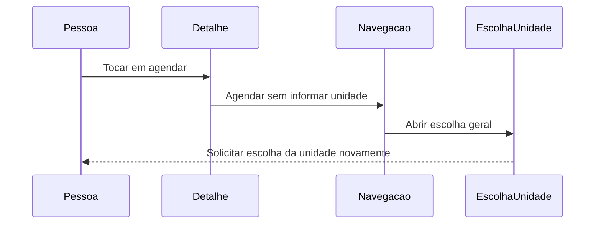
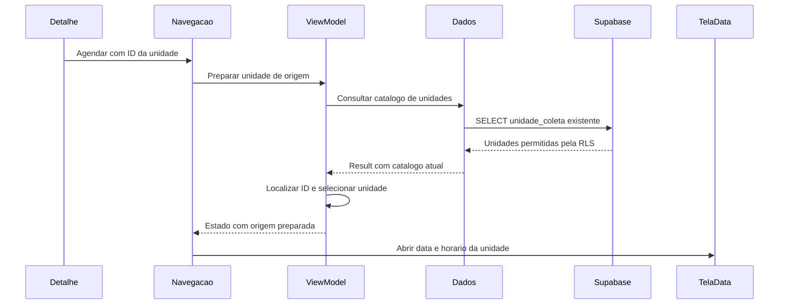

# T05 — agendamento iniciado por unidade ou campanha

## Estado atual — concluída e aceita em26/10

Usuária confirmou explicitamente que, nos dois caminhos (unidade e campanha), data/horário abriu com a unidade correta já selecionada e Voltar retornou ao detalhe de origem. Aceite manual por relato; sem captura nova, inspeção de tráfego/API/JWT ou atribuição de criação de reserva. T05 concluída neste recorte. Fechamento altera somente documentação, sem repetir testes/SQL/remoto ou executar Git. Próxima etapa depende de escolha e mantém tutoria com diagrama.

Autorização posterior em26/10: usuária pediu commit local e encerramento da T05, incluindo implementação/testes/documentação completos. Push novo não solicitado. Preservar arquivos locais ignorados; sem repetição das verificações aprovadas ou início de outro ID.

Tela/grafos/efeitos/callbacks de unidade e campanha escritos pela usuária e conferidos, incluindo correção do fechamento/onNavigate da campanha. Agente criou somente testes/docs. Rodada final integral **OK32 em122,223s**:8 SchedulingOriginFlowTest,14 CentersReadFlowTest,4 CampaignFilterFlowTest e6 AppointmentCreationFlowTest. APKs/Lint aprovados em3m9s, zero erros/14 avisos; atualização -r preservou dados no Moto g04/Android14. Primeira rodada8 teve1 falha na expectativa rígida de contagem de consultas; corrigido apenas teste para comportamento exigido (leitura atual, estabilidade no retorno, nova consulta ao reentrar), recompilação testes1m3s e rodada final integral aprovada. Detalhes/limites em docs/12; relatórios ignorados app/build/reports/t05-origin-flow.

Validados com fontes fictícias: ID da origem, campaign.centerId, modelo atual do catálogo, mesmo VM da preparação até revisão, remoção da preparação com retorno Android/seta às origens, filtros preservados, nova entrada com novo VM, pendência/ausência/erro/retry e entrada geral preservada. Sem rede/SQL ou reserva real. Consulta inicial é aproveitada quando ainda pendente; se já terminou, preparação solicita catálogo novo, podendo haver duas leituras sequenciais. Não houve alteração de produção pelo agente para ajustar esse comportamento.

**Roteiro manual encerrado:** Unidades → detalhe → Agendar doação → data/horário com unidade pronta → Voltar; Campanhas → detalhe → Quero agendar uma doação → data/horário com unidade vinculada → Voltar. Resultado confirmado pela usuária conforme registro acima. Roteiro se encerra antes de confirmar reserva; não atribuir nova gravação a esse aceite. Preservar23 e todos os perfis. Sem nova operação SQL/remota/Git autorizada. Os registros seguintes são históricos, com etapas já concluídas identificadas pela seção atual.

## Histórico da implementação guiada

Tela posteriormente conferida na pasta correta ui/screens/scheduling, sem duplicata em presentation, conteúdo/package preservados. A localização incorreta em presentation/scheduling foi corrigida pela usuária após orientação. Próximo passo único: registrar composable<ScheduleFromCenter> dentro do grafo Scheduling, antes de ScheduleCenter, com toRoute, VM compartilhado pelo schedulingEntry, coleta de estado, LaunchedEffect(centerId) iniciando preparação e CenterPreparationScreen com retry/back. Imports toRoute e tela necessários. Destino ainda não escrito/conferido; não muda startDestination nem liga origens ou avanço ainda. Sem nova compilação/testes nesta conferência; agente somente documentação.

Destino posteriormente escrito pela usuária conforme orientação; import toRoute ausente, corrigir no próximo passo. Orientado acrescentar também import de CenterPreparationUiState e efeito de avanço após o efeito de preparação. Chaves state.centerPreparation/route.centerId; Ready deve corresponder ao ID solicitado e à unidade selecionada. Navega ScheduleDate consumindo ScheduleFromCenter por popUpTo inclusivo e launchSingleTop, para não voltar à preparação e disparar avanço novamente. Fonte local Navigation2.9.8/NavOptionsBuilder confirma sobrecarga reified de popUpTo; preservação do VM e retorno serão conferidos em testes depois. Efeito ainda não escrito/conferido, callbacks das origens não ligados; sem compilação/testes novos, produção pelo agente/SQL/remoto/Git.

Imports e efeito de avanço escritos pela usuária e conferidos estaticamente conforme orientação. Próximo passo único: importar CenterDetailUiState em MainNavGraph e alterar apenas onSchedule da chamada real CenterDetailReadScreen no destino CenterDetailById. Extrair center do estado Loaded e enviar AppRoute.ScheduleFromCenter(center.id) quando presente; nenhum ID substituto/fallback. Callback ainda não escrito/conferido. Detalhe de campanha, protótipos antigos e entrada geral permanecem como estão neste passo. Depois ligação da campanha e validação dirigida do conjunto, incluindo preservação do VM/pilha/retorno; ainda sem nova compilação/testes/produção pelo agente/SQL/remoto/Git.

Callback da unidade e import conferidos conforme orientação. Próximo passo único: importar CampaignDetailUiState e alterar apenas onSchedule do detalhe real CampaignDetailReadScreen em CampaignDetailById, obtendo campaign do estado Loaded e enviando ScheduleFromCenter(campaign.centerId). ID da campanha não identifica unidade e não deve ser usado no lugar de centerId. Ainda não escrito/conferido; protótipos/entrada geral preservados. Após isso, compilar e testar grafo/atalhos/retorno/VM, adaptando expectativas antigas de abrir escolha geral. Sem novos testes/produção pelo agente/SQL/remoto/Git nesta revisão.

Import e lógica do callback da campanha escritos corretamente, mas o trecho perdeu onNavigate e o fechamento da chamada CampaignDetailReadScreen, ficando sintaticamente incompleto. Orientada substituição somente do destino composable<CampaignDetailById> pela versão completa formatada com os mesmos model/state/back, callback novo, onNavigate e parêntese final. Ainda não corrigido/conferido. Nenhuma compilação/teste de integração iniciado sobre o erro conhecido;17 anteriores permanecem evidência do ViewModel/fluxo geral antes desta integração. Agente somente documentação, sem produção/SQL/remoto/Git. Depois da correção, testes dirigidos de origem/pilha/VM/retorno.

Ligação de loadCenters escrita pela usuária e conferida. Agente criou apenas CenterPreparationViewModelTest:11 casos novos e6 AppointmentCreationFlowTest aprovados, OK17 em39,032s no Moto g04/Android14. APKs/Lint aprovados em1m19s, zero erros/14 avisos; instalados -r preservando dados. Fontes fictícias/sem rede ou banco; detalhes/limites em docs/12, saída ignorada app/build/reports/t05-center-preparation/instrumentation.txt. A consulta pendente do init atende a origem sem duplicação; respostas depois de clear/cancelamento não publicam estados; erros conhecidos, retry, modelo atual e rascunho/chave foram exercitados.

Próximo passo único orientado: criar ui/screens/scheduling/CenterPreparationScreen.kt com state: CenterPreparationUiState, onRetry e onBack. DsScreen com título Agendar doação; Idle/Loading informam consulta, Ready informa unidade selecionada e Error mostra mensagem, com retry somente se ID não branco. Tela ainda não escrita/conferida; não consulta nem navega por conta própria. Destino, passagem de ID nos detalhes, efeito de preparação/avanço e consumo da entrada com retorno continuam pendentes. Não declarar T05 funcional pela interface. Nenhuma nova produção pelo agente/SQL/remoto/Git. Seções seguintes preservam evolução histórica.

## Preparação em tutoria — 26/10/2026

Usuária escolheu T05 após concluir o recorte F04 de abertura externa. Marco f2a00ea conferido; main limpa e sincronizada com a referência local origin/main nesta preparação, sem novo fetch. Usuária escreve produção em passos curtos; agente confere e pode preparar testes/documentação. Nenhuma produção, teste novo, migração, seed ou configuração remota executados nesta preparação; nenhum Git novo autorizado.

## Comportamento existente

Os detalhes reais de unidade e campanha chamam onSchedule sem argumento. MainNavGraph encaminha ambos a AppRoute.ScheduleCenter; AppNavHost.navigateMain reconhece essa rota e abre AppGraph.Scheduling, removendo destinos internos da área principal. SchedulingNavGraph começa na escolha geral da unidade; SchedulingViewModel inicia loadCenters no init e selectCenter aceita um modelo escolhido. A etapa de data compartilha o ViewModel do grafo. Campaign já contém centerId, sem necessidade de transportar campanha inteira.

O destino de escolha geral continua funcional e será preservado para a entrada comum de agendamento.

## Fluxo proposto

Somente ID da unidade na rota ScheduleFromCenter(centerId). A origem passa center.id ou campaign.centerId. Uma entrada dedicada no grafo de agendamento prepara a seleção usando nova leitura pelo contrato getCenters. O ID da rota é uma intenção de seleção, não prova de disponibilidade nem autorização. A UI observa o resultado e avança a data/horário apenas com seleção válida do catálogo retornado.

Diagrama proposto mostra o sucesso, ainda não implementado. Falha de consulta precisa de mensagem/nova tentativa; unidade ausente precisa de mensagem específica e retorno, sem selecionar outra. Nova leitura não garante vagas futuras: horários e confirmação no servidor continuam com suas validações existentes. Não atribuir ao fluxo filtro de período da campanha ou disponibilidade antecipada de T03.

## Participantes, arquivos e camadas

| Participante | Arquivos e responsabilidade |
| --- | --- |
| Detalhe — UI | CenterScreens.kt e CampaignReadScreens.kt: clique informa ID da unidade carregada |
| Navegação — UI | AppRoute.kt, MainNavGraph.kt, AppNavHost.kt e SchedulingNavGraph.kt: transportar ID, entrada do fluxo e avanço/retorno |
| ViewModel — apresentação | SchedulingViewModel.kt e SchedulingUiState.kt: consultar, preparar seleção e expor carregamento/erro/sucesso |
| Dados — domínio/data | DonationCenterRepository, SupabaseDonationCenterRepository e SupabaseDonationCenterDataSource: contrato e consulta existentes; participantes agrupados no diagrama para legibilidade |
| Supabase — persistência | unidade_coleta e políticas existentes; sem mudança SQL prevista |
| TelaData — UI | ScheduleDateScreen em SchedulingScreens.kt: etapa já existente, usando unidade revalidada |

## Cuidados a resolver na integração guiada

- Entrada geral preservada; apenas detalhes reais usam nova rota. Protótipos antigos fora do percurso não justificam alteração automática.
- Compartilhar o mesmo ViewModel no grafo; coordenar init/loadCenters com intenção da origem, sem duas consultas concorrentes ou seleção antes da resposta.
- Preparar a origem uma vez por entrada, preservando seleção manual posterior e evitando reiniciar rascunho em recomposição/retorno. Limpar data/horário/chave anteriores conforme regras existentes, sem alterar pedido em gravação.
- Navegação para data consome/substitui a etapa de preparação para evitar reavanço automático ao voltar. Intenção de retorno: data volta ao detalhe de origem neste atalho; entrada geral continua voltando à escolha da unidade. Conferir pilha e escopo do ViewModel antes de considerar esse comportamento integrado.
- Não confiar em objeto da tela anterior como catálogo atual. Tratar ausência/erro com ações reais e mensagens específicas; nunca efetuar reserva automática.
- Não transportar dados pessoais, posição ou objetos completos na rota. Sem nova gravação no banco neste preparo.

## Primeiro passo orientado

Em AppRoute.kt, após ScheduleCenter, acrescentar somente @Serializable data class ScheduleFromCenter(val centerId: String) : AppRoute. Ainda não escrito/conferido. Rota é apenas declaração: não há destino/callback/preparação/avanço implementados. Preservar ScheduleCenter como data object e não alterar os demais arquivos neste passo. Conferência estática antes do próximo trecho; testes dirigidos depois de um conjunto coerente de integração, sem alegar comportamento pela declaração isolada.

## Validação planejada, ainda não executada

Origem de unidade/campanha transmite ID correto; catálogo novo fornece os dados atuais; ausência, erro/repetição e resposta atrasada não avançam indevidamente. Reposição/recomposição/Voltar não repetem preparação nem perdem seleção. Entrada geral, grafos, agendamento e retorno de mapas permanecem funcionais. Testes com fontes fictícias, sem reserva real/SQL ou disparo de e-mail. Aceite manual do atalho após integração; preservar reserva23 e todos os perfis.

Diagramas Mermaid locais; skill de diagramas e referência de sequência consultadas. Nenhum arquivo Figma/FigJam criado ou alterado nesta preparação.

## Rota conferida; estado da preparação orientado — 26/10

ScheduleFromCenter(centerId: String) escrita pela usuária e conferida com @Serializable, preservando rota geral. Apenas declaração; ainda sem destino ou callback. Próximo passo único: novo CenterPreparationUiState em presentation/scheduling, sealed interface com Idle, Loading(centerId), Ready(centerId) e Error(centerId,message). Representa preparo ainda não iniciado, consulta em andamento, unidade pronta e falha, mantendo identidade da origem nas respostas. Não guarda objetos de UI/SDK nem efetua consultas. Arquivo ainda não escrito/conferido; propriedade em SchedulingUiState, métodos de preparação, coordenação com loadCenters/init e integração nos grafos ficam para passos seguintes. Sem nova compilação/testes para declaração isolada; agente somente documentação, sem produção/SQL/remoto/Git.

Conferência posterior: conteúdo de CenterPreparationUiState escrito corretamente, mas salvo em CenterPresentationUiState.kt. Orientada somente renomeação do arquivo para CenterPreparationUiState.kt, mantendo declaração/conteúdo. Ainda sem conferência da renomeação ou ligação ao estado geral; nenhum teste novo/produção/SQL/remoto/Git pelo agente. Índice AM preexistente preservado.

Renomeação conferida: arquivo CenterPreparationUiState.kt no pacote scheduling e conteúdo correto preservado. Próximo passo único orientado: acrescentar centerPreparation: CenterPreparationUiState = CenterPreparationUiState.Idle ao construtor de SchedulingUiState após appointmentCreation; ainda não escrito/conferido. Mesmo pacote dispensa import; default mantém entrada geral sem preparação de origem. Nenhuma consulta/seleção/navegação implementada por essa declaração. Sem produção pelo agente, testes novos/compilação/SQL/remoto/Git; coordenação e integração continuam pendentes.

## Estado geral conferido; início da preparação orientado — 26/10

centerPreparation com Idle escrito pela usuária e conferido em SchedulingUiState. Próximo passo único: criar prepareCenterFromOrigin(centerId) no SchedulingViewModel, após selectCenter. Guardas para gravação ativa e mesmo ID já Loading/Ready; ID em branco gera mensagem específica, outros marcam Loading e chamam loadCenters. Repetição após Error continua permitida. loadCenters já tem guarda isLoading, portanto consulta do init em andamento é aproveitada; a ligação posterior do resultado com a preparação será necessária para atender a origem pendente. Método ainda não escrito/conferido. Não mudar init nem ligar destino/UI neste passo. Sucesso/falha/ensureActive no carregamento, seleção de modelo atual, limpeza coerente do rascunho, consumo da entrada e testes seguem pendentes; não declarar fluxo funcional por esse método isolado. Agente somente documentação, sem produção/compilação/testes novos/SQL/remoto/Git.

prepareCenterFromOrigin escrito pela usuária e conferido com as guardas/validação propostas. Antes da conclusão da consulta, próximo ajuste único orientado: no trecho final válido, resetAppointmentRequest e cancelar timeSlotsJob; substituir copy que apenas marcava Loading por novo SchedulingUiState, preservando catálogo e isLoading, e incluindo Loading(centerId). Isso limpa data/horário/estado de gravação anteriores e chave local para uma nova intenção, inclusive mesmo ID após erro, sem duplicar manualmente cada campo do rascunho. Não cancela reserva persistida; isLoading preservado mantém coordenação com consulta do init. Deixar loadCenters após o bloco. Ajuste ainda não escrito/conferido; conclusão/erros/cancelamento da consulta e grafos continuam pendentes. Agente somente documentação, sem produção/testes/compilação/SQL/remoto/Git.

Limpeza escrita pela usuária e conferida conforme orientação. Próximo passo único: helper privado completeCenterPreparation, após prepareCenterFromOrigin. Lê a intenção Loading atual, exige consulta terminada sem erro e ausência de gravação; busca ID no catálogo, publica Error específico se ausente e, se presente, reutiliza selectCenter e publica modelo atual/Ready. selectedCenter recebe explicitamente o registro atual no final para não preservar metadados antigos quando o ID coincidir. Helper ainda não escrito/conferido nem chamado; ligação ao sucesso de loadCenters, erro da consulta e ensureActive ficam para próximo trecho. Sem produção/compilação/testes novos/SQL/remoto/Git pelo agente; não avançar grafo/UI antes de coerência do resultado.

## Conclusão conferida; resultado da consulta orientado — 26/10

completeCenterPreparation escrito pela usuária e conferido conforme orientação, ainda sem chamada. Próximo passo único: no bloco de corrotina de loadCenters, guardar Result retornado, chamar ensureActive antes de publicar qualquer resultado e aplicar fold. Sucesso atualiza catálogo/isLoading=false e depois chama completeCenterPreparation; falha mantém mensagem geral existente, termina isLoading e transforma apenas preparação Loading em Error, preservando ID. Outros estados de preparação permanecem intactos. Mantidos início/guarda da função e init; ensureActive já importado. Ajuste ainda não escrito/conferido. Depois validar comportamento do ViewModel com fontes fictícias antes de destino/callback/UI. Sem produção pelo agente, nova compilação/teste/SQL/remoto/Git nesta conferência.
