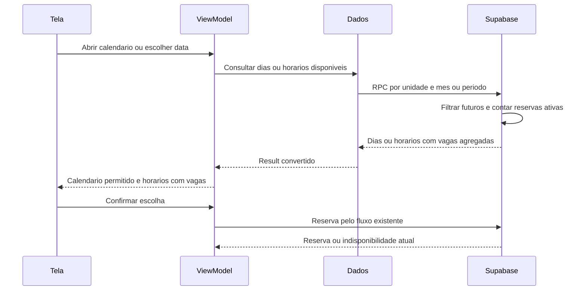

# T03 — dias e horários futuros com vagas

**Encerramento em 26/10/2026:** usuária confirmou teste manual sem bugs ou erros. Aceite por relato no recorte de disponibilidade; não implica cenários adicionais, nova reserva ou nova inspeção HTTP/JWT. Registro somente documental, sem repetir testes/SQL/seed/remoto ou executar Git. Próxima etapa depende de escolha da usuária e volta à tutoria com diagrama.

**Autorização posterior de Git em 26/10:** após esse aceite, usuária autorizou commit e push do conjunto completo de produção, testes, migração/seed e documentação da T03. Envio normal a origin/main; arquivos locais ignorados e dados preservados. Sem repetição de testes ou operações de banco pelo fechamento. As referências a Git ainda não autorizado abaixo registram o estado anterior a esta autorização.

## Escopo autorizado em26/10/2026

Usuária delegou implementar a etapa inteira diretamente após T05 (ed07251 enviado ao GitHub). Exceção de implementação só para T03; próximos conceitos voltam à tutoria. Estado inicial main limpa. Nenhuma autorização nova de Git/remoto está implícita; preparar arquivos e testes locais antes de pedir aplicação específica no projeto acadêmico fbrycvxelubxxafjstbo. Preservar todos os perfis e reserva23.

Antes desta etapa, a consulta lia horario_disponivel por unidade/faixa e filtrava ativo/publicação via RLS, sem vagas agregadas; o calendário aceitava dias sem oferta. Agora consulta as duas RPCs descritas abaixo. Reserva existente já bloqueia horário passado/lotado e serializa concorrência; esse controle foi preservado. Disponibilidade é uma fotografia, não reserva nem comprovação de coleta.

## Fluxo proposto (antes da implementação)

Dados agrupa contrato/repository/DataSource; nenhum dado pessoal de reservas sai da consulta. Confirmação no diagrama é o fluxo existente via AppointmentRepository/DataSource.

## Decisões de implementação

- RPC consultar_horarios_disponiveis: unidade/faixa finita de até32 dias, futuro em statement_timestamp, unidade publicada/horário ativo, capacidade menos todos os agendados (cancelados não ocupam), somente vagas positivas e ordenação por início/id. SECURITY DEFINER com search_path vazio e EXECUTE explícito anon/authenticated; nenhuma abertura de leitura privada nas tabelas.
- RPC consultar_dias_disponiveis: mês/unidade, usa fuso cadastrado da unidade para limites e dia local, reutiliza a consulta de horários e agrega dias sem limitação de linhas do transporte HTTP. Mês consultado ao navegar calendário, sem horizonte de produto inventado ou consulta por tecla.
- DTO exige vagas_disponiveis na resposta; sem fallback silencioso à consulta antiga caso migração ausente. Modelo/mapper/usecases/VM/UI acompanham disponibilidade. Calendário desabilita datas sem oferta consultada e durante carregamento/erro, com retry e confirmação protegida.
- Cancelar consulta anterior ao mudar unidade/mês/data e ignorar resposta tardia; atualização explícita. Conferência local de início antes de nova confirmação, preservando repetição idempotente de pedido já enviado.
- Testes SQL descartáveis e com ROLLBACK; fakes/JVM/Android para dados, calendário, vagas/tempo, cancelamento e regressões T05/confirmação. Aplicação remota específica só após autorização; não criar fixture persistente automaticamente nem alterar23.

## Fontes conferidas

Skill de diagramas e referência de sequência consultadas; Mermaid local, sem Figma remoto. Fontes primárias: [PostgreSQL CREATE FUNCTION](https://www.postgresql.org/docs/current/sql-createfunction.html), [Supabase funções](https://supabase.com/docs/guides/database/functions), [DatePickerState](https://developer.android.com/reference/kotlin/androidx/compose/material3/DatePickerState). Fonte local Material3 1.3.2 confirma que rememberDatePickerState atualiza selectableDates após recomposição; integração será testada com atualização assíncrona.

## Arquivos e responsabilidades

| Parte | Arquivos principais | Responsabilidade |
| --- | --- | --- |
| Banco | migrations/20261026000100_consultar_disponibilidade_agendamento.sql | Calcular vagas e dias, sem retornar reservas ou identidades |
| Dados demonstrativos | seed_disponibilidade_futura.sql | Acrescentar somente ofertas futuras ausentes da Demo A |
| Contrato e domínio | DonationTimeSlot, DonationTimeSlotRepository, GetAvailableDonationDatesUseCase, GetDonationTimeSlotsUseCase | Disponibilidade, limites do dia/fuso e proteção contra valores passados ou sem vagas |
| Dados Android | DTOs, mapper, SupabaseDonationTimeSlotDataSource/Repository | Chamar RPCs, exigir vagas na resposta e preservar cancelamento |
| Apresentação | CalendarAvailabilityUiState, SchedulingUiState/ViewModel | Consulta mensal, carregamento/erro/retry, cancelamento/respostas tardias e guarda de nova confirmação |
| Interface e ligação | DonationDatePickerDialog, SchedulingScreens, SchedulingNavGraph, AppContainer | Habilitar dias, apresentar vagas, atualizar e fornecer dependências |

Os arquivos Android estão sob app/src/main/java/br/edu/fatec/doesangue nas pastas correspondentes. O modelo mantém valor padrão para construtores existentes; o DTO da RPC exige explicitamente vagas_disponiveis, sem inventar disponibilidade quando o servidor não responde no contrato novo.

## Banco e dados demonstrativos concluídos em 26/10

SQL local PGlite0.5.10 com14 migrações aprovado: horários futuros/ativos/publicados, vagas de todos os doadores/cancelados, dias/fuso/bordas, parâmetros, permissões e liberação após cancelamento. Runner compara dados, definição de criar_agendamento e ACL/RLS antes/depois. Seed testado localmente com repetição sem duplicar, somente ofertas ausentes e sem sobrescrever capacidade/ativo previamente alterados.

Usuária autorizou especificamente a migração e o roteiro com ROLLBACK em fbrycvxelubxxafjstbo, identificado como projeto acadêmico apesar do rótulo main Production. Migração aplicada uma vez pelo SQL Editor; roteiro aprovado e9 verificações finais true. Preservados2 unidades/3 horários/3 perfis/1 agendamento,23 agendada e definição de criar_agendamento. Não reaplicar a migração nem repetir os testes remotos aprovados.

Depois, usuária autorizou somente seed_disponibilidade_futura.sql. Executado uma vez: IDs37/38/39 da unidade1, respectivamente **28/10/2026 08h (2 vagas), 28/10 10h (3) e 29/10 08h (1)** no fuso America/Sao_Paulo. Não cria reservas nem altera ofertas existentes. Conferência com ROLLBACK aprovou novamente9 verificações: leitura nos dois papéis, dias/vagas esperados e preservação dos três horários antigos, unidades, perfis, agendamento23 e função de reserva. Agora há6 horários; demais contagens citadas permanecem. Repetição do seed testada apenas localmente, sem segunda aplicação remota.

Evidências ignoradas em captures/2026-10-26-disponibilidade: baseline.json, migracao-aplicada.png, testes-supabase.png, conferencia-final.png/SQL, seed-aplicado.png, seed-conferencia-final.png/SQL e resultado.json. Conferências exibidas no chat. Testes SQL sob SET ROLE são administrativos; prova HTTP pública descrita abaixo é separada e não equivale a teste com JWT de doador.

## Android e limites

Produção implementada e instalada preservando dados. Cinco JVM aprovados (fuso/DST de23h, filtros, limites, DTO obrigatório e cancelamento). Quatro testes SDK interceptado e sete de ViewModel aprovados: contrato RPC/JSON, ausência de fallback, datas, tempo, refresh, resposta tardia e tentativa idempotente após início. Cinco testes do calendário/tela, uma leitura pública real pelo SDK e um percurso real de interface com consultas públicas aprovados; regressão de36 testes aprovada (11 preparação,8 origens,6 confirmação com fake,11 navegação). Resultados exatos/rodadas e Lint em [docs/12](12-validacao.md).

O percurso público usa cliente sem plugin Auth e dependências fictícias para perfil/sessão/reservas. Abre Unidades → Demo A → Agendar → calendário →28/10 → horários08h/10h com2/3 vagas e seleção; termina antes de enviar reserva. Não lê, renova ou modifica a sessão da usuária. Capturas calendario-supabase.png e horarios-supabase.png revisadas visualmente; instrução do calendário recebeu espaçamento para não encostar na borda arredondada.

A reserva continua sujeita ao estado atual do banco. Uma nova confirmação local é impedida quando o início chegou, mas repetir um pedido já enviado conserva a chave e pode recuperar o resultado após o início. Atualizar horários ou mudar a escolha inicia nova intenção conforme fluxo anterior. Rascunho/chave continuam em memória, sem promessa de restauração após morte do processo. Erros específicos da reserva fora do Auth continuam em F19, sem ampliar escopo.

Ofertas do seed expiram em28/29 de outubro; dados para apresentação de25/11 são B04 e dependem de preparação própria. Datas remotas não devem ser alteradas para fazer teste histórico passar. Testes públicos são opt-in (enableSupabaseReadTests=true; expectAvailabilitySeed=true exige a fixture datada). Aceite manual confirmado por relato da usuária, sem bugs ou erros, em 26/10/2026. Nenhum commit/push novo autorizado; próximos conceitos voltam à tutoria, sem iniciar backlog automaticamente.
