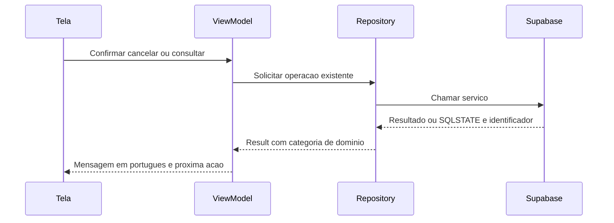

# F19 — mensagens específicas fora do Auth

**Encerramento em26/10/2026:** usuária confirmou o teste manual após a entrega. Aceite por relato no recorte de mensagens de erro, sem inferir cenários adicionais ou prova JWT/tráfego. Somente documentação atualizada; não repetir testes/SQL/remoto nem reaplicar migração por esta confirmação. Commit/push ainda sem autorização. Automação pontual já removida.

**Autorização posterior de Git em26/10:** usuária autorizou commit e push de todo o conjunto concluído F19, incluindo produção/testes/migração/roteiros/documentação. Envio normal a origin/main; arquivos ignorados e dados preservados. Não repetir validações aprovadas. Referências de Git não autorizado abaixo são anteriores a esta autorização.

## Autorização e proposta em26/10/2026

Após T03 concluída/enviada em1f5d3bd, usuária autorizou fazer também F19 diretamente, somente após15h24 America/Sao_Paulo. Automação desta conversa iniciou às15h25. Exceção somente F19; não iniciar demais IDs, não publicar Git automaticamente. Preservar reserva23, perfis, applicationId, dados/capturas/configurações ignorados. Remoto adicional exige autorização específica; nenhuma operação remota desta etapa executada nesta preparação.

Situação existente: Auth já tem classificação própria; edição completa do perfil já usa ProfileFailure, mas criação/tipo e algumas telas ainda perdem a causa. Outros repositories devolvem exceções brutas e ViewModels usam fallback para toda falha. criar_agendamento/cancelar_agendamento distinguem condições, porém vários RAISE usam o mesmo SQLSTATE P0001. Ler message em português/inglês ou HTTP400 não é contrato de causa.

## Sequência proposta antes do código

## Responsabilidades e limites propostos

- domain/model/DataFailure: categorias compartilhadas de dados e das operações de agendamento, sem SDK/Android/detalhes privados.
- data/supabase/mapper/DataErrorMapper: códigos estruturados e identificadores estáveis, exceções conhecidas de transporte/sessão, cancelamento preservado e UNKNOWN para causas não demonstradas.
- Repositories/DataSources: manter Result, identidade e guardas existentes; validar sessão/entrada com falha tipada, não por descrição de exceção.
- presentation/common/DataErrorMessages e ViewModels: mensagens por causa; fallbacks existentes por contexto; dados/escolhas/chave de repetição preservados e nenhuma navegação/limpeza de sessão automática (T01 separado).
- Perfil: reaproveitar ProfileFailure/ProfileErrorMessages existentes e completar os caminhos que ainda perdem a classificação, sem refazer Auth/edição.
- Nova migração: alterar somente RAISE das duas funções por CREATE OR REPLACE, acrescentando DETAIL estável doesangue.*.v1; preservar mensagens, SQLSTATE, parâmetros, regras, bloqueios, idempotência, atomicidade, grants/RLS. Não aplicar remotamente sem autorização específica.
- Testes: SQL em banco descartável/ROLLBACK, transporte SDK interceptado, mensagens/VM/UI com fontes fictícias; não criar/cancelar reserva real, enviar e-mail ou ler credenciais.

## Fontes

[PostgreSQL RAISE](https://www.postgresql.org/docs/current/plpgsql-errors-and-messages.html), [PostgREST erros](https://docs.postgrest.org/en/v14/references/errors.html) e fonte local postgrest-kt-android3.6.0: PostgrestRestException expõe code:String? e details:JsonElement?. SQLSTATE P0001 é compartilhado; DETAIL permite identificador sem depender da frase traduzida. Orientação de diagramas consultada, Mermaid local; nenhum Figma remoto alterado.

## Implementado

O padrão já usado no Auth foi reaproveitado para separar causa, transporte e mensagem, sem modificar o fluxo de autenticação. DataFailure transporta somente DataError, sem mensagem/cause bruta. ProfileFailure continua sendo o contrato do perfil; seu mapper reutiliza a classificação comum, e criação/edição de tipo passaram a preservá-la. Home, estoque e histórico usam toReadState com a mensagem tipada; unidades/campanhas/agendamentos/calendário traduzem a causa no próprio ViewModel. Estados de sucesso, ausência e vazio permanecem distintos de falha.

Identificadores do servidor ficam exclusivamente no campo DETAIL, no formato exato doesangue.<causa>.v1. O mapper de operações de agendamento exige também o SQLSTATE correspondente. Versão/campo/código inesperados não viram um diagnóstico por aproximação. O mapper de consultas não interpreta identificadores de criação/cancelamento. HTTP400/401/403/500, frases traduzidas, erros de constraint e exceções arbitrárias não bastam para afirmar falta de vaga, sessão expirada ou duplicidade.

| Identificador / código demonstrado | Causa apresentada |
| --- | --- |
| session_required / token rejeitado por código conhecido / sessão local ausente | Entrar novamente |
| profile_required | Acessar Perfil antes de continuar |
| slot_unavailable | Escolher outro horário; não revela se existe oferta oculta |
| slot_started | Horário escolhido já começou |
| slot_full | Horário ficou sem vagas |
| already_booked | Própria reserva ativa já existe neste horário |
| request_conflict | Pedido vinculado a outro horário; voltar e selecionar novamente |
| appointment_unavailable | Agendamento indisponível para a conta; mesmo identificador para inexistente e alheio |
| cancellation_closed | Prazo para cancelar terminou |
| invalid_request / dados inválidos por código conhecido | Conferir a escolha/dados |
| isolation_unsupported / função ou esquema ausente | Serviço indisponível; tentar mais tarde |
| Exceção conhecida de transporte / timeout | Verificar conexão e tentar novamente |
| Conflito transitório por SQLSTATE conhecido | Outra atualização em andamento; tentar novamente |
| 42501 sem identificador específico | Falta de permissão; não afirma que a sessão expirou |
| Desconhecido | Fallback seguro do contexto; nunca exibir exceção bruta |

Guardas locais de sessão e identificadores das operações usam falhas tipadas; erros de formato não precisam chegar ao servidor. A guarda temporal de T03 apresenta agora a causa específica de início/vaga, mantendo sua condição original e a exceção para repetição já enviada. Seleções, IDs, chave e dados carregados não são apagados em falha. Nenhum retry automático, logout, encaminhamento global ou nova regra de prazo foi introduzido; T01/T02 continuam separados. A resposta de sucesso ainda precisa corresponder ao ID/estado esperado.

## Banco aplicado e conferido em26/10

Migração20261026000200_identificar_erros_agendamento.sql preparada/testada localmente e aplicada uma vez, após autorização específica da usuária, no projeto acadêmico fbrycvxelubxxafjstbo, rótulo main Production. Acrescenta DETAIL aos19 RAISE das duas funções. Preserva SQLSTATE/mensagens, assinaturas, corpos (retirando somente DETAIL), ordem de bloqueios, idempotência, atomicidade, owner/ACL, RLS e demais funções. Nenhuma tabela ou seed novo.

PGlite0.5.10/15 migrações: runner validar_erros_agendamento.mjs compara corpos normalizados antes/depois, metadados/permissões/RLS/dados, executa o roteiro SQL descartável e verifica os dois papéis. Roteiro erros_agendamento_identificadores.sql usa dois perfis existentes e registros temporários do domínio; não cria/altera contas Auth ou perfis no Supabase. Confere17 rejeições no percurso principal, criação/repetição, cancelamento/repetição com um evento, privacidade de alheio/inexistente, preservação das linhas e quatro rejeições nos dois isolamentos. Todos os blocos terminam em ROLLBACK; sequências podem avançar. Ramos que dependem de violação impossível sob FK/locks são identificados na migração, sem corromper dados para forçá-los.

Remoto: conferência inicial encontrou **2 unidades/6 horários/3 perfis/2 agendamentos**, pois já havia mais um agendamento após o teste manual de T03. Ambos foram preservados, sem limpar ou atribuir essa criação ao agente. Hashes normalizados das duas funções coincidiram com a base local antes de aplicar. Migração retornou Success; roteiro integral aprovado; conferência final **10 true** para dados, corpos sem DETAIL/metadados, identificadores, RLS/EXECUTE e reserva23. Não reaplicar ou repetir os testes remotos aprovados. Asserções administrativas sob SET ROLE não comprovam JWT/tráfego de uma conta real.

Evidências ignoradas em captures/2026-10-26-erros-operacoes: baseline.json, migracao-aplicada.png, testes-supabase.png, conferencia-final.png/SQL, resultado.json e capturas sintéticas de interface. Resultado final mantido no navegador e prova exibida no chat. Nenhum e-mail, credencial, perfil real ou reserva existente foi alterado pelo teste; somente fixtures descartáveis foram criadas/canceladas no ROLLBACK.

## Testes Android e limites

Nove JVM novos (DataErrorMapperTest6 + DataErrorMessagesTest3) cobrem identificadores exatos/versionados/escopo e SQLSTATE, mesmo HTTP400 com causas distintas, ausência de inferência por frase/status, permissão versus sessão, schema/dados/busy, transporte/cancelamento, falhas já tipadas, mensagens/ReadUiState/perfil e não exposição de detalhes. Primeiro build destes testes falhou por import InternalAPI no pacote incorreto; corrigido somente no teste antes da aprovação.

SupabaseDataFailuresTest4 novos e SupabaseProfileEditTest4 de regressão: **OK8 em4,168s** no Moto g04/Android14 USB ZF524LTN7L. Auth/Postgrest reais com interceptor antes da rede e sessão apenas em memória. Confere DETAIL recebido, chave preservada, IDs/sessão inválidos sem HTTP, categorias propagadas em sete consultas e caminhos do perfil. Não acessa a sessão persistida no aparelho.

DataFailureFlowTest6 e AvailabilityViewModelTest7: **OK13 em28,730s**, fontes fictícias/sem rede. Criação: falta de vaga → conexão → desconhecido → sucesso, mesmo rascunho/chave; cancelamento mantém registro/estado até resposta correta e repete pelo mesmo ID; calendário com erro/retry/confirmar bloqueado; unidade com falha de serviço/retry; tipo sanguíneo com permissão negada mantém edição/seleção e repete; perfil com sessão indisponível permanece no destino e recupera consulta. Guarda temporal/idempotência de T03 conferida com mensagem atualizada. Capturas sem-vagas.png/prazo-cancelamento.png revisadas; são respostas artificiais de teste, não um cancelamento real fora do prazo.

APKs finais/Lint aprovados em2m2s, zero erros/14 avisos; instalados com -r preservando dados. Uma execução intermediária de Lint teve falha interna Unexpected owner function no LeakDetector; execução final sem cache de configuração passou, sem desativar ou suprimir verificações. Nove JVM finais novamente aprovados com os textos finais,0 falhas/erros/ignorados,0,566s de execução e build14s.

Regressão: **OK68 em233,204s**, sem falhas/ignorados: criação6, detalhe/cancelamento14, lista6, unidades14, campanhas4, perfil7, edição de perfil5 e Home12. Todos fictícios/sem rede. Total do recorte: **9 JVM e89 Android distintos aprovados** (8 SDK/perfil,13 interface/disponibilidade e68 regressão). Não se somam repetições do mesmo teste como casos novos. Relatórios ignorados em app/build/reports/f19-errors (sdk-first.txt,ui-first.txt,regression-final.txt), relatórios JVM/Lint usuais e relatório SQL local.

Limites: não houve teste de erro com JWT real, perda real de resposta ou nova concorrência de banco. Aceite manual confirmado por relato posterior; servidor testado administrativamente e SDK/UI com respostas fictícias. Contratos antigos sem identificador continuam seguros com fallback. Não alterar dados existentes para provocar erros. Implementação/validação técnica concluídas e aceite manual confirmado por relato posterior. Sem commit/push F19 autorizado. Automação pontual removida com sucesso ao encerrar esta execução; próximos conceitos voltam à tutoria e dependem de escolha da usuária, sem iniciar outro ID automaticamente.
