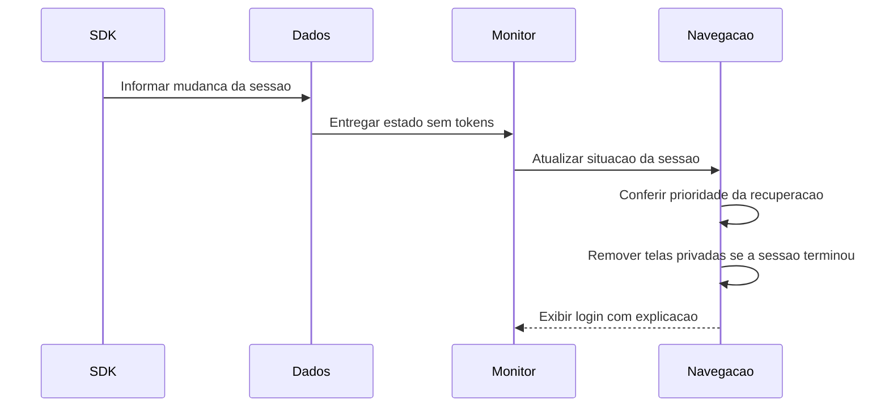

# T01 — sessão encerrada durante o uso

## Autorização e proposta em26/10/2026

Usuária autorizou implementar também T01 diretamente após F19 aceita/enviada emdc0c1c0; main limpa conferida. Exceção somente T01, sem executar backlog, operações remotas ou novo Git. Preservar applicationId, dados/perfis/reservas23 e demais, configurações/capturas ignoradas. Sem revogar sessão real, ler credenciais, enviar e-mail ou criar/cancelar reserva real nos testes.

Estado anterior: SessionViewModel restaura somente na Splash e depois é removido com o destino. F19 apresenta causas por operação, mas não coordena perda de sessão na navegação. F07 controla prioridade/identidade/saída da recuperação; F09 verifica confirmação em cliente isolado sem importar sessão. Esses fluxos precisam continuar protegidos.

## Sequência proposta antes do código

## Implementação e responsabilidades

- AuthRepository/SessionPresence: fluxo de ciclo de vida, somente usuário/estado, sem JWT/token/SDK. SupabaseAuthDataSource/Repository traduzem SessionStatus. Initializing, Authenticated, RefreshFailure e NotAuthenticated não são equivalentes.
- SessionMonitorViewModel/UiState: observação contínua no escopo raiz, sem NavController. Renovação temporariamente pendente mantém o último usuário verificado em memória; após recriação do processo sem usuário conhecido, aguardar autenticação antes de expor telas privadas.
- AppContainer/DoeSangueApp: injeção do monitor raiz, separado da consulta inicial da Splash.
- SessionNavigationPolicy/AppNavHost: área privada inclui Main e Scheduling; sessão encerrada limpa toda a pilha/VMs privados e abre login com mensagem, logout explícito preserva Boas-vindas. Mudança de conta limpa o conteúdo anterior. Bloquear apresentação privada enquanto o encaminhamento ocorre ou a identidade ainda está sendo verificada. Navegação continua na UI.
- AuthNavGraph: entrada autenticada aguarda identidade correspondente no monitor, sem perder resultado de login se a emissão do observador chegar depois. Recuperação tem prioridade; confirmação não deve importar sessão ou trocar conta.
- Guardas de dados/perfil: renovação temporariamente pendente não deve ser confundida com sessão definitivamente encerrada.
- Testes com SDK/interceptor/armazenamento em memória, estado/VM/grafos/Activity e regressões F07/F09/logout. Sem ajustes de duração de JWT, Supabase remoto ou contas reais.

Fonte local3.6.0: clearSession também usa NotAuthenticated(isSignOut=true) ao rejeitar refresh, portanto esse booleano sozinho NÃO demonstra saída voluntária. A intenção explícita deve vir da operação de saída do app; restauração/login/cadastro/recuperação novas limpam essa marca. RefreshFailure mantém retry do SDK, não deve disparar signOut/clearSession do aplicativo.

## Fontes e limites

[Eventos Kotlin](https://supabase.com/docs/reference/kotlin/auth-onauthstatechange), [sessões Supabase](https://supabase.com/docs/guides/auth/sessions) e sources.jar auth-kt-android3.6.0 conferidos. Monitor responde quando o SDK descobre a perda; não promete detecção instantânea de revogação remota enquanto o JWT ainda é válido. Backend/RLS continuam sendo a autoridade. Rascunho/chave após morte de processo é T02, não incluir armazenamento manual de credenciais nesta etapa. Mermaid local conforme orientação de diagramas; sem Figma remoto.

## Comportamento implementado

| Situação informada pelo SDK | Resposta do aplicativo |
| --- | --- |
| Sessão disponível da mesma conta | Mantém a navegação |
| Renovação pendente e conta já verificada nesta execução | Mantém tela, ViewModel e campos; informa que está tentando renovar |
| Inicialização ou renovação sem conta conhecida | Oculta conteúdo/semântica privados, bloqueia toques/teclas e aguarda identificação, sem apagar sessão |
| Sessão encerrada durante Main/Scheduling | Remove os destinos e ViewModels privados; abre Login com “Sua sessão foi encerrada. Entre novamente para continuar.” |
| Saída solicitada no aplicativo | Abre Boas-vindas sem aviso de expiração |
| Conta diferente da proprietária das telas | Remove o estado anterior; solicita nova entrada com explicação da mudança |
| Recuperação de senha em andamento | F07 mantém o controle do percurso; o monitor não redireciona |

O monitor é um ViewModel no escopo raiz; a Splash continua consultando a sessão inicial. A UI recebe apenas estados e ID do usuário. NavController fica na camada de navegação. O resultado do login/cadastro autenticado aguarda o observador confirmar o mesmo ID; uma emissão autenticada sozinha nunca entra automaticamente em Main. A política é testável sem Android.

Uma falha do próprio observador mantém a última identidade verificada e tenta observar novamente após dois segundos, sem criar uma conclusão de logout. Sessão encerrada elimina essa identidade em memória. Identidade proprietária e aviso usam rememberSaveable; não armazenamos tokens/senhas manualmente. T02 de rascunho após morte do processo continua separada.

A guarda comum requireDataUser aguarda a inicialização e protege operações privadas de agendamento, perfil e histórico. RefreshFailure produz SESSION_RETRYING, inclusive no contrato ProfileFailure reaproveitado. Não transforma erro genérico de rede/HTTP em sessão encerrada. Durante espera, o NavHost permanece montado para conservar o estado, mas conteúdo privado é ocultado de tela/semântica/entrada; foco/teclado são removidos quando o bloqueio é necessário. Na perda definitiva a pilha é removida, e os ViewModels descartados rejeitam respostas tardias.

## Validação técnica em26/10/2026

Diagrama registrado antes do código. **75 JVM aprovados**, zero falhas/erros (0,894s), incluindo seis novos SessionNavigationPolicyTest. **76 Android distintos aprovados** no Moto g04/Android14 USB, sem somar repetições:

| Grupo | Casos aprovados | Evidência e alcance |
| --- | --- | --- |
| SupabaseSessionMonitorTest / SessionMonitorViewModelTest | 7 / 4 | SDK real com transporte interceptado/memória: refresh vencido rejeitado, refresh sem rede e recuperação da mesma identidade, intenção explícita de logout versus flag do SDK, falha de logout, guardas de agendamento/perfil/histórico sem REST, espera da inicialização, tradução sem tokens. VM preserva usuário durante retry, limpa após encerramento, ignora eventos depois de descartado e retoma observação após falha |
| SessionMonitorFlowTest | 14 | Grafo/VM/UI reais: perfil/agendamento, limpeza de pilha/modelos, editor durante renovação, identidade inicialmente desconhecida, troca de conta, logout/retry, login aguardando observador correspondente, resposta tardia de leitura e criação, prioridade F07 e restauração do estado salvo |
| RecoveryActivityFlowTest / EmailConfirmationActivityTest | 10 / 6 | Activity/manifest/Compose reais com fontes fictícias atualizadas para emitir estados. Recuperação e confirmação mantidas com monitor raiz ativo |
| Login / logout / restauração / cadastro | 5 / 5 / 5 / 6 | Regressão dos percursos de entrada/saída e estados existentes |
| DataFailureFlowTest / SupabaseDataFailuresTest / SupabaseProfileEditTest | 6 / 4 / 4 | Regressão F19/contrato de perfil, mensagens e preservação de dados/chaves em falhas |

A rodada integral UI/regressão de49 casos passou em119,284s. Os11 SDK/VM passaram na rodada final.txt; os16 Activity F07/F09 passaram em integration.txt. Esses arquivos também conservam falhas anteriores dos testes descritas abaixo; a soma é por casos distintos aprovados, e não por todas as execuções. Relatórios ignorados em app/build/reports/t01-session. Capturas sintéticas ignoradas em captures/2026-10-26-sessao-durante-uso, sem credenciais ou dados reais do domínio.

APKs/Lint finais aprovados em3m37s, **zero erros/14 avisos**, instalados com -r preservando dados. Revisão visual identificou que o aviso de renovação ficava atrás do teclado. Uma tentativa com imePadding não resolveu no host de teste deste aparelho; o aviso passou para o topo com statusBarsPadding. O teste verifica também sua posição acima do campo. Repetição dirigida após esse ajuste aprovada em7,240s (banner-final.txt), sem somar como caso distinto. Capturas finais de encerramento e renovação revisadas: aviso legível, teclado aberto e campo preservado; nenhuma regra de sessão alterada pelo ajuste visual.

**Estado de entrega:** implementação e validação técnica concluídas; em26/10 a usuária aprovou o fechamento e autorizou commit/push do conjunto completo. Não foi relatado novo cenário manual ou revogação real. Versão instalada para conferência. A observação não exige configuração nova no Supabase. Próximos conceitos voltam à tutoria e dependem de escolha, sem iniciar T02 automaticamente.

Falhas intermediárias foram de preparação/seleção dos testes: scroll em diálogo sem área rolável; teste removia seu próprio último destino Login ao conferir popBackStack; título e botão com o mesmo texto exigiam selecionar a ação clicável. Corrigidos somente testes, sem enfraquecer regras de produção.

Nenhuma migração, seed, consulta remota, revogação de sessão real, e-mail, conta, perfil ou reserva reais foi alterada. SDK/HTTP usados nos testes são reais com transporte interceptado e armazenamento em memória; respostas/identidades são fictícias. Instalação com -r preserva os dados do aparelho. Esses testes não demonstram revogação remota/JWT real nem detectam revogação antes de o SDK receber evidência. Commit/push do conjunto completo autorizados posteriormente em26/10; testes/SQL não foram repetidos pelo fechamento.
