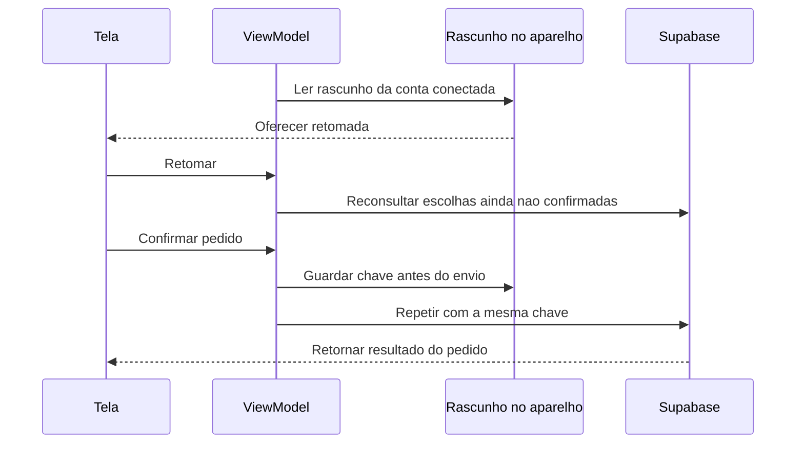

# T02 — retomada do rascunho e do pedido de agendamento

## Autorização e proposta antes do código — 26/10/2026

Usuária autorizou implementar T02 inteira diretamente, após T01 enviada em b750980/main limpa. Exceção somente T02; próximos conceitos voltam à tutoria. Sem Git novo, migração, operação remota, e-mail, conta/sessão persistida ou reserva reais nos testes. Preservar perfis, as duas reservas anteriores incluindo23, applicationId e ignorados.

## Decisões

- Persistência própria em arquivo privado noBackupFilesDir, gravação atômica/serializada, versão e validação do formato. Separação por ID da conta, nome de arquivo derivado por hash; sem senha/token/e-mail/perfil privado e sem backup automático desse rascunho. Guardar apenas IDs, etapa, data e metadados públicos mínimos para exibir o pedido anterior, incluindo identificação idempotente quando preparada.
- Rascunho sem pedido: oferecer retomar/descartar; após consentimento, reconsultar catálogo e disponibilidade. Unidade/data/horário inválidos voltam à escolha com explicação. Não tratar dados gravados como disponibilidade atual.
- Pedido preparado: guardar a chave com sucesso ANTES de chamar a RPC. Após interrupção, oferecer retomada explícita, nunca enviar automaticamente. Preservar a mesma chave/horário, inclusive com oferta oculta, vencida ou cheia; servidor já consulta idempotência antes da disponibilidade. Nunca inferir resultado consultando apenas horário/data da lista. Aceitar retorno cancelado como resultado anterior, sem reativação.
- Falhas desconhecidas/transitórias não liberam troca silenciosa de chave. Respostas estruturadas definitivas que comprovem rejeição permitem rever escolhas; saída para Home mantém o pedido pendente. Sucesso só limpa o arquivo quando a pessoa conclui o percurso. Erro local de gravação impede envio e explica a causa.
- Monitor T01 continua protegendo sessão/conta. Recuperação só expõe arquivo da identidade confirmada; cancelamento e respostas tardias não podem publicar na conta nova. Persistência fica em data, contrato/modelo em domain, coordenação em presentation e navegação/diálogos em UI.
- Testes fictícios: armazenamento/recriação com instância nova, conta diferente, arquivo inválido/falha de escrita, disponibilidade alterada, perda de resposta/mesma chave, cancelado, concorrência/cancelamento, origens T05 e regressão T01/F07/F09. Sem forçar encerramento do app real com sessão da usuária.

## Implementação

Application injeta FileSchedulingDraftStore em noBackupFilesDir/scheduling-drafts. Os containers dos testes antigos só habilitam esse recurso quando recebem um store explícito, preservando o isolamento dos testes. O arquivo tem versão1 explícita, JSON validado/limitado a16KiB, nome derivado por SHA-256 do ID, e campos públicos mínimos. Não armazena JWT, senha, e-mail, telefone ou nascimento. Um Mutex compartilhado no processo protege todas as instâncias; AtomicFile sozinho não oferece travas. A gravação faz fd.sync e confere os bytes publicados antes de retornar sucesso. Nenhuma chamada de criação sai se essa confirmação local falhar.

A confirmação durável usa createAppointmentForOwner: o data source confere a conta atual e captura a credencial correspondente somente em memória para a chamada, impedindo que o SDK escolha outra conta se a sessão mudar. O domínio recebe apenas IDs; tokens não chegam ao ViewModel nem ao arquivo. A RPC/JSON/schema e classificação SQLSTATE+DETAIL do F19 são preservados. O contrato padrão desse método falha fechado quando a implementação não oferece essa garantia; o caminho antigo de testes isolados continua separado.

SchedulingViewModel coordena oferta/revalidação/salvamento, protege pedidos preparados, rejeita respostas tardias e distingue rejeição definitiva de resultado incerto. A gate cobre todas as etapas e impede efeitos de origem antes da decisão de retomada. A retomada de escolhas reconsulta catálogo/horários; a de pedido preparado usa o resumo histórico, sem fingir disponibilidade atual. Não envia RPC ao abrir ou tocar Retomar. A confirmação exige ação própria. Resultado cancelado aparece como cancelado e não reativa; sucesso/cancelado só limpam o arquivo quando a pessoa conclui. Falha da limpeza repete apenas a limpeza local.

## Fontes técnicas

Escolha de persistência e limites de restauração conforme [estado de UI no Android](https://developer.android.com/topic/libraries/architecture/saving-states). Gravação e necessidade de sincronização própria conforme [AtomicFile](https://developer.android.com/reference/android/util/AtomicFile). Diretório excluído do backup conforme [getNoBackupFilesDir](https://developer.android.com/reference/android/content/Context#getNoBackupFilesDir()). SDK3.6.0 conferido em sources.jar local para captura de jwtToken apenas na chamada autenticada; sem alteração global da sessão.

## Validação técnica concluída — 26/10/2026

**77 JVM aprovados** (zero falhas/erros,0,944s), incluindo2 novos de validação do snapshot. **125 Android distintos aprovados**, sem somar repetições:

| Grupo | Casos | O que verifica |
| --- | --- | --- |
| FileSchedulingDraftStoreTest | 5 | Nova instância, isolamento/limpeza por conta, formato/versão/tamanho/owner inválidos, backup e leituras/escritas concorrentes entre instâncias, falhas de arquivo |
| PersistentDraftViewModelTest | 11 | Instância nova com arquivo físico, revalidação, vaga/unidade/data alteradas, falha local sem RPC, chave durável antes do envio, perda de resposta e repetição, cancelado, conta diferente, retry de leitura, rejeição definitiva e limpeza sem repetir confirmação |
| PersistentDraftFlowTest | 7 | Consentimento/nenhum envio automático, confirmação/conclusão, pedido passado/oculto já cancelado, descarte mantendo origem, reentrada no grafo, arquivo inválido, sessão/conta e Voltar por recorrência/data/unidade preservando escolhas |
| OwnedAppointmentRequestTest | 3 | SDK/HTTP interceptados: identidade/credencial capturadas, conta ausente/diferente/renovação sem REST, caminho RPC e schema preservados, erros SQLSTATE+DETAIL e mesma chave no retry |
| DisponibilidadeVM / preparação de origemVM / criação / origem / calendário | 7 / 11 / 6 / 8 / 5 | Regressão de estados, identidade idempotente, calendário e entrada por unidade/campanha |
| Navegação / UI F19 / UI T01 / Activity F07 / Activity F09 | 11 / 6 / 14 / 10 / 6 | Regressão de histórico, erros, perda/troca de sessão, recuperação e confirmação de e-mail |
| SDK T01 / SDK F19 / SDK edição de perfil | 7 / 4 / 4 | Regressão das guardas e categorias compartilhadas |

Rodada integral106 aprovada no Moto g04/Android14 em222,103s, após corrigir a disputa de AtomicFile. A etapa final de41 foi executada no Pixel_5/Android12/API32 temporário em34,221s, validando também os últimos ajustes de proprietário e retorno da navegação. Esses41 incluem22 casos já exercitados e19 adicionais; por isso o total distinto é125. Emulador executado sem janela, com -read-only/-no-snapshot; arquivos-base e dados da usuária preservados. Após a reconexão, os mesmos41 passaram no Moto g04/Android14 em42,693s e os APKs finais foram instalados com -r preservando dados.

Falhas intermediárias:2 aguardas de arquivo revelaram AtomicFile.openRead concorrendo com outra instância escritora; foi corrigida a sincronização no processo e acrescentada conferência dos bytes antes da RPC.3 novos SDK inicialmente falharam na fixture de login sem aud, antes de testar a operação; aud/role corrigidos somente no teste, depois os3 passaram. Falhas e rodadas anteriores permanecem nos logs, sem serem contadas como aprovação final.

APKs/Lint de produção finais aprovados em3m26s, **zero erros/14 avisos**; somente a fixture de teste mudou depois, e seu APK recompilou em1m19s. Relatórios ignorados em app/build/reports/t02-drafts (final.txt e final-owner-navigation-emulator.txt). Capturas sintéticas finais de oferta e pedido anterior no celular revisadas e legíveis em captures/2026-10-26-retomada-rascunho. A captura do emulador mostrou um alerta Bluetooth do sistema sobre a tela; foi separada como evidência do ambiente e não usada como aprovação visual do aplicativo. A conferência visual foi feita no celular após reconexão.

**Entrega:** código e validação técnica concluídos; a usuária confirmou “funcionou como esperado” e autorizou finalizar, comitar e enviar em26/10. Aceite por relato, sem atribuir cenários adicionais, morte de processo ou JWT/rede reais. A interrupção do celular foi resolvida inicialmente com o emulador e depois com a reconexão; o emulador temporário foi encerrado sem salvar estado-base. Usuária delegou F13/F14 diretamente após este fechamento; Google, Fale conosco e notificações ficam em tutoria. Regras dessas duas etapas dependem de decisão própria; massa de200 permanece separada.

## Limites

- Escolhas são gravadas assincronamente: um encerramento antes de concluir a última gravação pode recuperar a versão anterior. A chave do pedido tem barreira durável explícita antes da RPC.
- Rascunhos permanecem só neste aparelho/instalação e separados por conta, inclusive após sair. A outra conta não recebe suas escolhas. Desinstalar/limpar dados ou corromper o arquivo pode perder o rascunho; arquivo inválido não vira reserva e descarte exige ação explícita/aviso para consultar agendamentos.
- Não há expiração automática da chave incerta. Trocar de horário/chave só fica liberado depois de rejeição estruturada definitiva e revisão explícita, ou concluir o resultado recuperado.
- Testes recriam ViewModels e stores e usam arquivos físicos em cache isolado, sem matar o processo com a sessão real da usuária. Não atribuir prova de queda de energia, perda real de rede, JWT/revogação ou gravação de reserva real às simulações.
- Backend continua autoridade de identidade, capacidade e idempotência. Sem SQL remoto/migração/seed/teste remoto repetidos. Commit/push do conjunto completo T02 autorizados posteriormente em26/10; sem repetir testes pelo fechamento.
