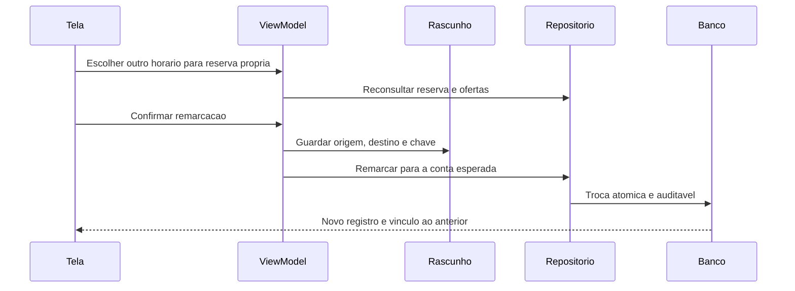

# F13 — remarcação do próprio agendamento

## Decisão e proposta antes do código — 26/10/2026

T02 aceita e enviada em e8220f3. Usuária delegou F13/F14 diretamente e aprovou remarcar até antes do início, para oferta futura com vaga, preservando o original em falha. Google, Fale conosco e notificações ficam em implementação acompanhada. Sem Git/remoto novo autorizado. Preservar23, segundo agendamento, perfis, applicationId e ignorados; testes fictícios sem Auth/contas/sessões/reservas reais.

## Decisões de implementação

- Criar novo agendamento e cancelar o anterior na mesma transação; manter horários e chaves de criação dos registros originais. Atualizar horario_id da reserva antiga quebraria a identidade de repetição já adotada na T02. Evento próprio liga origem/destino, ator, instante e chave da remarcação; cancelamento conserva seu evento. Não apagar originais.
- Perfil do doador coordena operações da mesma conta; horários antigo/novo são bloqueados em ordem estável de ID antes de criar/cancelar. Reusar funções existentes para capacidade/cancelamento, sem alterar seus contratos. Validar prazo após os bloqueios; falha reverte tudo.
- Idempotência da remarcação é consultada antes de estado/prazo/oferta; mesma chave e parâmetros retornam o resultado anterior, inclusive já cancelado. Reutilizar chave com outros parâmetros ou uma criação não relacionada é conflito. Mesmo horário não é remarcação válida.
- Nova consulta privada de resumos inclui vínculos de origem/destino para mostrar Remarcado e abrir o novo registro; consulta antiga permanece compatível. Tabela/sequence/eventos sem acesso direto por anon/authenticated; RPCs privadas verificam identidade.
- Wizard aproveita catálogo/calendário existentes. Confirmação mostra origem/destino; pedidos incertos mantêm chave e origem no arquivo da T02. Nova versão do snapshot lê arquivos anteriores; rejeição definitiva permite revisar. Retorno cancelado não é anunciado como ativo.
- Migração/roteiros serão preparados/testados localmente antes de pedir autorização específica de aplicação no projeto acadêmico. Nenhuma migração antiga será repetida.

Fontes técnicas: [bloqueios PostgreSQL](https://www.postgresql.org/docs/current/explicit-locking.html), [READ COMMITTED](https://www.postgresql.org/docs/current/transaction-iso.html). Não confundir teste administrativo/descartável com prova JWT/concorrência real.

## Estado

Implementação e validação técnica concluídas. Aceite visual confirmado por relato em26/10, após ajuste do calendário. Etapa encerrada; commit/push do conjunto completo autorizados em26/10/2026. Nenhuma operação remota adicional necessária; não repetir migrações/roteiro aprovados.

## Banco aplicado e conferido — 26/10

Após autorização específica, as duas migrações novas foram aplicadas uma vez no projeto acadêmico. Roteiro com ROLLBACK aprovado e nove conferências finais true. Baseline preservado:2 unidades,6 horários,3 perfis e3 agendamentos, incluindo23. Funções antigas preservadas por hash/metadados/ACL. Tabelasnovas vazias após rollback e sem acesso direto dos clientes. PGlite17migrações também aprovado; teste sequencial não é prova de concorrência/JWT reais. Não repetir aplicação/roteiro. Aplicativo e testes Android seguem em implementação.

## Aplicativo implementado

`SchedulingViewModel` consulta a reserva própria antes de preparar a troca e reaproveita unidade/calendário/horário. A confirmação mostra agendamento anterior e destino; a rotina é preservada e sua seleção não aparece na remarcação. Rejeição conhecida explica a causa e permite revisão; falha incerta conserva origem/destino/chave. Resultado cancelado de uma repetição nunca é apresentado como ativo. O detalhe antigo mostra Remarcado e abre a substituta, preservando Voltar ao anterior; chave do ViewModel acompanha o ID do registro.

O snapshot durável da T02 passou à versão2, mantendo leitura da versão1. A origem também pertence ao pedido e fica congelada depois de prepará-lo. Retomar uma troca pendente não exige oferta pública/original ainda ativa; a RPC decide entre resultado anterior e nova tentativa válida. Rascunho não enviado reconsulta a reserva própria. Origem de entrada só prevalece ao descartar explicitamente, evitando substituir silenciosamente a origem recuperada quando uma unidade desapareceu. O indicador de etapas usa três passos na troca e quatro na criação.

| Parte | Responsabilidade |
| --- | --- |
| Tela e grafo | Apresentar anterior/destino, pedir confirmação e navegar por ID |
| SchedulingViewModel | Preparar, conservar rascunho/chave e acompanhar resultado |
| AppointmentRepository e DataSource | Vincular a chamada à conta esperada e traduzir erros estruturados |
| remarcar_agendamento | Autoridade de identidade/prazo/vagas e transação com histórico |
| consultar_meus_agendamentos_v2 | Resumos privados e vínculos para acompanhar a substituição |

Regras de disponibilidade e identidade continuam no servidor. Nenhuma alteração manual do horário/chave do registro antigo, nenhum envio automático e nenhum acesso à sessão real nos testes. O aceite visual foi confirmado por relato em26/10 após o ajuste do calendário; Git deste recorte pendente.

## Resultado da validação

82 JVM/126 Android distintos aprovados; rodada final89 de regressão,15 UI/SDK e14 guarda/UI. APKs/Lint finais3m10s,zero erros/33 avisos registrados. Capturas finais sintéticas legíveis revisadas. Banco aplicado/testado após autorização, nove conferências finais true e3 agendamentos existentes preservados. Relatórios/detalhes/limites em [validação](12-validacao.md). Sem e-mails, sessões persistidas reais ou criação/cancelamento de reservas reais; sem prova JWT, morte real do processo ou nova concorrência remota. Aceite visual confirmado por relato em26/10; Git pendente; nenhuma próxima funcionalidade será iniciada automaticamente.

## Aceite manual — 26/10/2026

A usuária informou “Agora esta bom” após conferir o ajuste do calendário. Recorte encerrado por relato, sem atribuir cenários adicionais. Evidências anteriores preservadas, sem nova execução de testes/SQL ou Git por este aceite.

## Fechamento Git — 26/10/2026

Após o aceite, a usuária autorizou commit e push de F13/F14, incluindo o ajuste do calendário, testes e documentação. Preservar os arquivos ignorados. Validações anteriores mantidas, sem repetir SQL, testes ou sementes por este fechamento. Envio normal para origin/main, sem force-push; histórico anterior de Git pendente é conservado como registro.
