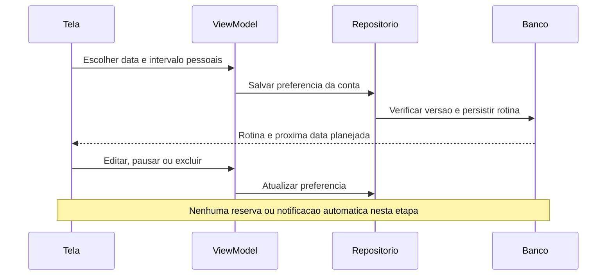
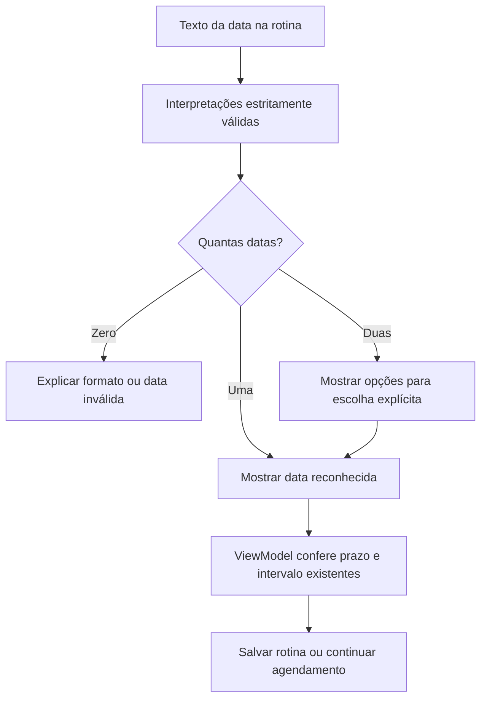
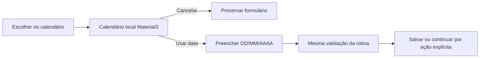

# F14 — rotina pessoal de lembretes

## Decisão e proposta antes do código — 26/10/2026

Usuária delegou diretamente e aprovou data inicial e intervalo em dias escolhidos pelo usuário, editar/pausar/excluir e nenhuma reserva futura automática. Entrega de notificações será F15, acompanhada pela usuária. Não oferecer cadência médica, calcular aptidão ou importar frequência clínica do protótipo. Sem novo Git/remoto autorizado.

## Decisões de implementação

- Uma rotina pessoal por conta, com início, intervalo de1 a3650 dias (limite técnico do formulário), fuso, ativa/pausada, versão e origem opcional no agendamento inicial. Não sugerir intervalo pré-selecionado. A próxima data é uma repetição de calendário, não data de aptidão para doar.
- Rotina é independente da ocorrência: cancelar/remarcar um agendamento não pausa nem apaga a preferência. Pode ser configurada em Minhas doações ou opcionalmente na confirmação inicial.
- Quando escolhida junto de um novo agendamento, gravar ambos atomicamente. Guardar um registro imutável dos parâmetros do pedido para que a repetição não reconfigure uma rotina editada/excluída posteriormente. Sem rotina escolhida não apaga a existente. Remarcação conserva a rotina atual.
- Edição usa versão para não sobrescrever atualização concorrente; repetição com mesmos dados já aplicados retorna o resultado. Pausar/retomar é estado explícito; exclusão repetida não recria rotina. Escolhas da confirmação fazem parte do snapshot durável da T02 e ficam congeladas após preparar o pedido.
- Datas, intervalo e fuso são validados no servidor e no app. Novo início não pode ser passado; editar mantém a base passada existente quando ela não for alterada. Nenhum envio de aviso nesta versão; F15 implementará entrega/consentimento/canais com a usuária.
- Dados privados via RPCs autenticadas, tabelas/sequences sem acesso direto por clientes. Função auxiliar interna sem EXECUTE para clientes. Nenhuma operação altera estoque, histórico de coleta, Auth ou perfis.
- Testes locais SQL/SDK/VM/UI com dados fictícios; autorização remota específica somente após preparar migração e roteiros concretos.

## Estado

Implementação e validação técnica concluídas. Aceite visual confirmado por relato em26/10, após ajuste do calendário. Etapa encerrada; commit/push do conjunto completo autorizados em26/10/2026. Nenhuma operação remota adicional necessária; não repetir migrações/roteiro aprovados.

## Banco aplicado e conferido — 26/10

Após autorização específica, as duas migrações novas foram aplicadas uma vez no projeto acadêmico. Roteiro com ROLLBACK aprovado e nove conferências finais true. Baseline preservado:2 unidades,6 horários,3 perfis e3 agendamentos, incluindo23. Funções antigas preservadas por hash/metadados/ACL. Tabelasnovas vazias após rollback e sem acesso direto dos clientes. PGlite17migrações também aprovado; teste sequencial não é prova de concorrência/JWT reais. Não repetir aplicação/roteiro. Aplicativo e testes Android seguem em implementação.

## Aplicativo implementado

Minhas doações → Agendamentos mostra o resumo e abre Minha rotina. Editor oferece data com máscara numérica DD/MM/AAAA, intervalo pessoal, salvar, pausar/retomar e excluir com confirmação. Mensagens específicas preservam o formulário em falhas. Conta diferente/saída limpa campos e cancela operações; resposta tardia da conta anterior é descartada. Recarregar resolve uma versão conflitante após revisão explícita.

Na criação, a pessoa escolhe somente aquele agendamento ou a rotina opcional. A preferência escolhida integra o pedido e o arquivo durável antes da chamada; não usar a opção mantém a rotina existente. `criar_agendamento_com_rotina` persiste reserva/preferência atomicamente, usando fingerprint imutável para repetir sem recriar preferência excluída ou sobrescrever edição posterior. A tela de sucesso distingue os parâmetros daquele pedido da configuração atual, que pode ter sido editada em outro aparelho.

| Parte | Responsabilidade |
| --- | --- |
| RoutineFields / ReminderRoutineScreen | Entrada com máscara, estado, mensagens e ações |
| ReminderRoutineViewModel | Validar, observar a conta e coordenar leitura/edição/pausa/exclusão |
| ReminderRoutineRepository | Contrato do domínio, Result e classificação de falhas |
| SupabaseReminderRoutineDataSource / DTO / mapper | Transporte vinculado à conta e conversão validada |
| RPCs privadas | Autoria, versão, validação e persistência |
| ReminderRoutine.nextDate | Próxima repetição de calendário no fuso da rotina, inclusive ano bissexto |

A versão é monotônica e não reinicia ao excluir/recriar, impedindo um editor antigo de apagar uma nova rotina. A próxima data não é aptidão clínica nem reserva. **F15 permanece pendente e será acompanhada pela usuária:** não existe entrega de notificações, permissão de avisos ou agendamento automático nesta etapa. Google/Fale conosco também permanecem guiados. Sem novo Git autorizado neste recorte.

## Resultado da validação

82 JVM/126 Android distintos aprovados; rodada final89 de regressão,15 UI/SDK e14 guarda/UI. APKs/Lint finais3m10s,zero erros/33 avisos registrados. Capturas finais sintéticas legíveis revisadas. Banco aplicado/testado após autorização, nove conferências finais true e3 agendamentos existentes preservados. Relatórios/detalhes/limites em [validação](12-validacao.md). Sem e-mails, sessões persistidas reais ou criação/cancelamento de reservas reais; sem prova JWT, morte real do processo ou nova concorrência remota. Aceite visual confirmado por relato em26/10; Git pendente; nenhuma próxima funcionalidade será iniciada automaticamente.

## Aceite manual — 26/10/2026

A usuária informou “Agora esta bom” após conferir o ajuste do calendário. Recorte encerrado por relato, sem atribuir cenários adicionais. Evidências anteriores preservadas, sem nova execução de testes/SQL ou Git por este aceite.

## Fechamento Git — 26/10/2026

Após o aceite, a usuária autorizou commit e push de F13/F14, incluindo o ajuste do calendário, testes e documentação. Preservar os arquivos ignorados. Validações anteriores mantidas, sem repetir SQL, testes ou sementes por este fechamento. Envio normal para origin/main, sem force-push; histórico anterior de Git pendente é conservado como registro.

## Correção da data manual da rotina — proposta em27/10/2026

A usuária relatou o problema na rotina. A máscara fixa transforma sete dígitos em uma data errada/incompleta. Manter o texto digitado e aceitar dia/mês sem zero; para seis a oito dígitos sem barras, enumerar somente interpretações estritamente válidas. Uma candidata é reconhecida; duas exigem escolha explícita. `1112026` significa 01/11/2026 OU 11/01/2026: nunca escolher por conta própria nem usar a regra de futuro para desambiguar. Reutilizar a validação estrita existente do calendário, sem alterar o calendário ou nascimento.

Correção compartilhada por Minha rotina e Configurar rotina no agendamento. Sem alterações de banco, perfis, reservas ou entrega de notificações. Testes e resultados pendentes.

### Ampliação pedida pela usuária em27/10 — calendário na rotina

Após a proposta de correção manual, a usuária pediu também o componente de calendário. Acrescentar calendário Material3 na mesma RoutineFields, mantendo entrada flexível. A rotina não depende de vagas/ofertas: selecionar uma data apenas preenche o formulário, sem salvar nem reservar. Permitir hoje/futuro e, ao editar, conservar a data original passada já admitida pelo ViewModel; cancelar mantém texto/intervalo. Conversão do DatePicker sempre em UTC para preservar o dia civil.

### Resultado técnico — 27/10/2026

Implementados RoutineDateInput (reutiliza SchedulingDateInput estrito), entrada preservada sem máscara fixa, reconhecimento canônico e duas opções explícitas nas ambiguidades. ReminderRoutineViewModel.choice é a mesma validação usada ao salvar e ao continuar o agendamento; não usa prazo/futuro para escolher uma interpretação por conta própria. Datas impossíveis, ano fora da faixa1900..9999 e início passado novo continuam bloqueados; data original passada de rotina existente pode ser conservada.

RoutineDatePickerDialog usa Material3, sem modo textual rígido embutido. RoutineFields compartilha o botão Escolher no calendário entre as duas telas. Seleção preenche DD/MM/AAAA; cancelar preserva texto/intervalo. UTC na conversão evita deslocar dia; calendário não consulta vagas e não salva nem cria reserva automaticamente.

Validação aprovada:

- 89 JVM, incluindo4 novos casos de parser: sem zero,6/7/8 dígitos, ambiguidades, datas inexistentes, entrada incompleta e ano bissexto. Zero falhas/erros/ignorados.
- 24 Android distintos OK em62,741s no Moto g04/Android14:9 ReminderRoutineViewModelTest (3 novos),11 RescheduleRoutineFlowTest (3 novos) e4 RoutineDatePickerTest novos. Cobrem interpretação explícita, bloqueio de gravação ambígua mesmo com uma candidata futura, prazo, calendário hoje/futuro/data original passada, cancelar, preenchimento sem gravação e rotina opcional no agendamento; regressão de salvar/pausar/editar/retomar/excluir, idempotência e remarcação.
- APKs/Lint finais aprovados em38s, zero erros/33 avisos. Instalados com -r preservando dados. A primeira tentativa de instalação, antes de acrescentar calendário, encontrou dispositivo offline e não iniciou testes; usuária reconectou e a rodada completa posterior passou.
- Capturas sintéticas do aviso/duas opções e do calendário legíveis, revisadas em captures/2026-10-27-data-rotina. Logs em app/build/reports/routine-date. Testes inteiramente fictícios/em memória, sem rede, e-mails, Auth ou reservas reais.

Nenhum SQL/migração/seed/remoto executado. Preservadas alterações locais anteriores de perfil/login, perfis, todos os agendamentos e applicationId. Aceite manual deste ajuste pendente; nenhum commit/push novo autorizado. Google continua como próxima implementação guiada após estes ajustes.

### Aceite manual — 28/10/2026

A usuária informou “conferi e agora está correto”. Ajuste de entrada manual e calendário da rotina encerrado com aceite por relato, sem atribuir cenários específicos adicionais ou operações de gravação não descritas.89 JVM/24 Android e verificações anteriores preservados; nenhuma repetição de testes/SQL/remoto por este aceite. Nenhum commit/push novo autorizado. Próxima etapa Google permanece guiada.

### Fechamento Git autorizado — 28/10/2026

Após confirmar o ajuste, a usuária autorizou commit e envio ao GitHub junto da reorganização de perfil/login. Preservar dados/ignorados e evidências, sem repetir testes ou SQL. Os registros anteriores de Git pendente são históricos.
