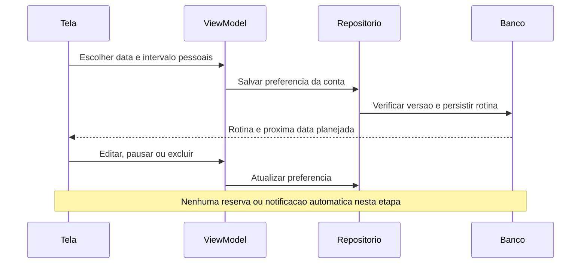

# F14 — rotina pessoal de lembretes

## Decisão e proposta antes do código — 26/10/2026

Usuária delegou diretamente e aprovou data inicial e intervalo em dias escolhidos pelo usuário, editar/pausar/excluir e nenhuma reserva futura automática. Entrega de notificações será F15, acompanhada pela usuária. Não oferecer cadência médica, calcular aptidão ou importar frequência clínica do protótipo. Sem novo Git/remoto autorizado.

## Decisões de implementação

- Uma rotina pessoal por conta, com início, intervalo de1 a3650 dias (limite técnico do formulário), fuso, ativa/pausada, versão e origem opcional no agendamento inicial. Não sugerir intervalo pré-selecionado. A próxima data é uma repetição de calendário, não data de aptidão para doar.
- Rotina é independente da ocorrência: cancelar/remarcar um agendamento não pausa nem apaga a preferência. Pode ser configurada em Minhas doações ou opcionalmente na confirmação inicial.
- Quando escolhida junto de um novo agendamento, gravar ambos atomicamente. Guardar um registro imutável dos parâmetros do pedido para que a repetição não reconfigure uma rotina editada/excluída posteriormente. Sem rotina escolhida não apaga a existente. Remarcação conserva a rotina atual.
- Edição usa versão para não sobrescrever atualização concorrente; repetição com mesmos dados já aplicados retorna o resultado. Pausar/retomar é estado explícito; exclusão repetida não recria rotina. Escolhas da confirmação fazem parte do snapshot durável da T02 e ficam congeladas após preparar o pedido.
- Datas, intervalo e fuso são validados no servidor e no app. Novo início não pode ser passado; editar mantém a base passada existente quando ela não for alterada. Nenhum envio de aviso nesta versão; F15 implementará entrega/consentimento/canais com a usuária.
- Dados privados via RPCs autenticadas, tabelas/sequences sem acesso direto por clientes. Função auxiliar interna sem EXECUTE para clientes. Nenhuma operação altera estoque, histórico de coleta, Auth ou perfis.
- Testes locais SQL/SDK/VM/UI com dados fictícios; autorização remota específica somente após preparar migração e roteiros concretos.

## Estado

Implementação e validação técnica concluídas. Aceite visual confirmado por relato em26/10, após ajuste do calendário. Etapa encerrada; commit/push do conjunto completo autorizados em26/10/2026. Nenhuma operação remota adicional necessária; não repetir migrações/roteiro aprovados.

## Banco aplicado e conferido — 26/10

Após autorização específica, as duas migrações novas foram aplicadas uma vez no projeto acadêmico. Roteiro com ROLLBACK aprovado e nove conferências finais true. Baseline preservado:2 unidades,6 horários,3 perfis e3 agendamentos, incluindo23. Funções antigas preservadas por hash/metadados/ACL. Tabelasnovas vazias após rollback e sem acesso direto dos clientes. PGlite17migrações também aprovado; teste sequencial não é prova de concorrência/JWT reais. Não repetir aplicação/roteiro. Aplicativo e testes Android seguem em implementação.

## Aplicativo implementado

Minhas doações → Agendamentos mostra o resumo e abre Minha rotina. Editor oferece data com máscara numérica DD/MM/AAAA, intervalo pessoal, salvar, pausar/retomar e excluir com confirmação. Mensagens específicas preservam o formulário em falhas. Conta diferente/saída limpa campos e cancela operações; resposta tardia da conta anterior é descartada. Recarregar resolve uma versão conflitante após revisão explícita.

Na criação, a pessoa escolhe somente aquele agendamento ou a rotina opcional. A preferência escolhida integra o pedido e o arquivo durável antes da chamada; não usar a opção mantém a rotina existente. `criar_agendamento_com_rotina` persiste reserva/preferência atomicamente, usando fingerprint imutável para repetir sem recriar preferência excluída ou sobrescrever edição posterior. A tela de sucesso distingue os parâmetros daquele pedido da configuração atual, que pode ter sido editada em outro aparelho.

| Parte | Responsabilidade |
| --- | --- |
| RoutineFields / ReminderRoutineScreen | Entrada com máscara, estado, mensagens e ações |
| ReminderRoutineViewModel | Validar, observar a conta e coordenar leitura/edição/pausa/exclusão |
| ReminderRoutineRepository | Contrato do domínio, Result e classificação de falhas |
| SupabaseReminderRoutineDataSource / DTO / mapper | Transporte vinculado à conta e conversão validada |
| RPCs privadas | Autoria, versão, validação e persistência |
| ReminderRoutine.nextDate | Próxima repetição de calendário no fuso da rotina, inclusive ano bissexto |

A versão é monotônica e não reinicia ao excluir/recriar, impedindo um editor antigo de apagar uma nova rotina. A próxima data não é aptidão clínica nem reserva. **F15 permanece pendente e será acompanhada pela usuária:** não existe entrega de notificações, permissão de avisos ou agendamento automático nesta etapa. Google/Fale conosco também permanecem guiados. Sem novo Git autorizado neste recorte.

## Resultado da validação

82 JVM/126 Android distintos aprovados; rodada final89 de regressão,15 UI/SDK e14 guarda/UI. APKs/Lint finais3m10s,zero erros/33 avisos registrados. Capturas finais sintéticas legíveis revisadas. Banco aplicado/testado após autorização, nove conferências finais true e3 agendamentos existentes preservados. Relatórios/detalhes/limites em [validação](12-validacao.md). Sem e-mails, sessões persistidas reais ou criação/cancelamento de reservas reais; sem prova JWT, morte real do processo ou nova concorrência remota. Aceite visual confirmado por relato em26/10; Git pendente; nenhuma próxima funcionalidade será iniciada automaticamente.

## Aceite manual — 26/10/2026

A usuária informou “Agora esta bom” após conferir o ajuste do calendário. Recorte encerrado por relato, sem atribuir cenários adicionais. Evidências anteriores preservadas, sem nova execução de testes/SQL ou Git por este aceite.

## Fechamento Git — 26/10/2026

Após o aceite, a usuária autorizou commit e push de F13/F14, incluindo o ajuste do calendário, testes e documentação. Preservar os arquivos ignorados. Validações anteriores mantidas, sem repetir SQL, testes ou sementes por este fechamento. Envio normal para origin/main, sem force-push; histórico anterior de Git pendente é conservado como registro.
