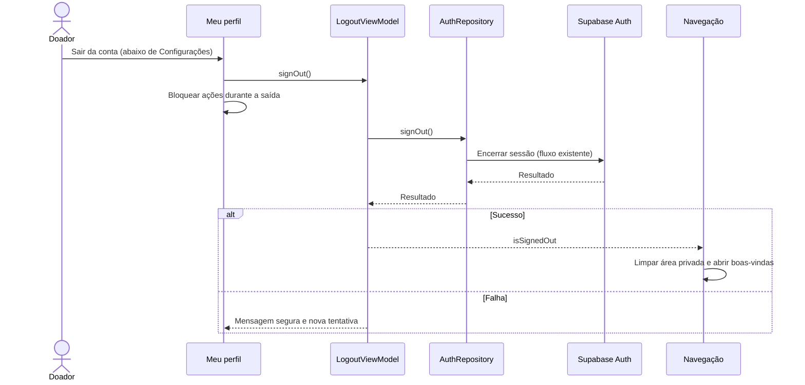

# Reorganização de perfil e login — 27/10/2026

Autorização direta da Katia: remover F17 (Fale conosco) e F06 (Facebook), mover Sair da conta para Meu perfil, abaixo de Configurações, e reorganizar o login. E-mail/senha permanecem; Google é a única opção social prevista, ainda sem integração. F05 será acompanhada em tutoria depois deste ajuste.

## Fluxo antes da implementação

O ponto de entrada muda da tela Configurações para Meu perfil. Repository, SDK e limpeza da pilha continuam no fluxo existente. A saída e as gravações do perfil não podem ocorrer juntas. Nenhuma migração, alteração remota, envio de e-mail ou configuração OAuth é necessária nesta etapa.

## Resultado técnico em27/10

- Produção: removidos Fale conosco (tela, rota e callback) e Facebook. Perfil recebe Sair da conta abaixo de Configurações; erro e nova tentativa ficam no perfil. Ações, navegação e Voltar bloqueados durante a saída; saída bloqueada durante criação de perfil ou gravação do tipo sanguíneo. Configurações conserva edição de perfil, segurança, notificações, FAQ e Sobre.
- Login: cabeçalho rosa com ilustração existente, formulário de e-mail/senha, separador e uma única opção social em largura total. Google está desabilitado e identificado com Em breve, até a integração F05 em tutoria. Teclado de e-mail, Autofill, Mostrar/Ocultar, mensagens e confirmação de e-mail preservados.
- 85 testes JVM aprovados, sem falhas/erros/ignorados.
- 46 testes Android distintos aprovados no Moto g04/Android14: primeira rodada43 em142,509s (login, saída, monitor/restauração de sessão, perfil e edição); rodada final22 em105,890s (19 revalidações pelo visual/bloqueios finais e3 de troca de conta em lista/detalhe/histórico). Capturas finais2 em12,906s, sem contar repetições como casos novos. Verificam ausência das opções removidas, ordem Configurações/Sair, erro/retry, bloqueio de navegação e gravações, limpeza da pilha e isolamento entre contas.
- APKs/Lint finais aprovados: build do visual em1m11s; recompilação dos testes/capturas em2m6s. Zero erros/33 avisos, sem apontamentos nos arquivos alterados desta etapa. APKs instalados com -r, preservando dados.
- Capturas sintéticas de login, perfil (rolado para mostrar saída) e configurações revisadas e legíveis em `captures/2026-10-27-perfil-login/profile-login-test`. A primeira captura via tela global pegou a transição anterior; helper mudou para captura do quadro Compose e os dois casos passaram novamente. Nenhuma regra de produção foi alterada por esse ajuste da captura.
- Logs ignorados: `app/build/reports/profile-login` (build, build-final, build-captures, android, android-final, captures). Fontes, sessões e respostas fictícias, sem e-mails/rede/Auth/reservas reais. Nenhuma operação remota executada; todos os dados existentes preservados.

Aceite visual da Katia ainda pendente. Nenhum commit/push novo autorizado ou realizado. F06/F17 retiradas do escopo; F05 é a próxima etapa guiada, ainda sem configuração de provedor/credenciais/retorno.

## Fechamento autorizado — 28/10/2026

A usuária autorizou commit e envio ao GitHub dos ajustes locais desta etapa. Aprovação para fechamento, sem atribuir novos cenários de teste manual do perfil/login. Evidências anteriores mantidas; não repetir testes ou operações remotas por esta autorização. Incluir também o ajuste de data/calendário da rotina aceito por relato (docs45), preservando arquivos ignorados. Após o envio, preparar o diagrama de F05 para tutoria, sem implementar OAuth automaticamente.
