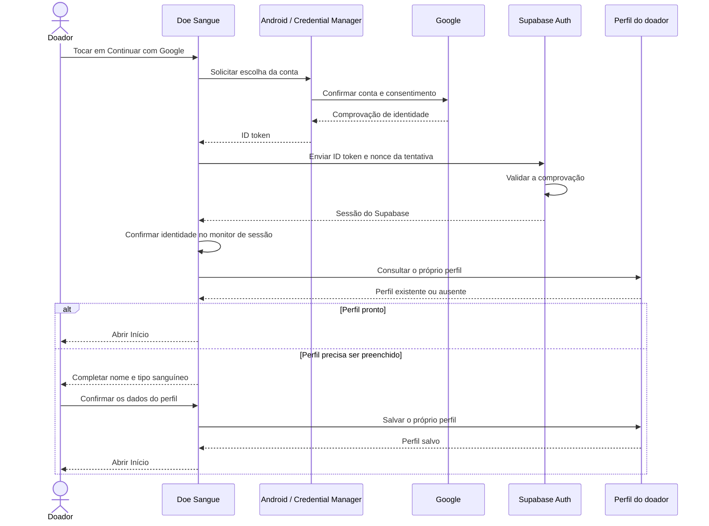

# F05 — login com Google: proposta e fluxo

**Prioridade confirmada em 29/10/2026.** A usuária escolheu concluir o escopo com login Google e, depois, notificações do aplicativo. Ambos seguem em tutoria. Google Calendar foi adiado como melhoria futura para a apresentação.

**Configuração conferida em 23/11/2026.** A usuária criou os clientes OAuth e configurou o provedor Google no Supabase acadêmico. O painel confirmou o provedor habilitado e a verificação de nonce ativa. O ID público Web foi configurado no `local.properties` ignorado pelo Git.

**Validação no aparelho em 23/11/2026.** A usuária confirmou que o login com Google funcionou corretamente no próprio aparelho. O relato confirma o login e deixa em aberto a conferência específica de primeiro perfil, restauração e cancelamento do seletor. Os APKs do app e de testes compilaram e os 96 testes JVM passaram. No Pixel_6 virtual, o Google Play Services estava abaixo da versão mínima exigida pelo Credential Manager. A repetição desse teste no emulador fica pendente.

Preparado em 28/10/2026, após envio de `cb75367` para `origin/main`. O conjunto de perfil/login e data/calendário da rotina foi publicado; a árvore estava limpa e sincronizada antes deste documento. Este arquivo inicia o planejamento local da F05, ainda sem implementação ou configuração remota.

## Proposta para o Android

Usar a seleção nativa de conta pelo **Credential Manager**. O Google confirma a identidade e devolve um **ID token**, uma comprovação assinada de quem entrou. O aplicativo encaminha essa comprovação ao Supabase Auth, que a valida e emite a sessão usada pelas nossas consultas privadas.

Esta é uma proposta de integração baseada nas documentações oficiais abaixo. Os detalhes de dependências e da API da versão instalada serão conferidos no passo correspondente da tutoria.

## Quem se comunica com quem

O diagrama representa o caminho de sucesso proposto. Cancelar a seleção mantém o login disponível. Falhas identificáveis recebem mensagens específicas, e uma resposta antiga não pode abrir a área privada para outra tentativa ou conta.

## Como isso se divide no nosso código

| Parte | Papel previsto | Situação atual |
| --- | --- | --- |
| `LoginScreen` | Mostrar o botão, iniciar a seleção nativa e exibir o resultado | Tela existe; botão Google está desabilitado |
| Adaptador do Credential Manager | Conversar com a interface nativa do Android e devolver sucesso, cancelamento ou falha | Será criado na camada Android; Context não vai para domínio/ViewModel |
| Coordenação de login / ViewModel | Controlar tentativa, carregamento, cancelamento e respostas atrasadas | Login por e-mail existe; comportamento Google será acrescentado em tutoria |
| `AuthRepository` e implementação | Definir a operação Google e encaminhar a comprovação à fonte de dados | Contrato Google ainda não existe |
| `SupabaseAuthDataSource` | Usar o SDK para validar ID token com provedor Google e nonce | SDK Auth já instalado; operação Google ainda não implementada |
| `SessionMonitorViewModel` e navegação | Confirmar a identidade autenticada antes da área privada | Fluxo existente será integrado, preservando perda de sessão e troca de conta |
| Repositório/tela de perfil | Ler perfil existente ou conduzir preenchimento inicial | Leitura/criação existem; entrada Google precisa ser ligada e validada |

O **nonce** é um valor aleatório próprio de cada tentativa, vinculado à comprovação recebida. O formato enviado ao Google e o valor apresentado ao Supabase devem seguir o contrato oficial; não basta receber um texto e considerá-lo autenticado.

## Mapa de arquivos previsto para a tutoria

Padrão didático confirmado pela usuária em28/10: mostrar arquivos/responsabilidades antes de escrever código. Nomes auxiliares abaixo são propostas; confirmar os detalhes no passo correspondente e atualizar a tabela se a divisão mudar.

| Situação | Arquivo | Camada e responsabilidade |
| --- | --- | --- |
| Novo, proposto | `GoogleSignInLauncher.kt` | Adaptador Android: abrir seleção nativa e devolver resultado sem levar Context ao domínio/ViewModel |
| Novo, proposto | `GoogleSignInCredential.kt` | Modelo independente do Android: representar comprovação e vínculo da tentativa; tratar valores sensíveis sem exposição em logs |
| Novo, proposto | `GoogleSignInResult.kt` | Resultado da seleção: sucesso, cancelamento ou falha |
| Acrescentar código | `domain/repository/AuthRepository.kt` | Contrato da autenticação Google |
| Acrescentar código | `data/repository/SupabaseAuthRepository.kt` | Implementação e conversão de falhas |
| Acrescentar código | `data/supabase/SupabaseAuthDataSource.kt` | Operação do SDK para validar comprovação e obter sessão |
| Acrescentar código | `presentation/auth/LoginViewModel.kt` e `LoginUiState.kt` | Tentativa, carregamento, resultado e proteção contra respostas antigas |
| Acrescentar código | `ui/screens/auth/AuthScreens.kt` | Botão e apresentação do fluxo |
| Integração prevista | `ui/navigation/AuthNavGraph.kt` e `AppNavHost.kt` | Sessão e destino após autenticação/primeiro acesso |
| Revisar conforme integração | Mensagens/mapper de erros e arquivos existentes de perfil | Erros específicos e conclusão do perfil ausente sem sobrescrever dados existentes |
| Configuração | `gradle/libs.versions.toml` e `app/build.gradle.kts` | Dependências e identificador público do cliente Google |
| Testes, agente | Arquivos de testes novos/atualizados a definir por comportamento | Seleção/cancelamento, token/nonce, erros, concorrência de tentativas, sessão e perfil |

Os caminhos Kotlin existentes acima são relativos a `app/src/main/java/br/edu/fatec/doesangue/`. Localização exata dos novos arquivos será explicitada antes de criá-los. Configurações do Google/Supabase e testes serão explicados separadamente. Cada passo guiado indicará arquivo, motivo, entrada/saída e ligação com o próximo componente; nenhuma produção foi implementada ao registrar este mapa.

## Perfil e contas existentes

### Passo do seletor nativo

O adaptador recebe uma Activity e o ID público do cliente Web. O Google recebe o SHA-256 hexadecimal do nonce, e o resultado de sucesso guarda o token e o nonce original para a futura validação pelo Supabase. Cancelamento e falha são resultados distintos.

| Arquivo novo | Camada e responsabilidade |
| --- | --- |
| `ui/auth/GoogleSignInLauncher.kt` | Integração Android com Credential Manager e Google ID |
| `domain/model/GoogleSignInCredential.kt` | Token e nonce original da mesma tentativa |
| `presentation/auth/GoogleSignInResult.kt` | Resultado entregue pela seleção nativa |

A validação deste passo é a compilação do APK de debug. A ligação com sessão, perfil e botão será feita nos passos de integração.

### Passo da autenticação no Supabase

`domain/repository/AuthRepository.kt` recebe a credencial do seletor. `data/repository/SupabaseAuthRepository.kt` devolve o usuário autenticado ou uma falha de domínio e propaga o cancelamento da corrotina. `data/supabase/SupabaseAuthDataSource.kt` envia o token e o nonce original pelo SDK Auth. O SDK atualiza a sessão observada pelo app. Os repositórios fictícios em `androidTest/ui/navigation` implementam o novo contrato para que a suíte existente continue compilando.

### Passo da coordenação do login

`presentation/auth/LoginViewModel.kt` reserva uma tentativa ao abrir o seletor, recebe seu resultado e chama o repositório. `LoginUiState.kt` já representa carregamento, erro e usuário autenticado. O estado de carregamento cobre a seleção e a autenticação e impede sobreposição com o login por senha. O tipo `GoogleSignInResult.kt` passa para `presentation/auth/`, onde pode ser usado pelo ViewModel e devolvido pelo adaptador Android. A ligação do botão e a validação do perfil ficam para os passos de integração.

### Passo do botão de login

`ui/screens/auth/AuthScreens.kt` recebe a ação opcional do botão. `ui/navigation/AuthNavGraph.kt` usa a Activity da tela para entregar o resultado do seletor ao ViewModel. A configuração pública do cliente Web será conectada pelo grafo principal junto com o tratamento de perfil e sessão restaurada. Até lá a ação permanece indisponível no app.

### Passo do primeiro acesso e da sessão restaurada

| Arquivos | Responsabilidade |
| --- | --- |
| `app/build.gradle.kts`, `local.properties` | Ler o ID público em `GOOGLE_WEB_CLIENT_ID` e disponibilizá-lo ao app |
| `AuthenticatedUser.kt`, `SupabaseAuthDataSource.kt` | Identificar o login Google e reconhecer a identidade Google na sessão restaurada |
| `AppNavHost.kt`, `AppRoute.kt`, `AuthNavGraph.kt`, `DoeSangueApp.kt` | Conferir a sessão e conduzir a consulta de perfil antes do Início |
| `CompleteGoogleProfileScreen.kt`, `ProfileViewModel.kt`, `AppContainer.kt` | Reutilizar consulta e criação do perfil em uma tela de primeiro acesso vinculada à conta |
| `DonorProfileRepository.kt`, `SupabaseDonorProfileRepository.kt`, `SupabaseDonorProfileDataSource.kt` | Gravar nome e tipo em uma única inserção vinculada à conta, com os mesmos controles de acesso |

Perfil existente abre Início. Perfil ausente pede nome e tipo sanguíneo, incluindo Não sei. Falhas de consulta permitem tentar novamente ou sair. A validação técnica compila APKs do app e de testes. O acesso real é validado em uma conta de teste acompanhada.

A trigger local atual cria o perfil automático somente quando encontra `nome_exibicao` nos metadados do cadastro. Não podemos presumir que um primeiro acesso Google produza esse mesmo perfil. O planejamento inclui tratar perfil ausente e pedir nome/tipo sanguíneo (incluindo Não sei), sem sobrescrever um perfil existente. Telefone/nascimento continuam opcionais.

Antes da implementação, conferir a política do Supabase para identidade Google e conta já cadastrada com o mesmo e-mail. A identidade da sessão será a referência; o aplicativo não fará fusão manual de contas por comparação de e-mail.

## Etapas acompanhadas

1. Conferir/criar o projeto e a configuração do Google Auth Platform, com identificadores Web/Android, `br.edu.fatec.doesangue` e assinatura de desenvolvimento. Configurações em conta externa serão acompanhadas e delimitadas no passo correspondente.
2. Configurar o provedor Google no Supabase acadêmico com os identificadores corretos. Segredos ficam na configuração do servidor; não entram no aplicativo, documentação ou Git.
3. Acrescentar dependências, adaptador Android e contrato/coordenador em passos pequenos, explicando as camadas.
4. Integrar validação de token/nonce, sessão e perfil; ligar o botão quando o fluxo estiver pronto.
5. Testar com respostas fictícias cancelamento, erro, repetição, resposta atrasada, conta diferente e perfil ausente/existente. Depois realizar o teste real acompanhado, com autorização específica para a conta de teste e sem compartilhar senha ou tokens no chat.

Os passos técnicos registrados acima incluem as dependências, a seleção de conta, a autenticação e a entrada por perfil. O login real foi confirmado por relato no aparelho da usuária.

## Referências oficiais consultadas em 28/10/2026

- [Android — Sign in with Google e Credential Manager](https://developer.android.com/identity/sign-in/credential-manager-siwg)
- [Android — implementação do Sign in with Google](https://developer.android.com/identity/sign-in/credential-manager-siwg-implementation)
- [Supabase — Google no Android, incluindo Credential Manager](https://github.com/supabase/supabase/blob/master/apps/docs/content/guides/auth/social-login/auth-google.mdx)
- [Supabase Kotlin — autenticação nativa com ID token](https://supabase.com/docs/reference/kotlin/auth-signinwithidtoken)
