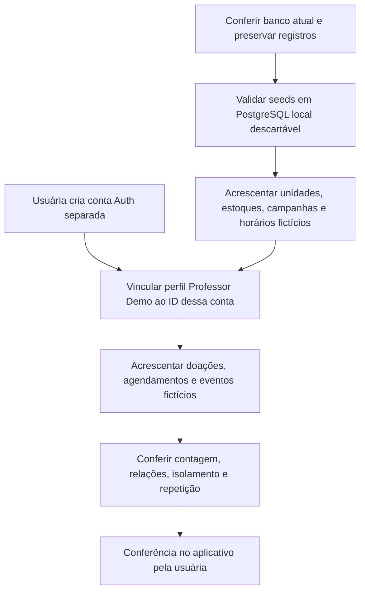

# Massa acadêmica e conta de avaliação — 28/10/2026

Delegação direta da Katia: antecipar a massa de200 registros e preparar uma conta separada para avaliação, com histórico de doações, cancelamentos e rotina. Somente dados fictícios no domínio; e-mail fornecido fica apenas no Auth e não neste documento/Git. Senha aleatória entregue à usuária sem arquivo; entrada e confirmação no painel ficam com ela.

## Fluxo antes da carga

| Arquivo novo previsto | Responsabilidade |
| --- | --- |
| `supabase/seed_avaliacao_publica.sql` | Acrescentar12 unidades fictícias,8 estoques e8 horários por unidade,2 campanhas por unidade e tipos das campanhas dirigidas |
| `supabase/seed_avaliacao_professor.sql` | Receber o ID Auth da conta já criada e inserir somente o perfil e os cenários privados de avaliação |
| `supabase/tests/local/validar_massa_avaliacao.mjs` | Validar17 migrações locais, seeds, repetição/preservação, integridade e leitura com papéis simulados |
| Este documento e README Supabase | Distribuição, período, execução e evidências |

Nenhuma alteração de código Android, esquema, função, permissão ou migração remota está prevista. Os scripts são aditivos, transacionais, com marca própria e preservação de todas as linhas anteriores. Datas desta versão são fixas para a avaliação entre fim de outubro e início de dezembro de2026; reexecutar não renova datas nem reabre dados alterados pelo usuário. Não simular coleta real nem aptidão: histórico, estoques, unidades e rotina são demonstrações.

## Conferência inicial remota

Projeto acadêmico `fbrycvxelubxxafjstbo`, main. Consulta de28/10 encontrou2 unidades,6 horários,3 perfis,**4 agendamentos**,2 eventos de cancelamento,4 campanhas,2 vínculos de tipos,16 estoques e3 doações. Preservar todos, não presumir o baseline anterior de3 agendamentos. Reserva23 continua protegida como todos os registros existentes. As duas tabelas finais de rotina serão conferidas novamente em consulta compacta. Nenhum dado foi inserido durante essa leitura. Conta pretendida ainda não existia no Auth; formulário preparado para a usuária definir a senha e criar.

## Resultado aplicado em28/10/2026

A usuária criou no painel a conta Auth separada com auto confirmação; o agente não digitou/submeteu senha. Conta vinculada somente ao perfil Professor Demo, tipo Não sei, telefone/nascimento nulos. Nenhum acesso administrativo foi concedido ao professor.

Os dois seeds foram aplicados UMA VEZ no projeto acadêmico. São **276 novos registros**, levando o domínio de42 para **318 registros**, sem contar as5 contas Auth.

| Tabela | Antes | Novos | Depois |
| --- | ---: | ---: | ---: |
| unidade_coleta | 2 | 12 | 14 |
| estoque_sangue | 16 | 96 | 112 |
| horario_disponivel | 6 | 99 | 105 |
| campanha | 4 | 24 | 28 |
| campanha_tipo_sanguineo | 2 | 24 | 26 |
| perfil_doador | 3 | 1 | 4 |
| agendamento | 4 | 7 | 11 |
| agendamento_cancelamento | 2 | 4 | 6 |
| doacao_historico | 3 | 6 | 9 |
| agendamento_remarcacao | 0 | 1 | 1 |
| rotina_lembrete | 0 | 1 | 1 |
| agendamento_rotina_pedido | 0 | 1 | 1 |
| **Total** | **42** | **276** | **318** |

Das12 unidades novas,10 estão publicadas e2 ocultas. Das24 campanhas novas,19 ficam visíveis:20 de unidades publicadas menos1 rascunho. Há gerais e dirigidas a pares de tipos. As8 ofertas públicas por unidade vão de29/10 a09/12/2026; outras3 são ofertas históricas inativas usadas no cenário de cancelamento. Coordenadas aproximadas são fictícias e identificadas como demonstração; não são locais reais de atendimento.

Professor Demo tem6 doações fictícias em datas históricas,7 agendamentos (3 ativos,3 cancelamentos históricos e1 original remarcado),4 eventos de cancelamento,1 vínculo de remarcação e1 rotina ativa iniciando01/12/2026, intervalo técnico fictício30 dias. Preferência não calcula aptidão, não cria reservas futuras nem envia notificações. Uma intenção histórica vincula uma reserva à configuração da rotina.

## Evidências e limites

- PGlite descartável:17 migrações locais, ambos seeds e repetição aprovados;252 públicos/24 privados. Preserva linhas antigas/funções/ACL, nega conta ausente, confere leitura pública e consultas privadas. Roteiro final somente leitura também testado localmente.
- Após a aplicação inicial, o arquivo do seed privado recebeu guarda adicional para uma repetição futura não recriar rotina excluída pelo usuário. Caso de exclusão/repetição aprovado somente no PostgreSQL local; não houve nova carga remota por esse ajuste.
- Remoto: conferência somente leitura/ROLLBACK aprovada; conta confirmada,6 doações/7 agendamentos/1 rotina nas RPCs da identidade simulada do professor; identidade sintética diferente não recebe registros. RLS ativo nas12 tabelas, capacidade e eventos coerentes. Não são provas de JWT/login real ou concorrência.
- Comparação remota adicional dos9 resumos MD5 existentes antes da carga retornou `dados_anteriores_preservados = true`; inclui os4 agendamentos anteriores,3 perfis e demais dados das tabelas então populadas. As3 tabelas restantes estavam vazias antes.
- Cada seed captura todas as linhas anteriores das12 tabelas em tabelas TEMP e impede COMMIT se qualquer registro antigo mudar. O aviso do painel sobre RLS se referia apenas a essas tabelas temporárias, descartadas no COMMIT; não foi desabilitado RLS nem alterado grant/policy de tabela permanente.
- Evidências locais ignoradas: app/build/reports/massa-avaliacao e captures/2026-10-28-massa-avaliacao. Payload privado aplicado contém ID de teste e fica ignorado; e-mail e senha não entram em fonte/documentação/Git. Scripts públicos versionados não contêm credenciais.

Não repetir seeds/migrações/fixtures remotos por mero aceite ou commit. A conferência no aplicativo com login real da nova conta ainda cabe à usuária. Nenhum código Android mudou e não foi executada nova suíte Android por esta carga. Google e notificações continuam pendentes em tutoria; sem commit/push novo autorizado.

## Roteiro para conferir no celular

1. Sair da conta atual e entrar com o e-mail de avaliação e a senha definida no painel.
2. Conferir Professor Demo no Perfil, seis registros em Doações → Histórico e os estados em Agendamentos.
3. Abrir detalhes de um cancelado e do remarcado; conferir vínculos e retorno.
4. Conferir a rotina em Configurar/Editar rotina, sem necessidade de salvar alterações.
5. Explorar Unidades, Estoques e Campanhas e aplicar filtros por tipo; unidades/campanhas ocultas não devem aparecer.

O APK atual acessa a nova massa pelo Supabase, sem precisar embutir o banco. Esta carga prepara avaliação, sem representar que as últimas funcionalidades ou a entrega acadêmica já foram aceitas.

## Aceite e fechamento — 28/10/2026

A usuária informou “conferi e esta funcionando” e autorizou commit e push. Massa aceita por relato de funcionamento no aplicativo, sem atribuir cenários adicionais ou aprovação do professor. Evidências e dados anteriores preservados; nenhuma repetição de testes/SQL/seed por este fechamento. Publicar scripts, testes e documentação completos, preservando arquivos ignorados e credenciais. Próximos conceitos (Google/notificações) seguem em tutoria com diagrama e mapa dos arquivos. Pendências anteriores de aceite/Git nesta página são históricas.
