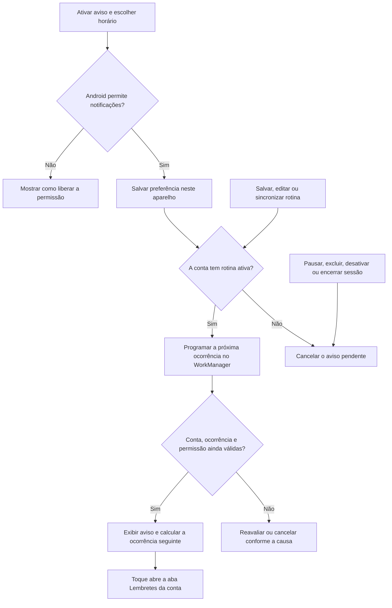

# F15 — Notificações da rotina

Escopo inicial aprovado em 23/11/2026. A pessoa pode ativar um aviso local no dia de cada ocorrência da rotina e escolher o horário. Ao tocar no aviso, abre a aba **Lembretes** da conta conectada. A reserva de uma doação continua sendo uma ação feita no aplicativo.

## Comportamento

- Em **Configurações → Notificações**, a preferência começa desativada. A ativação oferece a escolha de horário e solicita a permissão do Android quando necessário. Se a permissão estiver bloqueada, a tela informa o motivo e oferece acesso às configurações do sistema.
- A data vem de `ReminderRoutine.nextDate`. O horário é interpretado no fuso já armazenado na rotina. Se o horário de hoje já passou, programar a próxima ocorrência. O Android pode entregar o aviso depois do horário escolhido.
- As preferências são locais, por conta e por dispositivo. O aviso usa texto genérico na tela bloqueada. A rotina continua disponível na aba Lembretes mesmo com as notificações desativadas.
- Salvar ou editar uma rotina ativa substitui o trabalho pendente. Pausar, excluir, desligar o aviso, efetuar logout ou trocar de conta cancela o trabalho correspondente e remove avisos já exibidos para aquela conta.
- A abertura do app reconcilia o estado após a restauração da sessão. Mudanças feitas em outro dispositivo ficam sujeitas à próxima sincronização. Antes de publicar, o worker confirma a conta, a rotina ativa, a ocorrência e a permissão. Se a validação estiver temporariamente indisponível, pode tentar de novo no mesmo dia da ocorrência; avisos vencidos não são exibidos. A próxima ocorrência é calculada a partir da data da rotina para evitar deslocamento após atrasos.
- Este recorte cobre a rotina pessoal. Avisos de agendamentos, campanhas, estoques e atualizações do app dependem de uma definição própria. Google Calendar segue como melhoria futura.

## Fluxo

## Mapa de arquivos

Os caminhos Kotlin são relativos a `app/src/main/java/br/edu/fatec/doesangue/`. Os arquivos novos são propostos e serão confirmados no passo correspondente.

| Arquivo | Camada | Responsabilidade |
| --- | --- | --- |
| `domain/model/ReminderRoutine.kt` | Domínio existente | Reusar a data da próxima ocorrência e o fuso da rotina |
| `domain/notifications/RoutineNotificationSchedule.kt` | Domínio, proposto | Combinar data e horário, tratar horário passado e definir quando a ocorrência vence |
| `data/notifications/RoutineNotificationPreferences.kt` | Dados locais, proposto | Guardar ativação e horário vinculados à conta |
| `data/notifications/RoutineNotificationScheduler.kt` e `RoutineNotificationWorker.kt` | Android, propostos | Programar ou cancelar um trabalho por conta, verificar validade e publicar no canal da rotina |
| `presentation/notifications/RoutineNotificationsViewModel.kt` | Apresentação, proposto | Carregar e salvar preferências e solicitar a reconciliação do agendamento |
| `ui/screens/profile/ProfileScreens.kt` e `ui/navigation/MainNavGraph.kt` | Interface existentes | Ligar a tela Notificações ao estado, ao seletor de horário e à permissão do sistema |
| `presentation/routines/ReminderRoutineViewModel.kt` e `presentation/scheduling/SchedulingViewModel.kt` | Apresentação existentes | Solicitar atualização após sucesso de salvar, pausar ou excluir, também quando um agendamento criar ou editar a rotina |
| `di/AppContainer.kt`, `MainActivity.kt`, `ui/navigation/DoeSangueApp.kt` e `AppNavHost.kt` | Integração existente | Injetar componentes, reconciliar ao mudar a sessão e encaminhar o toque para `AppRoute.DonationsReminders` depois de confirmar a conta |
| `app/src/main/AndroidManifest.xml`, `gradle/libs.versions.toml` e `app/build.gradle.kts` | Configuração Android | Declarar a permissão e adicionar o WorkManager |
| `app/src/test/` e `app/src/androidTest/` | Validação | Usar relógio e contas fictícias para verificar cálculo, permissão, atualização, cancelamento e destino do toque |

## Ordem da implementação acompanhada

1. Implementar o cálculo de data e horário com relógio controlado. Validar ocorrência de hoje, horário já passado, fuso e rotina pausada.
2. Ligar a preferência local à tela e ao pedido de permissão. Validar persistência, conta diferente e permissão negada.
3. Integrar WorkManager, canal e cancelamento. Validar substituição sem duplicatas, aviso fora do prazo, edição e perda de sessão.
4. Ligar o toque à aba Lembretes. Validar app fechado e troca de conta com dados fictícios, depois conferir uma entrega no aparelho.

Em 23/11/2026, o primeiro passo foi implementado em `domain/notifications/RoutineNotificationSchedule.kt`. A função recebe a rotina, o horário escolhido e um relógio e devolve a próxima data e hora no fuso da rotina, ou ausência quando não há ocorrência. Se uma transição de horário de verão eliminar o horário escolhido, o horário é deslocado pela duração da transição. A validação direcionada passou com 6 casos do cálculo e 5 da rotina existente. O próximo passo é ligar a preferência local à tela e à permissão.

## Preferência e permissão

Neste passo, `RoutineNotificationPreferences.kt` guarda a ativação e o horário, vinculados ao ID da conta. As regras de backup excluem somente esse arquivo de preferências. `RoutineNotificationsViewModel.kt` expõe a preferência à interface. `RoutineNotificationsScreen.kt` substitui a tela estática de `ProfileScreens.kt`, usa o seletor de hora do Android e registra a ativação apenas quando o sistema permite notificações. `AppNavHost.kt` e `MainNavGraph.kt` fornecem a sessão para vincular a tela à conta verificada. O horário inicial de 09:00 fica editável, e os avisos começam desligados.

Validação do passo de preferência e permissão. Os APKs de debug e testes compilaram. Dois testes Android passaram em Pixel_6 temporário, Android 12, com contas fictícias. Conferiram persistência do horário, isolamento por conta, ativação recusada sem permissão e aviso de bloqueio na tela. A permissão foi simulada nos testes. O diálogo do sistema no Android 13 ou superior será conferido em aparelho. A entrega pelo WorkManager é o próximo passo.

## Programação e entrega

O `RoutineNotificationScheduler.kt` reconcilia preferência, conta e rotina e mantém um trabalho por ocorrência. `RoutineNotificationWorker.kt` chama a mesma coordenação em segundo plano e valida a ocorrência antes de publicar. `DoeSangueApplication.kt` mantém a instância usada pelo app e pelo worker. `MainActivity.kt` inicia a reconciliação ao voltar ao primeiro plano. O AppContainer entrega o sinal de mudança às telas e aos ViewModels da rotina e do agendamento.

O canal é `Lembretes da rotina`. A notificação tem texto genérico e abre a aba Lembretes. O WorkManager 2.11.2 atende ao mínimo Android 23 do aplicativo.

Validação do passo. APKs de debug e testes compilados. Onze testes JVM e 12 Android passaram no recorte da rotina, das preferências e do WorkManager. O teste do WorkManager no Pixel_6 temporário confirmou a substituição da ocorrência editada, o descarte de uma ocorrência vencida e o cancelamento ao pausar ou sair. Foram usados relógio, rotina e conta fictícios. O teste não publicou um aviso real. A entrega visível e o toque serão validados no próximo passo.

## Toque no aviso

`NotificationIntent.kt` cria um PendingIntent explícito e imutável, separado por conta. `RoutineNotificationScheduler.kt` inclui a ação no aviso. `MainActivity.kt` recebe o pedido na abertura inicial ou com o app já aberto. `DoeSangueApp.kt` encaminha o pedido a `AppNavHost.kt`, que aguarda a conta verificada e a entrada na área privada. Pedidos sem sessão, de outra conta ou durante a recuperação de senha são descartados. A rota de destino é a aba Lembretes existente.

Os APKs finais compilaram. No Pixel_6 temporário com Android 12, os testes publicaram um aviso do Android com rotina fictícia e acionaram seu PendingIntent com a Activity fechada. Também conferiram a navegação com o app aberto e o descarte de aviso de outra conta. A rodada final teve 3 testes aprovados, com 2 cenários de abertura novos e 1 regressão do WorkManager já contabilizada. Na primeira rodada, o seletor do teste buscava texto de outro resumo. A correção da asserção usou o rótulo da aba Lembretes. As mensagens da interface que anunciavam a função como futura passaram a indicar o caminho de ativação.

O teste chamou a entrega com relógio fixo e usou o PendingIntent publicado pelo Android. A entrega disparada no horário pelo WorkManager e o diálogo real de permissão no Android 13 ou superior continuam para conferência em aparelho.

## Clareza da tela Notificações

`MainNavGraph.kt` usa o ViewModel da rotina para consultar a conta verificada e abre a aba Lembretes quando a pessoa toca em Ver minha rotina. `RoutineNotificationsScreen.kt` identifica a finalidade do aviso, mostra a próxima data da rotina e diferencia rotina pausada e ausente. A data apresentada descreve o planejamento, enquanto o horário define a preferência de entrega.

Após a usuária confirmar que a ativação funcionava no aparelho, ela apontou que a finalidade do aviso e a ocorrência estavam pouco claras. Os APKs atualizados compilaram e três testes Android passaram no emulador temporário com dados fictícios. A rodada conferiu a apresentação de data e horário, o atalho e as regressões de preferência e permissão simulada. O relato no aparelho confirma a ativação.

## Referências

- [Android Developers — Permissão de notificações](https://developer.android.com/develop/ui/views/notifications/notification-permission)
- [Android Developers — Agendamento com WorkManager](https://developer.android.com/develop/background-work/background-tasks/persistent/getting-started/define-work)
