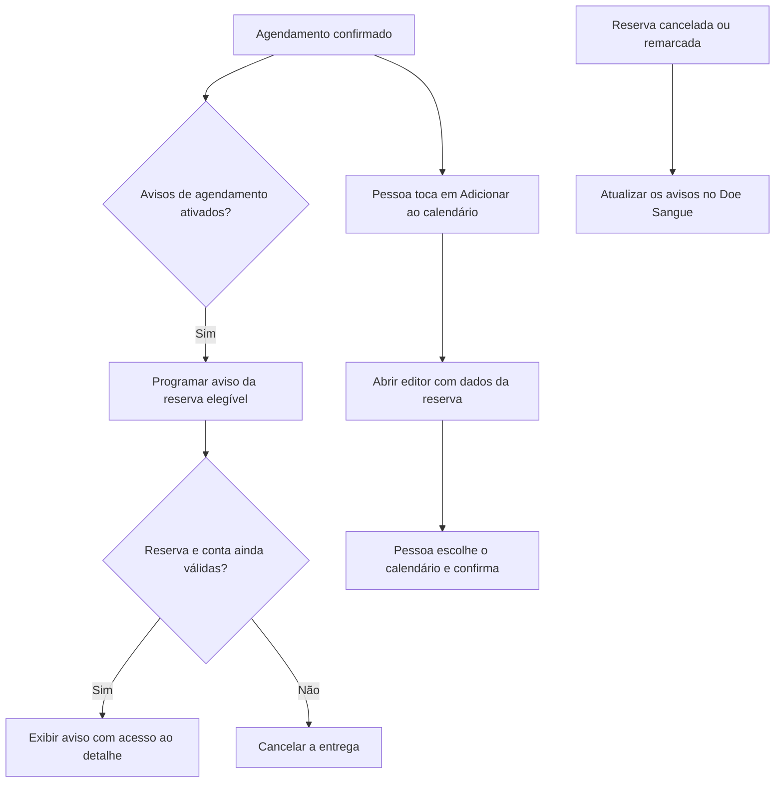

# Avisos de agendamento e Google Calendar

A usuária escolheu oferecer um aviso do Doe Sangue para agendamentos e um botão opcional para adicionar a reserva ao calendário. O recorte de calendário abre o editor Android com o evento preenchido. A pessoa escolhe o calendário, como o da sua conta Google, e confirma o salvamento.

## Comportamento

- **Aviso de agendamento.** Preferência separada de Lembretes da rotina, inicialmente desligada. A usuária confirmou um aviso por reserva ativa, 24 horas antes. Reservas feitas com menos de 24 horas de antecedência seguem com a confirmação já exibida no app.
- **Alterações.** Ao cancelar, o Doe Sangue cancela o próprio aviso. Ao remarcar, cancela o da reserva original e programa o da substituta, se elegível. O worker confirma a sessão, o estado atual da reserva e o horário antes de publicar. O toque abre o detalhe da reserva da conta ativa.
- **Calendário.** O botão Adicionar ao calendário aparece na confirmação e no detalhe de uma reserva ativa futura. O editor recebe título, data, horário e nome da unidade. A exportação usa o instante confirmado pela reserva. Se o aparelho não tiver um editor compatível, a tela informa que o calendário está indisponível.
- **Evento exportado.** A pessoa decide se salva e se quer um alerta do calendário. Após remarcar ou cancelar, ela atualiza ou remove o evento no calendário. A sincronização automática pela API do Google Calendar fica fora deste recorte.
- A integração usa os dados e os vínculos de remarcação existentes. O editor de calendário requer a ação explícita da pessoa. O login com Google continua usando as permissões de identidade.

## Fluxo

## Mapa de arquivos

Os caminhos Kotlin são relativos a `app/src/main/java/br/edu/fatec/doesangue/`. Nomes de arquivos novos são propostas.

| Arquivo | Camada | Responsabilidade |
| --- | --- | --- |
| `domain/model/AppointmentSummary.kt`, `domain/repository/AppointmentRepository.kt` | Domínio existente | Reusar o horário confirmado, o estado e a consulta privada das reservas |
| `RoutineNotificationsScreen.kt` e arquivos locais de preferências de notificações | Interface e dados locais | Exibir controles distintos para rotina e agendamento, com permissão do Android compartilhada |
| `data/notifications/AppointmentNotificationScheduler.kt` e `AppointmentNotificationWorker.kt` | Android, propostos | Programar por reserva, revalidar a entrega e cancelar trabalhos obsoletos |
| `presentation/scheduling/SchedulingViewModel.kt`, `presentation/appointments/AppointmentDetailViewModel.kt` | Apresentação existente | Disparar atualização dos avisos após criação, remarcação ou cancelamento bem-sucedido |
| `MainActivity.kt`, `ui/navigation/AppNavHost.kt`, `DoeSangueApplication.kt`, `di/AppContainer.kt` | Integração existente | Vincular o ciclo de avisos à sessão e validar a conta antes de abrir o detalhe pelo toque |
| `ui/calendar/AppointmentCalendarLauncher.kt` | Android, proposto | Abrir o editor de evento com os dados confirmados |
| `ui/navigation/SchedulingNavGraph.kt`, `ui/screens/scheduling/SchedulingScreens.kt` | Interface existente | Oferecer a exportação na confirmação |
| `ui/navigation/MainNavGraph.kt`, `ui/screens/donations/AppointmentDetailByIdScreen.kt` | Interface existente | Oferecer a exportação no detalhe da reserva elegível |
| `app/src/test/`, `app/src/androidTest/` | Validação | Exercitar exportação, estados da reserva, horário, conta e cancelamento com dados fictícios |

## Ordem da implementação acompanhada

1. Ligar o botão ao editor de calendário a partir dos dados confirmados. Validar data, fuso, unidade, reserva elegível e ausência de editor.
2. Definir a antecedência do aviso, então ligar a preferência separada de agendamento às permissões e ao WorkManager.
3. Integrar criação, remarcação, cancelamento e toque para o detalhe. Validar conta, deduplicação e entrega em aparelho.

Este documento registra o escopo escolhido e o comportamento proposto antes do código.

### Arquivos da exportação

`SchedulingViewModel.kt` obtém o instante do horário associado à reserva confirmada, incluindo pedidos retomados de rascunho. A rota de confirmação entrega esse instante a `ScheduleSuccessScreen`. O detalhe já recebe `AppointmentSummary.startsAt` e chama o mesmo botão compartilhado. `AppointmentCalendarLauncher.kt` prepara o editor do Android, mantendo o instante confirmado, e trata o caso de editor indisponível. A duração fica a cargo do editor, pois o agendamento fornece apenas a hora de início.

Os APKs de debug e testes compilaram. Cinco testes Android passaram no Pixel_6 temporário. A validação conferiu título, instante com conversão de fuso, unidade, ausência de editor e visibilidade apenas para reserva futura ativa. Na confirmação e no detalhe, os testes capturaram o Intent emitido pelo botão. O emulador não tinha um editor compatível. A abertura e o salvamento no Google Calendar ficam para a conferência no aparelho.

### Preferência e agendamento do aviso

`AppointmentNotificationSchedule.kt` calcula a hora subtraindo 24 horas do instante da reserva e exclui reservas criadas após esse limite. `RoutineNotificationPreferences.kt` mantém a preferência de agendamento por conta, ao lado da preferência já usada pela rotina. A tela Notificações oferece controles distintos e pede a permissão Android para o controle escolhido. O WorkManager usa um canal e um trabalho próprios para cada reserva elegível. O toque e os sinais de atualização imediata ao editar reservas serão ligados no passo seguinte.

APKs de debug e de testes compilados. Nove testes JVM e cinco testes Android distintos passaram com reservas fictícias. O WorkManager enfileirou apenas a reserva elegível e cancelou o aviso ao desligar a preferência. Após corrigir a assinatura do teste do WorkManager, ele passou. Uma interrupção de foco do emulador afetou a rodada conjunta seguinte. Os quatro testes de tela e preferência passaram na execução isolada. A entrega no horário em aparelho será validada após a ligação do fluxo de reserva e do toque.

### Atualização imediata e toque

`SchedulingViewModel.kt` sinaliza a atualização após criação ou remarcação confirmada. `AppointmentDetailViewModel.kt` sinaliza após o cancelamento confirmado. O `AppContainer.kt` liga os sinais ao agendador. `NotificationIntent.kt` e `AppointmentNotificationScheduler.kt` acrescentam o destino de agendamento ao aviso. `MainActivity.kt`, `DoeSangueApp.kt` e `AppNavHost.kt` verificam a conta antes de abrir o detalhe existente. A rotina mantém a aba Lembretes como destino.

Os APKs finais compilaram e quatro testes Android passaram no Pixel_6 temporário. A fila substituiu a reserva original pela remarcada, retirou a cancelada e foi esvaziada ao desligar a preferência. A notificação sintética do Android abriu o detalhe da reserva correta, e os testes de abertura dos lembretes da rotina passaram novamente. A publicação foi acionada no teste com relógio fixo. A entrega automática das 24 horas e a exportação para o calendário da conta Google ainda precisam de conferência no aparelho.

### Ajuste visual da confirmação

Em 24/11/2026, a usuária relatou que o fluxo funcionou e pediu mais espaço entre as ações da confirmação. A tela passou a agrupar Adicionar ao calendário e Ir para o início com intervalo de 12 dp, reduziu os espaços acima do cartão e das ações e ganhou margem inferior. Os APKs compilaram e cinco testes Android passaram no Pixel_6 temporário, incluindo a verificação do espaço entre os botões.

- [Android Developers — Intents de calendário](https://developer.android.com/guide/components/intents-common#Calendar)
